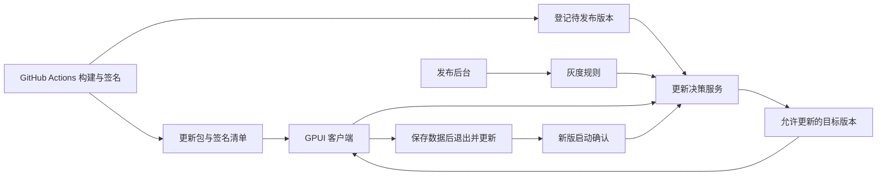

# 自建 OTA 平台与灰度发布设计

日期：2026-10-14。状态：建议方案，尚未实现。文档入口见 [OTA 自动更新](../ota/README.md)，基础选型见 [OTA 调研报告](../research/OTA_UPDATE_RESEARCH.md)。本页描述需要自定义灰度时的服务端设计；仅使用 GitHub Releases 自动更新时不必建设完整平台。

## 推荐范围

采用「GPUI 客户端 + Velopack SDK/更新执行器 + 自建发布服务 + GitHub Releases」架构。发布服务控制谁可以获得哪个版本，客户端 SDK 负责获取更新内容，独立更新执行器负责替换程序。文件托管可按需要改用对象存储/CDN。也可以选现成托管服务；若希望自主定义名单、标签、条件和后台操作，自建轻量发布服务更容易控制这些规则。

首版交付 Windows x64、macOS ARM64、macOS Intel 的更新闭环。Linux 的客户端平台适配、AppImage 打包和实机验收作为独立工作；如果要求三系统同时上线，则必须在首发前完成。

当前应用没有账号，首版“灰度用户”实际按安装实例识别。无需为了 OTA 增加账号系统。

## 组件职责

| 组件 | 负责的工作 | 建议实现 |
| --- | --- | --- |
| 客户端更新模块 | 安装 ID、检查更新、验证来源、进度展示、保存状态、协调退出、启动确认 | 接入当前 GPUI 事件协调器，用后台任务执行网络和磁盘工作 |
| Velopack SDK 与更新执行器 | SDK 定位、下载和准备包，辅助进程在旧应用退出后替换文件并重启；后续增加差分 | 锁定兼容版本的 Rust SDK 与 `vpk` |
| 更新决策 API | 根据平台、架构、版本、渠道、名单、标签和比例选择目标版本 | 一个后端应用即可；可选 Rust Axum，或团队已有成熟技术栈 |
| 管理后台 | 上传/查看版本、圈定范围、调整比例、暂停、撤回、查看失败原因 | 简单 Web 管理界面，与 API 共用业务服务 |
| 数据库 | 版本、包、安装实例、发布规则、更新事件和操作记录 | PostgreSQL；首版无需 Redis、消息队列或微服务拆分 |
| 文件托管 | 保存不可变安装包、全量包、差分包、签名清单 | 优先 GitHub Releases；按需改用 S3 兼容服务、OSS 或 COS/CDN |
| CI 与签名环节 | 构建、测试、打包、平台签名、更新清单签名、上传、登记草稿 | 扩展现有 GitHub Actions；客户端不携带存储写密钥 |



自建灰度平台的最小部署资源为：一个后端部署实例、一个数据库、HTTPS 域名与管理后台，更新包继续放在 GitHub Releases，无需另建对象存储。API 返回少量元数据，大文件由文件托管服务提供，避免下载占满 API 服务器。具体规格应按活跃安装量、检查频率、包大小与发布频率估算。见 [GitHub Releases 分发方案](../ota/GITHUB_RELEASES.md)。

## 安装实例与灰度对象

应用首次运行时生成随机 `installation_id`，保存在用户数据目录，正常升级不改变。设置页提供“复制更新 ID”，管理员可把测试者的 ID 加入名单。卸载清理数据后重装通常会获得新 ID；同一人的两台电脑也是两个实例，不能把它描述成跨设备用户身份。

不需要采集硬盘序列号、MAC 地址或提醒记录。安装 ID 仅用于稳定选择范围，不是可信账号认证；若测试包需要限制访问，应另外使用服务器登记的邀请凭证或已有账号身份，并控制下载权限。

首版支持以下范围即可：

| 范围方式 | 例子 | 处理方式 |
| --- | --- | --- |
| 指定安装名单 | 自己与 10 位测试者 | 精确匹配安装 ID；必要时通过邀请登记 |
| 安装分组/标签 | `internal`、`beta-volunteers` | 标签保存在服务端，不直接相信客户端提交的“我是内部用户” |
| 平台与架构 | 只更新 Windows x64 | 使用安装包目标架构，不能只看硬件 CPU；Intel 应用在 ARM Mac 上运行也需匹配正确包 |
| 当前版本范围 | 只让 0.1.1～0.1.4 升级 | 服务端做版本比较；不使用字符串大小比较 |
| 百分比 | 合格安装的 5%、20%、100% | 使用稳定分桶，同一轮灰度扩大比例时保留之前的人群 |
| 排除名单 | 暂不更新的测试机器 | 在同一轮灰度中，排除优先于包含 |

以后有账号体系时，可再增加用户 ID、组织、租户等维度。按组织灰度应以组织 ID 分桶，避免同一组织的成员被随机分到不同版本。

## 灰度决策规则

建议首版对每组 `应用 + 平台 + 架构 + 渠道` 只允许一轮活跃灰度，减少规则冲突。stable/beta 表示更新渠道；“stable 内 5% 安装收到下一个版本”表示灰度，两者是不同维度。

一次检查按以下顺序决策：

1. 确认应用 ID、包类型、平台、架构、渠道、操作系统版本和更新器协议兼容。已撤回或禁止安装的包一律不能选中。
2. 查找该渠道可用的全量稳定版本，作为默认候选。
3. 查找有效的灰度任务，检查开始时间、版本范围与安装排除名单。
4. 在安全与兼容条件都满足时，指定包含名单可直接进入该轮灰度；其余实例需要满足分组条件，再进行百分比分桶。
5. 命中灰度则返回灰度目标；未命中则返回默认稳定候选。只提供比当前版本更新的目标，首版不自动降级。

稳定分桶示意：

```text
bucket = SHA256(规范编码的 rollout_id 与 installation_id) 的固定部分取模 10000
命中 5%：bucket < 500
命中 20%：bucket < 2000
```

同一轮扩量保留 `rollout_id`，不能每次检查随机抽签，也不能每改一次比例就新建分桶种子。5% 指满足该轮条件的人群的期望占比，小样本不保证恰好 5%；指定包含名单可以额外命中。

例如稳定版为 0.1.1，0.1.2 只对 Windows x64 开放 5%：符合条件并命中的安装收到 0.1.2；未命中的旧安装仍可升级到 0.1.1；已经是 0.1.2 的安装不会因为任务暂停而被自动降到 0.1.1。

## 接口与 Velopack 对接

下面是建议的自有接口，**不是 Velopack 原生协议**。

| 接口 | 用途 |
| --- | --- |
| `POST /v1/update/check` | 提交安装 ID、应用版本、包平台/架构、OS 版本、渠道、更新器协议版本，获取决策 |
| `POST /v1/update/authorize` | 应用更新前重新检查目标是否仍允许安装，返回有期限且绑定目标的授权 |
| `POST /v1/update/events` | 按安装尝试 ID 上报最少量检查/下载/安装/启动结果；重试去重 |
| 管理端版本接口 | CI 登记不可变产物，管理员查看、校验和准备发布 |
| 管理端灰度接口 | 保存规则、预览命中情况、开始/扩量/暂停/撤回，并记录操作者 |

有更新的响应应明确绑定：决策 ID、目标 release ID、版本、包平台/架构、渠道、签名清单位置及摘要、有效期；没有更新时返回明确的 `no_update` 结果。暂时失败与“没有更新”应在客户端内部区分，不能记录成一次成功检查。

建议实现自有 `UpdateSource`：调用决策 API，验证目标的签名清单，向 Velopack 提供**仅通向该目标版本**的完整包和必要差分链。禁止检查接口只说“允许更新”，随后让 SDK 去公共 feed 自选最新版本，否则可能越过灰度边界。每个差分来源、目标与摘要也应受可信清单约束；首版可以只使用全量包。

已核对的 Velopack 1.2.161 默认 `HttpSource` 会请求 `releases.{channel}.json`，携带 `localVersion`、应用 `id`、`stagingId`。简单百分比灰度可以在这个 endpoint 动态生成兼容 feed；复杂标签、安装授权与独立的签名清单流程采用自定义 `UpdateSource` 更清晰。不能默认认为内置 staging ID 的生命周期与自有安装 ID 完全相同，接入时应选择统一标识或建立持久映射。

动态决策/授权接口返回 `Cache-Control: no-store`，避免 CDN 把一个安装的结果发给另一个安装。带版本或摘要的不可变更新包可以长期缓存。私有测试包应另外使用受控下载授权；“后台不展示某版本”本身不是下载访问控制。

## 发布和客户端全过程

1. 开发完成并合并，准备统一递增版本号。
2. 现有 CI 分别构建各平台，执行检查，使用 `vpk` 生成更新产物，完成平台签名/公证与更新清单签名。
3. 先上传不可变产物并确认可下载，再登记草稿；打包成功不会立即向所有用户发布。
4. 管理员选择目标版本与平台，在后台预览规则；先发布给指定安装名单。
5. 应用在启动后和定期检查时请求 API。建议初始周期 12 小时并加入随机抖动，提供手动检查按钮；这不是服务器实时推送。
6. 服务端计算资格，返回与该安装匹配的目标。客户端验证清单、下载、验证文件，显示“更新已准备好”。
7. 用户选择重启更新，或到约定的更新时机；客户端再次获取安装授权，确认没有撤回、目标未变且授权仍有效。
8. 客户端确认设置与数据库写入成功，避开休息会话，释放单实例锁并正常退出，由更新器替换程序并启动新版。
9. 新版打开数据库、完成迁移、进入可用状态后，在本地确认此次升级成功；可在联网时发送最少量结果，网络失败不阻止本地运行。
10. 后台观察结果，人工决定是否扩大到 5% → 20% → 50% → 100%；首版不建议未经验证就做自动扩量。

所有比例均为示例，不是固定发布门槛。应分平台查看检查、下载、安装和启动结果；小样本或大量结果未知时，不应仅凭“成功率 100%”扩量。

客户端状态建议为：空闲 → 检查 → 可更新 → 下载 → 已验证待安装 → 授权与保存状态 → 退出安装 → 新版启动确认。每一步都保留错误状态和重试入口。普通断网、服务故障不影响本地提醒。

本设计选择“应用新版本前需要在线重新授权”，因此断网时保留已经下载的包并继续运行旧版本。这样能加强撤回控制；它不能保证已经取得有效授权的安装瞬间停下，也不能远程撤销已经运行的新程序。若未来需要完全离线安装缓存更新，应明确接受撤回时效降低，并另行调整授权有效期。

Velopack 1.2.161 默认启用启动时自动应用下载包。若采用上述授权流程，应关闭该默认行为或改为受控入口，避免客户端重启后绕过撤回检查。当前项目退出的两秒超时信号也不能直接作为保存成功证据。

## 暂停、撤回与回退

| 操作 | 语义 |
| --- | --- |
| 暂停一轮灰度 | 停止该轮新资格与新安装授权；缓存包应用前需再检查，已取得有效授权者存在短暂窗口 |
| 撤回问题版本 | 所有规则都不得再选择它，安装授权拒绝；已有用户不自动降级 |
| 发布修复版本 | 用更高版本修复，可针对已安装问题版本的人群优先开放 |
| 自动回退 | 另行设计本地启动健康确认、保留旧程序、有限重试及数据兼容；首版不默认承诺 |

服务器无法从“没有收到启动成功事件”直接判断启动失败：可能是离线或禁止上报，应标成未知。安装失败和新版启动崩溃的判定需要本地状态记录，必要时由独立更新进程或下次启动补报。

当前 SQLite 数据库会拒绝高版本 schema。旧程序回退前必须保证数据库兼容，或拥有经过验证的一致性备份恢复方案。优先采用可兼容迁移和更高版本修复，避免把“回退程序文件”误当作完整恢复。

## 后台最小功能与数据

首版后台做五类页面：版本/产物、安装分组、灰度发布、更新结果、操作记录。规则编辑页应展示“平台与版本条件 + 包含/排除名单 + 分组 + 百分比 + 起止时间”，并允许输入某个安装 ID 预览决策与原因。发布状态与产物构建状态分开显示。

建议核心数据：`releases`（版本）、`artifacts`（平台产物与签名摘要）、`installations`（安装实例与服务端标签）、`rollouts`（规则与状态）、`update_events`（带尝试 ID 的结果）、`audit_logs`（后台操作）。简单名单与规则可先使用结构化 JSON，无需立刻实现通用规则引擎。

更新事件只保留做发布判断所需的信息：版本、平台、阶段、错误码、耗时、匿名安装 ID，不上传喝水/护眼记录等业务内容。统计区分安装实例与检查次数，重试不能重复计为多个用户；禁用结果上报时应展示统计覆盖不足。数据保留期限应明确配置。

管理员使用已有身份认证或成熟身份服务，至少区分查看、发布和管理权限。上传产物的 CI 凭证与公开检查接口分离；签名密钥由受控签名环节管理。签名清单绑定应用、版本、平台、架构、渠道、文件名与摘要，客户端内置验证公钥，并规划轮换。动态选择与安装授权不能绕过产物验签。

## 建议实施顺序

| 阶段 | 交付内容 | 验收标准 |
| --- | --- | --- |
| 1. 更新闭环 | 客户端、真实打包、GitHub Releases 更新源、两个版本 | Mac 双架构与 Windows 能从旧版升级并保留数据；明确签名与退出验证路径 |
| 2. 可控发布 | 决策 API、安装 ID、指定名单、版本后台、可信清单验证 | 只有允许的实例获得目标版本；手动检查也不能绕过规则 |
| 3. 灰度运营 | 标签、百分比、规则预览、安装前授权、暂停/撤回、最少量结果统计 | 分桶稳定、扩量包含之前的人群、缓存包不绕过策略、失败与未知能区分 |
| 4. Linux 与优化 | 补齐 Linux 适配和 AppImage；按需增加差分/CDN | 支持范围内实机通过；差分失败退全量，离线提醒继续可用 |

若第一批就要覆盖 Linux，将 Linux 工作前移到阶段 1；阶段安排不改变三平台的最终目标。已有无更新器客户端仍需要手动迁移一次。

来源：[Velopack 自托管](https://docs.velopack.io/distributing/self-hosting)、[Rust 1.2.161 UpdateSource](https://docs.rs/crate/velopack/1.2.161/source/src/sources/mod.rs)、[HttpSource](https://docs.rs/crate/velopack/1.2.161/source/src/sources/http.rs)、[启动自动应用逻辑](https://docs.rs/crate/velopack/1.2.161/source/src/app.rs)。本页灰度规则、API 和后台均为本项目建议设计，未声称是 SDK 的现成功能。
