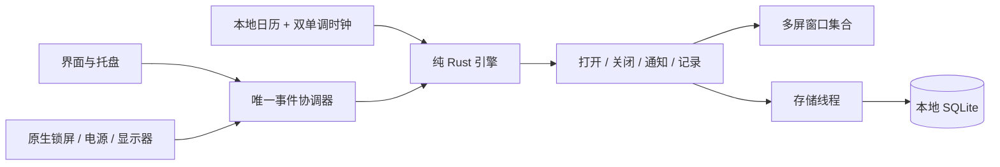

# 实现决策与模块边界

日期：2026-10-13。版本：0.1.0 个人预览版。

## 已采用的技术

| 部分 | 选择 | 原因 |
| --- | --- | --- |
| GUI | gpui-kit 0.7.3 / gpui-pre 0.3.9，Cargo.lock 锁定 | 本机已构建并运行；使用同一套原生界面 |
| 工具链 | Rust 1.97.1，edition 2024 | 可复现的已验证版本 |
| 数据 | rusqlite 0.37，bundled SQLite，WAL / FULL | 离线事务写入和实例唯一约束 |
| 桌面入口 | tray-icon 0.24.2 | macOS 菜单栏和 Windows 托盘 |
| 通知 | GPUI SystemNotification，单一响应路由 | 不依赖系统动作按钮；应用内有完整操作 |
| 单实例 | fs2 文件锁 + 数据目录 activate 文件和 notify 文件监听 | 无端口、无后台服务；重复启动激活原实例 |

## 时间语义

macOS 使用 `mach_absolute_time` 计算不含睡眠的间隔、`mach_continuous_time` 计算含睡眠的休息。Windows 使用 `QueryUnbiasedInterruptTime` / `QueryInterruptTime`，100ns 转毫秒。平台锁屏事件补充“清醒但已锁定”的暂停状态。两种时钟都不依赖系统日期设置。

本地工作日与时段从 chrono 的本地日历快照计算，期间发生日期、偏移或时区变化则重新判定工作窗口，不追溯补发。休息截止点与当前工作边界分开，唤醒后按先后结算，边界同刻优先。提醒循环按最近截止时间醒来，最多 60 秒看门狗；可见首页或遮罩每秒刷新，隐藏界面不每秒重绘。第二次启动通过文件事件即时唤醒。

定时暂停运行中由连续时钟截止；暂停的本地日期用于显示和重启恢复。未来工作日遇到夏令时变更的系统日历专项仍需实测，未声称跨全部时区验收。

## 退出与降级

每块活动显示器创建一个独立、不可点击穿透的置顶窗口，共用一个会话截止点。鼠标所在屏优先获得焦点。任一退出事件关闭整个窗口集合，随后异步写记录。显示器变化重新建立窗口集合而不重置截止点。任一窗口创建失败先撤下已创建窗口，再把同一批实例降级为轻提醒；稍后重发仍保持轻提醒。

macOS 窗口参与所有 Space 并可作为全屏辅助窗口；Windows 置顶普通用户桌面。没有输入钩子、截图背景、录屏权限或系统锁定。关闭时尽力恢复休息前的应用焦点；操作系统可拒绝焦点请求。

## 数据与故障

设置校验、数据库写入成功之后才替换运行配置。记录使用实例 UUID 主键，重试使用 INSERT OR IGNORE。存储工作在独立线程，失败留在内存并每 3 秒重试，紧急退出不等写盘。应用主动退出给写入 2 秒收尾时间；若磁盘持续不可写且进程被结束，尚未保存的内存记录会丢失，界面会提前显示保存错误。

崩溃后的 active_session 仅转换为中断记录，不恢复旧遮罩。损坏或新版本数据库会停用自动提醒，用户可选择上一份设置或默认设置；原数据库及 WAL/SHM 先另存 recovery 文件。恢复默认数据是恢复路径，不是静默重置。

## 交付边界

本机 arm64 与 Intel x86_64 都提供独立 `.app` 和 ZIP，使用个人 ad-hoc 签名；尚未 Apple 公证。Windows 原生适配模块有独立类型检查工程，完整 GUI 构建需要 Windows SDK，提供 PowerShell + Inno Setup 脚本和 CI 配置。CI 文件尚不代表远程工作流已运行。
