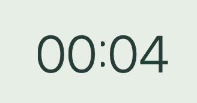

# 咕嘟扭扭放风站｜图标与界面优化方案

> 2026-10-13：用户已授权实施推荐方向 A。界面与资源已落地，实际规格见 [UI_SPEC](UI_SPEC.md)，验收证据见 [视觉回归报告](../validation/UI_REFRESH_REPORT.md)。下文保留原方案和验收目标，不把所有目标自动视为已通过。

版本：0.1 · 日期：2026-10-13 · 状态：已实施，保留原设计目标与验收清单。

面向产品确认、视觉设计与 Rust / GPUI Kit 实现。依据用户提供的两张截图、当前源代码、[需求文档](../requirements/PRD.md)和[现有界面规范](UI_SPEC.md)。下文保留原提案的图标、布局和尺寸目标；已实现内容及验证范围以文首所链接的界面规范和回归报告为准。

## 1. 推荐方向与执行顺序

将咕嘟扭扭设计成一个**安静、圆润、有一点小卡通性格的桌面休息站**。保留品牌的温柔绿色，用一个原创小角色统一 Dock 图标、应用内品牌和休息画面。首页让用户快速看懂“接下来提醒什么、还有多久、怎样暂停”；休息画面集中呈现本次事项、剩余时间和退出入口。

按以下顺序实施，每一步都有可单独查看的交付物：

1. **解决看不清：倒计时排版缺陷。** 先复现并修复字形缺损，作为独立的小范围修复。
2. **确定长什么样：图标与品牌方向。** 提供三款简单卡通草案，选定一款后完成小尺寸和系统图标适配。
3. **确定怎样用起来舒服：首页与休息页设计稿。** 先看关键页面的实际尺寸效果，再铺开设置、记录与引导。
4. **实现和回归：落地 GPUI 界面与图标打包。** 本机检查通过后交付 Windows 10 / Intel Mac 的视觉验证清单。

本轮继续遵循已确认的四类提醒、默认强制休息、可选轻提醒、紧急退出和双时钟规则。主题切换、音效、角色养成、健康评分和新统计功能不加入这次视觉优化；深色系统环境下的图标可见性属于本轮要求。

## 2. 问题与证据

### 2.1 图 1：Dock 图标外轮廓生硬

**已确认原因：** 当前 `assets/icons/app.png` 为 1024×1024 RGBA 图片，但所有像素的 Alpha 都是 255，透明像素数为 0。四角被填成米色，因此显示出完整方形底板。macOS 打包脚本只缩放并转换成 `.icns`，没有改变轮廓。

圆形笑脸只是图片内部的主体，不能让外面的方形背景自动变圆。当前 `.icns` 方案应在图稿中做圆润底板和透明外角，不能依赖桌面系统替它裁切，也不能用接近 Dock 的颜色假装透明。

**视觉问题：** 笑脸和右上小圆点的含义不够明确；缩小时缺少与“休息、伸展”关联的独特轮廓。用户希望的“简单、卡通”可以保留，但需要重做形体、留白与小尺寸表现。

### 2.2 图 2：倒计时局部字形显示不完整

用户反馈数字左侧和中间分隔符被截断。这里的分隔符实际为冒号 `:`，文档统一称为“数字 / 冒号字形缺损”。

**代码事实：** `Overlay::render` 使用 56 / 86 逻辑像素的大字、`FontWeight::LIGHT`，没有为该文字块显式设置独立行高、数字字体和测量后的安全尺寸；其祖先包含可滚动区域。文字由一个 `MM:SS` 字符串绘制。

**尚未确认：** 单凭这张截图无法区分字体本身的形状、字形边界测量、父容器裁剪、像素缩放或渲染缓存问题。不能把“改一下圆角 / 字号”当成已经找到原因。实施时需要在相同字体与显示器上复现并逐项排查。

### 2.3 整体界面的结构问题

以下是结合当前代码和此前本机界面回归提出的设计判断，不把局部截图当作全应用证据。

| 编号 | 当前问题 | 优化目标 | 本轮顺序 |
| --- | --- | --- | --- |
| UI-01 | 应用图标实心方底、角色辨识度不足 | 圆润外轮廓，透明外角，统一原创角色 | 第二步 |
| UI-02 | 大倒计时存在字形缺损反馈 | 所有数字、冒号完整；时间切换不跳动 | 第一步 |
| UI-03 | 品牌区、按钮式导航、欢迎大块、页脚层层占空间 | 缩减固定区，把首屏让给状态与四类提醒 | 第三步 |
| UI-04 | 四张卡片较高，暂停操作在页面底部 | 默认窗口下四类提醒与暂停入口同屏可达 | 第三步 |
| UI-05 | 多个同等显眼按钮并列，导航用文字前加圆点表达选中 | 导航、主操作、次操作各有明确样式 | 第三步 |
| UI-06 | 设置需要纵向寻找操作，休息时长直接输入总秒数 | 分组清楚、分秒输入、固定保存栏、就近报错 | 第四步 |
| UI-07 | 遮罩的通用标题、本次标题、退出说明有重复 | 单一标题、清晰事项、突出时间、保留一个固定退出区 | 第三步 |
| UI-08 | 应用图标与托盘图标由两套独立绘图逻辑产生 | 同一个角色派生彩色应用版和极简托盘版 | 第二步 |

本轮顺序不改变 PRD 中功能的 P0 / P1 等级。

## 3. 图标设计方案

### 3.1 推荐角色：伸懒腰的小水团「小咕」

**外形：** 一团略微倾斜的圆润水团，轮廓偏圆豆形，两只短短的手向上伸展；两颗眼睛和一条短弧线构成放松表情。用柔和深绿表达主体，奶油白圆角底板承托，最多保留一个小面积暖杏色点缀。

**品牌关系：** 水团联想到“咕嘟”，伸展动作联想到“扭扭”，轻松神态联想到“放风”。无需把水杯、脖子、厕所和椅子都塞进一枚图标。

**风格：** 平面形体为主，允许非常轻的明暗层次；不加字母、中文、数字、徽章或复杂场景。角色亲切，但不使用夸张表情、粗重描边或高饱和糖果色。

| 候选 | 形象 | 优点 | 注意点 |
| --- | --- | --- | --- |
| A · 伸懒腰的小水团（推荐） | 圆豆形水团、短手、松弛表情 | 同时表达喝水与活动，容易扩展到应用内 | 小尺寸时要保住身体和手臂的分界 |
| B · 抱杯的小团子 | 圆脸角色抱一只小杯子 | 喝水含义直观，卡通感更强 | 容易被理解为只提醒喝水；小杯细节需简化 |
| C · 休息小基地 | 圆润小站外形、一个微笑窗口 | 更贴近“放风站”的名字 | 角色感较弱，可能被识别成房屋工具 |

下一阶段先用同一背景、同一尺寸画出 A / B / C，以 A 为主方向。此表是设计构想，不代表已经生成或选定最终图稿。

### 3.2 轮廓与留白

- 母版画布 1024×1024，轮廓以圆润的连续曲线圆角方形为主；“圆润”不要求改成正圆。
- 底板初始占画布边长约 82%–86%，四周保持透明留白；角色约占底板宽度 60%–68%。这些是本项目试稿值，最终以真实 Dock 对比调整，并非操作系统强制规范。
- 圆角过渡平滑，透明边界抗锯齿；不留下米色方角、白边或黑色晕边。
- 大尺寸可用极轻阴影；16–32 像素版本减少阴影和高光，优先保留轮廓与表情。
- 主体光学重心居中。导出后分别在浅色、深色和有纹理的桌面背景检查，不能只在白底大图上评审。

### 3.3 系统图标适配

| 使用位置 | 方案 | 检查重点 |
| --- | --- | --- |
| macOS Dock / Finder | 带透明外角的彩色图标，输出完整 `.icns` 尺寸组 | 与旁边常用应用体量协调，Retina 边缘清晰 |
| macOS 菜单栏 | 小咕轮廓的单色模板图，去掉底板和装饰 | 亮 / 暗菜单栏均清晰，18–22 pt 环境可辨认 |
| Windows EXE / 快捷方式 / 任务栏 | 多尺寸 `.ico`，嵌入程序资源并配置窗口图标 | 不能只改安装包图标而让运行中的任务栏仍是默认图标 |
| Windows 托盘 | 从同一轮廓派生简化版 | 16–32 像素与不同 DPI 可辨，状态仍有文字说明 |
| 应用内 | 使用同源矢量或相应密度图片 | 不再用字符笑脸和另一套临时绘图冒充品牌图形 |

建议 `.ico` 包含 16、24、32、48、64、128、256 像素层。当前文件只有一层 256 像素图；当前构建配置也未见将应用图标嵌入 EXE 的资源步骤，实施时需一并补齐。`.icns` 沿用项目的标准尺寸组，但小尺寸版本单独检查，不能只盲目缩小。

图标更新需重新打包、核验包内资源并查看真实系统入口。如 Dock 仍缓存旧图，先用新包路径验证，必要时引导用户重新固定图标；不把修改应用标识或清理整个系统缓存作为默认做法。

### 3.4 图标交付和验收

交付：可编辑母版、1024 PNG、macOS ICNS、Windows ICO、单色菜单栏 / 托盘资源、16/32/64/128 像素对比板，以及资源生成方法。若使用生成式工具出概念图，后续仍需清理轮廓与透明通道，并整理成可维护的资产。

验收标准：

- 在真实 Dock 中不再出现实心方形外角，与邻近应用没有明显大小失衡。
- 32 像素下能识别一个伸展的小角色；16 像素下至少保住特征轮廓，不糊成绿点。
- 边缘透明且平滑，深浅背景均无杂边；不使用其他应用的图形作为主体。
- 应用、安装入口和托盘视觉同源；Windows 是否通过只依据 Windows 实机结果。

## 4. 倒计时修复与视觉规范

### 4.1 先定位原因

| 排查顺序 | 做法 | 得到的结论 |
| --- | --- | --- |
| 1. 复现 | 使用相同包，在用户当前 Mac 的内置屏和外接屏分别观察；保留原尺寸截图 | 判断是否只发生在某一显示器或缩放下 |
| 2. 核对字形 | 把 `00:04` 在普通文本块和遮罩中分别绘制，比较 Light / Regular / Medium | 区分字体形状与实际裁切 |
| 3. 检查布局 | 临时可视化文本行、容器、滚动区边界；读取文字测量值与实际高度 | 检查行高、首尾字形外伸、容器收缩与裁剪 |
| 4. 检查缩放 | 测试整数与非整数比例、窗口跨屏后的重绘 | 检查舍入或缩放更新是否相关 |
| 5. 最小修复 | 依据证据修改字体、行高、约束或重绘中的具体问题 | 避免一次改多个变量后无法判断原因 |

临时调试边框和固定时间样例只用于开发验证，不进入正式休息界面。仅在证据指向 GPUI 字形渲染问题时再处理依赖层；本次没有更换 UI 框架的依据。

### 4.2 数字排版目标

- 倒计时继续采用 `MM:SS`，一个独立文本组件、同一字体、同一基线。冒号完整显示两个点，不替换成分号、图片或装饰圆点来掩盖缺陷。
- 字重从 Light 调整为 Regular 或 Medium 后比较实机效果；优先使用清晰的等宽数字特性。若当前字体 / GPUI API 不支持，使用经过验证、包含数字和冒号的数字字体，并确认许可证与离线打包。
- 正常遮罩数字建议 80–96 逻辑像素，紧凑高度建议 56–64。根据可用宽高、真实字形测量和退出区域占用一起决定，避免仅凭高度阈值切换。
- 显式设置匹配字体的行高，初始按字号约 1.15–1.25 倍试排，再依据 ascent / descent 验证；上下、左右留足字形安全空间。
- 为 `00:00` 至 `30:00` 中最宽的合法时间预留宽度，防止 `01:00 → 00:59` 时整块左右跳动。使用等宽数字时，冒号宽度也保持稳定。
- 文本块不被 flex 压扁；在 GPUI 布局层正确处理最小尺寸与滚动边界。无需把 Web CSS 属性原样套进 Rust API。
- 使用当前引擎截止时间计算剩余值；视觉刷新不能新建计时器、改变截止点或延长休息。

### 4.3 修复验收

| 维度 | 检查样例 | 通过条件 |
| --- | --- | --- |
| 数字字形 | `00:04`、`00:00`、`01:11`、`08:08`、`09:59`、`10:00`、`30:00` | 数字左右上下完整，冒号两点完整 |
| 时间切换 | `01:00 → 00:59`、`00:10 → 00:09`、最后几秒 | 基线稳定、无宽度跳动、无重影 |
| 视觉与计时 | 静态诊断样例 + 一次真实五秒体验 + 一次正式休息 | 样例覆盖字形；真实流程按既有规则结束，不要求零秒多停一秒 |
| macOS | Retina 内置屏、当前两块外接屏、窗口跨屏 | 无字形缺损、过度模糊或缩放后错位 |
| Windows | 100%、125%、150%、200%，至少一组混合 DPI | 同上；由用户在目标机器验证 |
| 紧凑区域 | 640×480 开发预览、较低高度屏幕、多项长标题 | 内容可以滚动，退出按钮始终可见可点 |

修复前后的截图用相同尺寸对比，同时观察静止和连续倒计时。一次截图看起来正常不足以关闭 UI-02。

## 5. 统一视觉语言

### 5.1 配色

减少整屏重绿色，使用暖白底、深绿文字和小面积浅色类别标记。所有颜色统一收敛为语义 token，避免页面内继续散落色值。

| Token | 建议值 | 用途 |
| --- | --- | --- |
| `surface.app` | `#F7F7F2` | 主窗口背景 |
| `surface.card` | `#FFFFFF` | 输入区和主要卡片 |
| `surface.rest` | `#EAF1E9` | 休息遮罩背景 |
| `text.primary` | `#243D35` | 主标题、正文、倒计时 |
| `text.secondary` | `#607068` | 辅助说明 |
| `action.primary` | `#2F6B58` | 当前页标记与主操作 |
| `border.subtle` | `#DDE5DC` | 低强调分隔；不能单独承担焦点指示 |
| `category.water` | `#E8F2F6` | 喝水淡蓝底 |
| `category.stretch` | `#EFEAF6` | 颈肩淡紫底 |
| `category.walk` | `#F8EEDC` | 放风暖杏底 |
| `category.stand` | `#E8F0DF` | 站立淡绿底 |
| `status.danger` | `#A34237` | 错误与删除确认 |

正文对比度目标至少 4.5:1；大字至少 3:1；可操作控件边界和焦点标记至少 3:1。类别底色是装饰，必须配图形和文字名称；低对比的分隔线不能当作唯一输入边界。数值以实际组合、透明度与禁用状态复核。

### 5.2 排版与组件

| 项目 | 建议规格 |
| --- | --- |
| 普通文字 | 系统 UI 字体；正文 14–15、辅助信息 12–13 逻辑像素；中文字形完整 |
| 层级 | 页标题 22–24；区块标题 16–18；卡片时间 24–28；避免每一层都大且粗 |
| 间距 | 4 / 8 / 12 / 16 / 24 / 32；卡片内 16，组间 16–24 |
| 圆角 | 普通控件 8–10；卡片 16；品牌展示区最多 20；不把所有矩形都改成胶囊 |
| 按钮 | 常规高 36–40；主要点击区域不低于 32×32；紧急退出高至少 44 |
| 边框与阴影 | 以轻边框分区，阴影仅用于悬浮菜单等需要层级的元素 |
| 图形 | 同一套圆润矢量图形，描边粗细一致；不混用系统 Emoji、汉字图标和多套素材 |
| 反馈 | 保存成功轻量提示；错误持续显示并提供处理动作；焦点可见，不只靠 hover |
| 动效 | 首轮以静态为主，可用 120–180ms 小范围反馈；倒计时不闪烁，不做循环角色动画 |

文案集中管理，界面与可访问名称复用同一文案来源；本轮维持简体中文，无需为了视觉更新额外上线多语言。完整英文品牌名保留在关于页。

## 6. 页面设计

### 6.1 首页「我的小站」

默认继续以当前 860×700 逻辑像素窗口为设计基准，最低 640×480。截图可能以 Retina 物理像素呈现，不能把截图像素直接当窗口逻辑尺寸。

**宽窗口布局：** 左侧约 144–152 的轻量导航栏，右侧为内容区；品牌角色与“咕嘟扭扭”在左上，导航为我的小站、提醒设置、今日记录，关于放底部。当前页用浅色背景、图形和文字强调，移除文字前的实心圆点。

**内容从上到下：**

1. 页标题与状态：例如“下午好，给身体留点空隙”；旁边显示“值班中 / 已暂停 / 非工作时段”。模式是状态标签，可进入设置调整。
2. 紧凑摘要：今日休息场次、事项完成次数、最近一项提醒。下一提醒用“还需 X 有效时间”，避免把预计时刻写成承诺时间。
3. 四类提醒：两列两行。每卡片显示图形、名称、剩余时间、小字说明和“我已完成”；详细历史统计移至今日记录。
4. 全局暂停：标题右侧始终可达的“暂停提醒”菜单，包含现有四种暂停选项；暂停后显示清晰的“恢复提醒”按钮与期限。

卡片建议高约 136–152，但高度允许按文字和缩放自适应。正常状态下默认窗口首屏能看到四类提醒与暂停入口；有待处理提醒或恢复错误时，允许正文滚动，不能为了强塞首屏裁掉文字。

**轻提醒待处理：** 放在四张卡片之前；每项提供“已完成”“稍后…”“跳过”。稍后菜单保留 5 / 10 / 15 分钟，避免一行排五个同权重按钮。存在待办时不重复显示另一个抢眼的大欢迎区。

**窄窗口：** 低于约 760 逻辑像素时导航缩成有工具提示的图标栏，卡片转单列；所有图标仍有可访问名称。内容滚动，导航和全局操作不挤压正文。

### 6.2 强制休息遮罩

按“角色 → 标题 → 本次事项 → 倒计时 → 一句动作提示”构成一个居中内容组，最大内容宽度约 560–640 逻辑像素。底部退出区独立固定。

| 元素 | 建议处理 |
| --- | --- |
| 角色 | 小咕静态伸展姿势，约 72–96；小屏可缩小或省略 |
| 标题 | 正式休息显示“一起放个风吧”；体验显示“体验一下休息” |
| 本次事项 | 用带图形的文字标签显示喝水 / 颈肩 / 放风 / 站立，允许换行 |
| 倒计时 | 页面视觉中心，按第 4 节专门排版 |
| 提示 | 例如“咕嘟一口，肩膀也放松一下。”；合并提醒保留必要事项说明 |
| 退出 | 高对比按钮“紧急退出本次休息”，下方一条“按 Esc 也可退出”；两者始终可见 |
| 体验说明 | “5 秒体验，不计入记录。”，不重复通用标题和退出说明 |

退出按钮与屏幕安全边缘至少留 24 逻辑像素；小高度下优先保留时间与退出，角色和标题间距退让。退出按钮不因鼠标移开隐藏，不增加等待、长按或二次确认。任一屏退出仍需同时撤下全部遮罩。

遮罩色彩柔和但保持原有阻挡普通窗口点击的行为；不为视觉效果引入透明穿透。各屏共用同一截止点，不能因重布局、跨屏或角色切换重新计时。

### 6.3 提醒设置

- 分为“四件小事”“工作时间”“提醒方式与通知”三个清楚的区块。移除装饰性的 01 / 02 / 03 大编号。
- 每个事项一行或一张紧凑卡片：图形与名称、开关、间隔、休息时长。宽窗口对齐输入列，窄窗口纵向排列。
- 休息时长按 PRD 改成“分 + 秒”输入，保存时仍转成总秒数；总范围 5–1800 秒，秒字段 0–59。关闭某项时保留配置，输入区呈禁用态。
- 工作日用可多选的日期按钮；时间段开始 / 结束输入对齐，“添加时段”用次要按钮。范围、重叠、空值错误在相关字段旁指出并保留输入。
- 强制休息 / 轻提醒使用两个可选择模式卡，各自一句行为说明。体验遮罩和测试通知紧邻相关模式。
- 保存 / 取消放在内容区底部的固定操作栏，预留正文底部空间，防止遮住最后一个字段。显示“有未保存的修改”；离开脏表单时提供保存、放弃、继续编辑，不能静默丢输入。
- 保存成功保留现有“回到首页”的规则；失败保持表单与原运行设置，明确提示未生效。通知权限未知时仍显示未知，不能靠视觉状态假装已经允许。

### 6.4 今日记录

- 顶部用小型摘要区分“休息场次”和“事项完成次数”，不增加健康分数或完成率压力。
- 每场合并休息可折成一组，展开或行内看到四项结果；数据仍按原实例存储，不改变场次计算。
- 时间、事项、结果三列对齐；结果用文字加轻标签区分计时完成、手动完成、跳过、中断、未处理与取消。
- 无记录时展示小咕和“今天的小站刚开门”，不放空图表。
- 清空记录放在次要区域，使用明确的危险操作确认；默认焦点在取消，确认后不影响设置。

### 6.5 首次引导、关于与托盘

- 首次引导复用新的设置组件，突出默认强制休息及可随时退出；“体验 5 秒”与“确认，开始照顾自己”清晰区分，确认前不启动调度。
- 关于页展示新角色、品牌名、slogan、版本与本地数据说明；退出保留明确入口。
- slogan 放在引导和关于页，首页不再占用一个始终固定的高页脚。
- 托盘沿用系统原生菜单与已有操作，图标单独适配；不为品牌色强制自绘整套系统菜单，不每秒闪烁或变更图标。

## 7. 必须覆盖的界面状态

| 状态 | 显示与操作 |
| --- | --- |
| 正常计时 | 四类剩余有效时间、工作状态、暂停入口 |
| 全部提醒关闭 | “所有提醒已关闭”与设置入口，不显示伪倒计时 |
| 已暂停 / 非工作时段 | 明确原因或恢复时间；手动暂停提供恢复按钮 |
| 轻提醒待处理 | 完成 / 稍后 / 跳过，长列表可滚动 |
| 强制休息 / 体验 | 同一安全退出结构；体验明确不写记录 |
| 保存中 / 失败 | 禁止重复提交，错误可读，输入保留 |
| 存储损坏 / 遮罩降级 | 原因、当前提醒是否可用、下一步操作始终明确 |
| 今日无记录 / 有记录 | 友好空状态与真实记录列表 |
| 键盘操作 | Tab、Shift+Tab、焦点可见；遮罩 Esc / macOS ⌘W 有效 |
| 读屏与缩放 | 按钮含事项名，倒计时可查询但不每秒打断朗读；文字放大后仍可操作 |

原生桌面使用 WCAG 对比度和可访问性的通用原则，不把 HTML / ARIA 或浏览器指标直接当成 GPUI 验收实现。目标仍需 VoiceOver / Narrator 的真实操作验证。

## 8. 分阶段交付与落地位置

| 阶段 | 交付物 | 完成条件 |
| --- | --- | --- |
| U1 · 可读性修复 | 倒计时最小修复、原因记录、修复前后截图 | 第 4 节本机用例通过，调度和退出规则无回归 |
| U2 · 品牌图标 | 三款草案、选定图稿、透明与小尺寸版、平台资源 | 用户选定形象；本机 Dock / Finder / 菜单栏实看通过 |
| U3 · 页面设计 | 首页、遮罩高保真稿，宽 / 窄布局与关键状态 | 用户可在真实尺寸下评审并确定布局；随后补齐其它页面 |
| U4 · 界面实现 | GPUI 组件、统一 token、图标生成 / 打包更新 | 本机真实界面回归、适当的功能检查与新版安装包 |
| U5 · 外机核验 | Windows / Intel 视觉测试清单与结果模板 | 用户执行后据结果修复；未测项不标兼容通过 |

U1 可独立实施。U2 / U3 的评审用于收敛审美选择，设计确认不要求反复确认已经确定的提醒规则。当前文档按 A 角色、暖白绿色、侧边导航提出推荐；下一步无需再填写一轮需求问卷。

| 当前文件 | 后续修改方向 |
| --- | --- |
| `assets/icons/`、`scripts/generate-icons.py` | 原创图稿、透明边界、小尺寸资源、可复现生成流程 |
| `scripts/package-macos.sh`、`packaging/macos/Info.plist` | 核验 ICNS、资源版本与包内图标 |
| `crates/gulu-app/src/tray.rs` | 替换独立像素笑脸；接入同源的单色 / 小尺寸资源 |
| `scripts/package-windows.ps1`、`packaging/windows/installer.iss` | 多尺寸 ICO、EXE 资源与运行窗口图标链路检查 |
| `crates/gulu-app/src/ui.rs` | 倒计时组件、导航、页面排版、字段校验提示和状态展示 |
| `crates/gulu-app/src/main.rs` | 统一主题 token、必要的窗口尺寸策略和提示状态 |
| `docs/design/UI_SPEC.md` | 方案确认并实现后更新为实际规格 |
| `docs/validation/` | 追加视觉专项证据，保留原平台与计时验收结论 |

实施时按功能拆分必要的 UI 组件，避免一次性大重构。Rust / GPUI Kit 技术路线继续沿用；审美更新不要求改存储模型或提醒引擎。

## 9. 最终验收清单

- [ ] Dock 图标无方形外角、透明边缘干净、大小与邻居协调。
- [ ] 图标母版、ICNS、ICO、菜单栏和托盘资源来自同一个形象。
- [ ] 数字与冒号完整，所有测试时间及缩放组合无缺损；时间切换不抖动。
- [ ] 默认窗口正常状态首屏能查看四类提醒并暂停，窄窗口不横向溢出。
- [ ] 遮罩退出始终可见，任一屏按钮 / Esc / macOS ⌘W 能按既有时限结束全部遮罩。
- [ ] 设置分秒输入与原范围一致，固定保存栏不挡内容，取消与失败不丢表单。
- [ ] 提醒待办、暂停、空记录、保存失败、数据恢复等状态有一致设计。
- [ ] 字体、颜色、图形、圆角、间距和焦点样式已统一；主要文字和操作对比度达标。
- [ ] 真实五秒体验、正式提醒、轻提醒处理与记录检查通过；合并和双时钟语义未改变。
- [ ] 发布包的图标与界面实测一致，分别记录本机与 Windows / Intel 的实际验证状态。

本轮推荐先进入 U1，随后产出 U2 的三款图标草案与 U3 的首页 / 遮罩设计稿。每一步以可查看的结果推进，不再用“编译成功”代替视觉验收。
