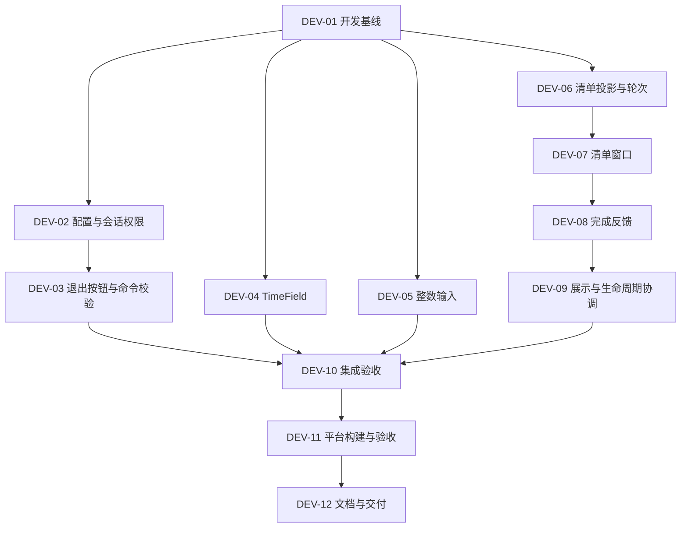

# 胶囊事项清单、时间输入与全屏退出设置｜开发计划

- 版本：1.0
- 日期：2026-10-15（Asia/Shanghai）
- 需求基线：[专项 PRD v1.1](../../tasks/prd-floating-list-time-input.md)
- 规划状态：已完成源码核对、任务拆分及验收设计。
- 实施状态：代码、64 项自动测试、静态检查、Mac 双架构 Release 包已完成；本机主要交互已补验，键盘／拖动边界及外机待测见[报告](../validation/FLOATING_LIST_TIME_INPUT_REPORT.md)。
- 调查时源码基线：`d3ba16b`；实施分支 `codex/floating-list-input-exit`，本次改动尚未提交／推送。

本计划覆盖本次全部四项优化，以专项 PRD 的 8 个用户故事、26 项功能需求和 21 个重点场景为验收依据。历史文档中“始终可以紧急退出”的规则已由本次可配置退出规则取代。

后续调整：已按用户反馈修改清单根背景透明、退出按钮改为可配置隐藏，以及剩余时间越少越靠近主胶囊的排序规则。用户明确本轮只开发、不验证，因此本轮不执行原计划中的检查或打包步骤，由用户手动验证。下文已有验证状态属于本轮调整之前。

## 1. 开发顺序与阶段成果

建议按“配置与退出权限 → 设置输入 → 清单状态与操作 → 清单窗口 → 集成回归 → 构建交付”的顺序推进。先处理会影响真实行为的状态与命令，再接入界面。

| 阶段 | 内容 | 对应任务 | 阶段完成标准 | 当前状态 |
| --- | --- | --- | --- | --- |
| P0 | 调查与开发计划 | 本文 | 已识别现有能力、改动点、依赖和验收要求 | complete |
| P1 | 准备开发环境、配置兼容、全屏退出权限 | DEV-01～03 | 默认可退出、禁用有效、跨重启保留、旧配置可读 | 代码／自动检查完成；正式／体验主要交互通过 |
| P2 | TimeField 与整数输入 | DEV-04～05 | 时段控件和数字编辑可用，全天及草稿行为兼容 | 代码完成；验收状态见报告 |
| P3 | 活动清单状态、窗口与完成操作 | DEV-06～09 | 真实倒计时、剩余越少越靠近胶囊、逐项完成及提醒条协调闭环 | 代码完成；验收状态见报告 |
| P4 | 完整回归与本机原生验收 | DEV-10 | 8 个故事及 21 个场景有检查结果，功能缺陷已修复 | 自动检查通过；原生部分通过 |
| P5 | 平台构建、运行记录与交付文档 | DEV-11～12 | 产物可追溯，已测／未测范围明确，文档与代码一致 | Mac 包／文档完成；Windows 包及外机待测 |

`pending` 表示尚未执行；阶段只有取得对应代码和验证证据后才可标记完成。本计划不承诺具体日历工期，平台实机检查取决于可用设备。

## 2. 源码核对结果与实施决策

| 当前事实 | 对开发的影响 |
| --- | --- |
| `Snapshot.remaining` 是面向主界面的文字，`DisplayState` 只覆盖胶囊摘要 | 新清单需要结构化事项状态，不能解析文字或复制倒计时逻辑 |
| `Engine::upcoming_summary()` 只返回最早的一组等待／稍后事项 | 保留该摘要供主胶囊使用，另提供全量清单投影，不能把主胶囊改为最长时间 |
| `Command::Manual` 只携带事项类型，`last_manual` 只限制一秒内重复提交 | 增加当前轮次识别，覆盖过期回调、重排和不同入口同时完成；一秒节流不足以满足要求 |
| 轻提醒条按实例分别创建窗口，更多菜单是独立窗口 | 优先用一个弹层窗口容纳清单的多条胶囊行，减少焦点和滚动协调复杂度 |
| `sync_reminder_rows()` 已会在更多菜单打开时收起提醒条 | 将清单展开纳入展示协调，隐藏窗口不改变引擎待办 |
| TimeField 已包含在锁定的 GPUI Kit 0.7.3 中，日内小时为 0–23 | 直接复用组件，通过独立表单状态表达“至当天结束”，保留 1440 分钟 |
| 底层输入状态提供 `validate`／`pattern`，NumberInput 只是另一种呈现 | 优先检查候选文本的整数校验能力；不能仅换 NumberInput 就视为解决输入问题 |
| 配置以 JSON 保存在 SQLite，已有 schema 1 → 2 迁移 | 新增退出布尔字段时默认 false，兼容旧 schema 2 及 schema 1 迁移结果，优先不改表结构 |
| `Command::Interrupt` 当前先清空体验、关闭遮罩，再调用引擎 | 必须先验证本场身份和权限，再产生退出副作用；仅禁用 UI 按钮不够 |
| `BreakSession` 没有退出权限，体验状态只有截止时间 | 为正式会话和体验保留本场权限快照及标识，保证下一场生效和旧回调失效 |
| 显示器变化会重新创建正式遮罩 | 重建时沿用同一场会话权限，不能重新读取最新设置而改变本场规则 |
| 保存成功事件才替换引擎设置 | 新选项复用现有保存链路，未保存草稿不影响正式休息及体验 |

上表来自当前源码及本机锁定依赖检查。组件是否完整覆盖输入法、焦点和粘贴，仍需在实现阶段通过原生交互验证。

## 3. 工作区与改动边界

### DEV-01：建立开发基线

**前置：** 开始实施时重新核对仓库状态；已在原工作区建立开发分支，保留原文档。

- 保留本次未提交的 PRD 和计划。从届时确定的源码基线创建开发分支，建议 `codex/floating-list-input-exit`；不直接在 `release` 上实施和推送。
- 若使用独立工作树，先检查本聊天已有工作树并优先复用合适的一个；显式指定正确基线，并将尚未提交的本次需求／计划带入，不能默认它们已经存在于新检出中。
- 核对工具链、Cargo.lock、平台检查入口及可用测试设备；使用隔离数据目录，避免把用户日常配置和记录当作测试数据。
- 执行一次现有 `./scripts/check.sh`，记录开始时的测试结果；既有失败与本次新增失败分开定位。

**交付：** 开发分支／检出路径、基线提交、初始质量检查结果和隔离数据位置。

### 3.1 预计文件影响

| 文件／模块 | 计划改动 |
| --- | --- |
| `crates/gulu-core/src/config.rs` | 退出禁用配置、默认值与序列化兼容 |
| `crates/gulu-core/src/model.rs` | 正式休息权限快照、活动清单投影及轮次标识所需类型 |
| `crates/gulu-core/src/engine.rs` | 当前轮次管理、全量清单状态、完成与中断校验 |
| `crates/gulu-core/tests/scheduling.rs` | 新状态与竞态回归 |
| `crates/gulu-storage/src/lib.rs` | 新字段读取／保存与旧配置、旧会话恢复测试 |
| `crates/gulu-app/src/main.rs` | 清单命令／快照、窗口生命周期、完成反馈、退出权限及体验状态 |
| `crates/gulu-app/src/floating.rs` | 清单图标、拖动区域及主胶囊布局 |
| `crates/gulu-app/src/floating_controller.rs` | 清单开合、定位、焦点与生命周期协调 |
| `crates/gulu-app/src/reminder_rows.rs` | 清单展开时去重展示、收起时恢复未完成条目 |
| `crates/gulu-app/src/ui.rs` | TimeField、整数输入、全屏复选框、退出按钮和关联说明 |
| 新增 `crates/gulu-app/src/floating_list.rs`，按需 | 清单行渲染、反馈和交互；避免继续扩大主胶囊模块 |
| 小型设置字段辅助模块，按需 | 封装时段草稿映射和整数输入，不建立通用表单框架 |
| `platform/{macos,windows}.rs`、检查桩，按需 | 仅在清单窗口或焦点存在平台缺口时调整，并同步类型检查 |
| 文档与验收证据 | 更新用户指南、界面规格、主 PRD、新专项测试手册和交付报告 |

不更换 UI 框架，不为这些控件升级整套依赖，不建立第二个引擎或独立倒计时线程。上述新模块属于组织建议，可在保持职责清晰的前提下合并。

## 4. 任务分解

### DEV-02：保存退出选项并固定本场权限

**前置：** DEV-01。**需求：** FR-E02、E04～E05；US-008。

1. 在 `Settings` 增加全局布尔字段，建议命名 `disable_fullscreen_exit`，默认 false；使用明确的缺失字段默认值，保持旧配置可反序列化。
2. 在正式休息创建时，将已保存配置中的值固化到 `BreakSession`。新增会话字段同样兼容旧的 `active_session` JSON，不能使异常退出恢复失败。
3. 将体验状态从单独截止时间扩展为包含会话标识、截止时间和退出权限的小型结构；只从已保存设置创建，保持 5 秒体验及无正式记录语义。
4. 复用 `Job::Save → Event::Saved → replace_settings`；只改退出选项不得进入间隔重置集合，也不改变已开始会话的权限。
5. 在设置页加入“全屏休息”分组和“禁用退出全屏按钮”复选框，接入草稿、保存、取消及未保存保护。

**检查：** 新默认、旧 schema 2 缺字段、schema 1 迁移、true/false 保存重载、备份恢复、旧 active_session 恢复、保存失败、仅改该项不重置提醒、下一场生效。

**完成条件：** 配置和两种会话均能提供可靠权限；不要求按钮界面已接入。

### DEV-03：退出按钮文案与操作校验

**前置：** DEV-02。**需求：** FR-E01～E06；US-007～008。

1. 为遮罩传入明确的正式／体验会话身份和本场权限，不依赖窗口标题判断操作权限。
2. 按钮文案统一为“退出”；禁用时保留可见、去掉手形和可执行动作，正确标记无障碍禁用状态。
3. 退出命令携带目标会话标识。Controller 在清空体验、关闭窗口或调用引擎前验证“目标仍是当前场次且允许退出”。正式引擎的手动中断入口也执行对应校验。
4. 同一场多屏退出只结算一次；旧窗口的迟到点击不得结束下一场。显示器变化重建遮罩时沿用旧会话权限。
5. 自然计时完成、工作时段结束、全局暂停、退出应用、窗口故障清理继续走原有路径，不误受“禁止手动中断”的限制。
6. 同步设置页、关于页、遮罩提示和读屏描述，清除无条件“始终可退出”的承诺；禁用配置不触发故障降级。

**检查：** 允许／禁用 × 正式／体验 × 单屏／多屏；鼠标、键盘、辅助动作、旧命令；自然结束、全局清理、屏幕重建和保存设置后当前场次不变。

**完成条件：** US-007、US-008 的功能及本机原生交互验收完成，完整质量门禁通过。

### DEV-04：替换工作时段 TimeField

**前置：** DEV-01；建议在 DEV-03 后实施，避免同时修改设置表单。**需求：** FR-T01～T05；US-004～005。

1. 将 `periods` 中的自由文本输入状态改为小时／分钟 TimeField；通过结构化时间读取时段，不再使用字符串解析作为正常输入路径。
2. 为结束字段保留 `end_of_day` 与最近普通结束时间的草稿状态。`24:00` 以 1440 分钟映射；取消“至当天结束”按 PRD 恢复最近草稿或 `23:59`。
3. 同步初始化、添加时段、删除时段、重置表单、保存成功回填、恢复默认和导航保护，避免只替换渲染代码。
4. 将用户编辑、失焦和保存时的错误展示区分开，允许组件正常完成分段输入；时段组合合法性仍由原配置校验处理。
5. 核对组件对中文、分隔符与粘贴的行为，满足 PRD 的不接受自由文本、不误读整段粘贴要求。

**检查：** 日内映射、全天无损往返、只聚焦不产生脏状态、1–4 时段、相邻合并、重叠及逆序错误、取消／保存失败保留草稿、输入法与 Tab。

**完成条件：** US-004、US-005 验收完成，完整质量门禁通过；首次引导与设置使用同一行为。

### DEV-05：统一整数输入

**前置：** DEV-01；建议紧接 DEV-04。**需求：** FR-N01～N04；US-006。

1. 为间隔、休息分、休息秒建立共用的整数输入构造入口，复用当前 InputState；优先使用候选值校验，而不是在 Change 之后删除字符。
2. 允许空编辑态及 ASCII 数字，整段拒绝含非法字符的粘贴；不使用会把 `1.5` 过滤成 `15` 的掩码。验证候选值校验能覆盖输入法提交和粘贴失败提示，否则仅增加必要的输入适配。
3. 字符合法性和数值范围分层处理，避免输入 `20` 时把中间的 `2` 强制改为 5；失焦／保存再报告范围错误。
4. 补齐前导零规范化、超长数字、秒数和总时长校验；不引入自动进位、截断或边界钳制。
5. 核对选中替换、清空重填、剪切粘贴、撤销重做、禁用字段、轻／全屏切换及原有草稿行为。

**完成条件：** US-006 验收完成，三类字段均覆盖键入、输入法及粘贴，完整质量门禁通过。

### DEV-06：活动清单状态与轮次识别

**前置：** DEV-01。**需求：** FR-L04～L08；US-001～002 的状态基础。

1. 新增不含 GPUI 类型的只读清单投影：事项类型、当前轮次、等待／稍后／待完成状态、剩余毫秒和可操作性。沿用引擎真实时钟，主胶囊仍使用最近事项摘要。
2. 引擎提供真实剩余毫秒，界面按清单相对胶囊的位置排序：向下展开升序、向上展开降序，确保剩余越少越靠近胶囊；待完成按 0，同值从上到下按事项固定顺序。关闭事项过滤，全屏会话活跃时不提供清单完成操作。
3. 增加轻量运行态轮次标识，建议每事项独立维护；每秒 tick 不改变标识，同一轮 Waiting → Pending／Snoozed 保持关联，完成／跳过／取消／重置后进入新轮次。仅用于运行时，不新增持久任务表。
4. 完成请求绑定事项与轮次，先推进时钟、处理边界，再验证当前状态与轮次，随后复用原有完成和记录逻辑。返回明确的已接受／已失效／不可操作结果供 UI 反馈。
5. 核对主窗口、轻提醒条与清单的所有完成路径都能使旧轮次失效；需要带轮次的旧命令同步调整，不能留下另一入口重复结算的缺口。保持主窗口原有非清单场景的操作语义。

**检查：** 同值与三位分钟排序、稍后与待完成、瞬间到期、双入口完成、旧命令延迟超过一秒、设置关闭、时段结束、全屏开始及新一轮生成。

**完成条件：** 核心规则在确定性时钟测试中通过，清单 UI 可以只读取投影并发送带身份的命令。

### DEV-07：清单入口与原生弹层

**前置：** DEV-06。**需求：** FR-L01～L03、L06、L11；US-001。

1. 在 `···` 前加入清单图标，重新分配点击和拖动区域。验证最长倒计时与两个按钮的空间；只在必要时最小幅度加宽主胶囊。
2. 优先创建一个独立悬浮弹层，内部以有间距的胶囊行绘制五项，不把列表塞进主胶囊高度。统一处理焦点、Esc、滚动和点击外部收起。
3. 在完整接入前，先验证单弹层在两平台的透明区域、圆角、点击范围和跨窗口焦点。已有平台圆角／形状函数可能假设窗口是单个胶囊，不可直接套到整份列表上；有可复现缺口再调整平台适配或窗口组织。
4. 为各行提供名称、图标、真实倒计时和完成按钮；使用事项身份作为稳定 UI 标识，不使用排序下标绑定动作。
5. 将可见清单计时纳入 `wait_ms`／刷新判定，主窗口关闭后仍秒级更新；收起后移除仅为清单服务的刷新需求。

**检查：** 深浅色、`240:00`、五项、底边向上展开、小工作区滚动、主窗关闭、焦点／键盘和拖动区域。

**完成条件：** US-001 的窗口和显示验收完成，完整质量门禁通过；基础弹层方案有原生运行证据。

### DEV-08：完成反馈、保留行与重排

**前置：** DEV-06、DEV-07。**需求：** FR-L07～L08；US-002。

1. 只有点击 `✓` 发送该行完成命令；完成成功后在同一行显示约 1 秒反馈，按钮暂时禁用，列表保持展开。
2. 计时从实际完成时立即开始，反馈仅影响呈现。反馈期间保留行位置，结束后使用新投影重排，避免在双击过程中将第二击落到另一行。
3. 命令失效或不可操作时刷新最新状态，不显示成功、不重复提交；与主窗口同时完成也遵循相同规则。
4. 延迟反馈任务绑定行的旧轮次和清单打开代次，列表关闭／重开后旧反馈不得污染新视图。
5. 成功反馈以引擎接受操作为依据；若随后存储异常，沿用原重试和错误机制并给出可见提示，不生成第二次完成请求。

**完成条件：** US-002 及 AT-04～05 通过，完整质量门禁通过；记录数量、目标事项和其他倒计时均经核对。

### DEV-09：协调轻提醒条及全局生命周期

**前置：** DEV-07、DEV-08。**需求：** FR-L09～L11；US-003。

1. 成功展开清单后隐藏独立轻提醒条；展开失败时保留原待办展示并给出错误，不留下不可见待办。收起后根据最新引擎状态恢复仍未完成条目。
2. 清单与更多菜单互斥。点击另一行、清单内空白或拖动胶囊，不被错误识别为点击整组外部；按钮点击也不触发主胶囊双击打开。
3. 将暂停、下班、全部关闭、隐藏胶囊、全屏／体验、锁屏、退出和恢复错误状态接入统一收起逻辑，清单关闭不得清空业务状态。
4. 拖动时跟随定位，屏幕／DPI 变化后重新校正；隐藏／重建过程不抢焦点、不重新排序成从短到长。
5. 全部事项待完成时入口仍可用；恢复正常状态后默认收起，不持久化展开状态。

**完成条件：** US-003 及 AT-06～09 通过，完整质量门禁通过；无重复提醒、残留窗口或屏外按钮。

### DEV-10：集成回归与本机验收

**前置：** DEV-03～05、DEV-09。**需求：** 全部 US／AT。

- 执行完整质量门禁，并在正式运行方式下用隔离数据走完 PRD 的 AT-01～21；自动化结果与原生交互证据分别记录。
- 验证组合流程：修改 TimeField／数字／退出设置并保存 → 隐藏主窗口 → 打开清单完成 → 自然触发全屏 → 禁用退出 → 自动结束 → 清单／待办恢复 → 重启保留设置。
- 核对正式完成、中断、轻提醒完成和体验记录，保存错误不改变运行配置；旧配置升级不丢间隔、工作时段或历史记录。
- 对比清单收起与展开时的唤醒和写盘行为，确认没有隐藏列表仍逐秒更新、重复订阅或持续写盘。
- 发现问题先定位并修复，再重跑受影响检查；最终集成版本完成完整门禁。没有变更或失败时不重复扩大测试范围。

**交付：** 本机验收记录、必要截图／诊断日志、实际执行的检查及剩余平台项。

### DEV-11：跨平台构建与包验证

**前置：** DEV-10。

- 使用当前项目打包入口生成两个 Mac 架构包，在 Windows 构建便携包，并按分发需要验证安装包。
- 本机可先运行 Windows 适配检查，涉及平台接口变化时同步检查桩；它不替代完整 Windows 应用编译和实机验收。
- 优先复用 `.github/workflows/verify.yml` 的独立验证流程；不通过推送 `release` 来运行检查，因为发布流程是另一项操作。
- 记录提交、构建号、目标架构、产物路径和摘要；包内资源、配置读取、冷启动及正式／体验退出均需冒烟验证。
- Windows 10／11、Intel Mac、不同缩放和多屏的结果分别记录。可构建与实机通过分列；设备不可用时保留明确待测项和复现步骤，不阻塞其余可执行检查。

**交付：** 构建结果、可用安装／便携产物及平台验收矩阵；不自动发布、推送或合并发布分支。

### DEV-12：文档与交付收尾

**前置：** DEV-10；构建／平台状态依据 DEV-11 的实际结果。

- 更新 `docs/user-guide.md`、`docs/design/UI_SPEC.md` 及主 PRD 的相关规则，保持四项功能与实现一致；旧报告保留为历史证据。
- 新建专项手工验证手册与交付报告，报告逐项关联 US-001～008、AT-01～21，分别标明通过、失败、未执行及原因。
- 在本计划和根实施索引更新实际状态，记录尚未完成的平台检查，避免用“计划完成”表示“功能完成”。
- 交付代码变更说明、已验证行为、包路径、已知限制和下一步待测项。

**完成条件：** 所有已实现内容有对应验证记录；仍未执行的必需平台项保持未完成，不能宣称完整跨平台验收通过。

## 5. 依赖与需求追踪

图表示技术依赖，不要求并行实施；建议执行顺序仍为 DEV-01 至 DEV-12。多个任务涉及 `main.rs` 和 `ui.rs`，顺序集成能减少状态和表单冲突。

| 用户故事 | 需求 | 开发任务 | 重点验收 |
| --- | --- | --- | --- |
| US-001 活动清单与计时 | L01～L06、L11 | DEV-06、07、09 | AT-01～03、09 |
| US-002 提前完成及下一轮 | L07～L08 | DEV-06、08 | AT-04～05、07 |
| US-003 待办与桌面协调 | L09～L11 | DEV-09 | AT-06～09 |
| US-004 TimeField | T01～T02、T04～T05 | DEV-04 | AT-10～11、16 |
| US-005 全天兼容 | T03、T05 | DEV-04 | AT-12、16 |
| US-006 整数输入 | N01～N04 | DEV-05 | AT-13～16 |
| US-007 退出文案 | E01、E06 | DEV-03 | AT-17、21 |
| US-008 退出配置 | E02～E06 | DEV-02、03 | AT-18～21 |

## 6. 验证入口与完成门槛

以下为实施期间执行的命令，本轮没有运行功能测试或构建。

| 检查 | 入口 | 用途 |
| --- | --- | --- |
| 核心和存储定向检查 | `cargo test --locked -p gulu-core -p gulu-storage` | 配置、轮次、权限、排序及旧数据兼容 |
| 应用定向检查 | `cargo test --locked -p gulu-app` | 表单映射、展示策略和相关应用逻辑 |
| 完整质量门禁 | `./scripts/check.sh` | fmt、workspace test、Clippy；各用户故事完成时执行 |
| Windows 适配检查 | `cargo check --locked --manifest-path tools/windows-adapter-check/Cargo.toml --target x86_64-pc-windows-msvc` | 本机可执行的适配层类型检查，不是 Windows 完整运行验证 |
| Apple Silicon 打包 | `scripts/package-macos.sh aarch64-apple-darwin` | 正式应用与 ZIP |
| Intel 打包 | `scripts/package-macos.sh x86_64-apple-darwin` | Intel 正式应用与 ZIP，仍需 Intel 实机验证 |
| Windows 便携包 | 在 Windows PowerShell 执行 `./scripts/package-windows.ps1 -SkipInstaller` | 完整 Windows 构建与便携产物 |
| Windows 安装包 | 在具备 Inno Setup 的 Windows 环境执行 `./scripts/package-windows.ps1` | 安装／升级／卸载验证 |

验收分三层记录：

1. **逻辑与兼容通过：** 确定性测试覆盖权限、身份校验、排序、输入范围及旧配置读取，完整检查无新增失败。
2. **本机交互通过：** 正式 `.app` 完成真实输入、清单开合、双击／拖动、暂停、全屏、重启和多屏检查；静态截图或浏览器预览不代替原生行为。
3. **平台交付通过：** 各目标有对应构建与运行证据；未拥有的设备保持待测，不能从交叉编译推断运行结果。

仅按钮文字、链接和说明等低影响修改不单独编写镜像测试；行为测试集中在状态边界和输入／存储正确性。原生 UI 验收采用可执行步骤，避免仅验证代码里存在某个字符串。

## 7. 重点风险与处理

| 风险 | 处理及退出条件 |
| --- | --- |
| 新增清单图标挤压 200 像素主胶囊 | DEV-07 先验证真实布局，必要时最小加宽；三位分钟和两个入口均完整可点击 |
| 多窗口失焦导致完成时提前收起 | 优先单弹层，按整个胶囊／清单区域判断外部操作；以真实 Mac／Windows 点击和拖动验证 |
| 重排时点中另一事项或重复完成新一轮 | 轮次身份、稳定行标识、反馈期冻结、手势结束后重排；旧回调测试必须通过 |
| 禁用按钮但命令仍先撤罩 | 所有副作用之前检查会话身份与权限；引擎手动中断入口也校验，正常清理路径独立 |
| 显示器重建或设置保存改变本场权限 | 从会话快照重建，不从实时设置推断；多屏及下一场生效场景验证 |
| 新字段破坏旧配置或异常会话恢复 | 缺字段默认 false，测试 schema 1、2、备份和旧 active_session |
| TimeField 无法表示 24:00 | 独立“当天结束”状态与整数分钟映射，全天往返及取消草稿测试 |
| 数字掩码悄悄改变粘贴含义或打断输入法 | 校验整次候选文本并保留原值，真实输入法／粘贴验证后再确定适配方式 |
| 更新旧说明时误改已验证历史 | 用户指南和当前基线更新，历史报告保留版本与证据归属 |
| 在 release 分支直接操作引发发布 | 开发开始时建立独立分支，构建走验证入口，发布单独处理 |

## 8. 交付清单（2026-10-15 更新）

- [x] 四项优化的实现代码及必要行为测试。
- [x] 8 个用户故事、21 个验收场景的逐项结果，包含部分／未测状态。
- [x] `./scripts/check.sh` 及本机可执行的平台构建检查结果。
- [x] Mac 双架构 build 8 Release 包、构建号与摘要；Windows 包未生成。
- [x] 新专项验证手册、交付报告和更新后的用户指南／界面规格。
- [x] Windows 10／11、Intel Mac、缩放／多屏等平台验证矩阵及未测项说明。

DEV-01～09 的实现已完成，DEV-10 自动检查及部分原生操作通过；DEV-11 完成 Mac 构建和 Windows 适配层检查，缺少 Windows 原生构建及外机运行；DEV-12 文档交付完成。完整 US／AT 原生验收尚未完成，不能以交付文档或交叉构建替代。
