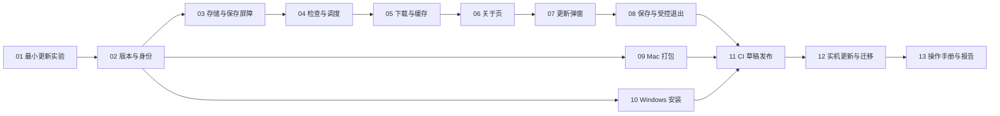

# Velopack + GitHub Releases OTA 完整实现计划

日期：2026-10-14（北京时间）。分支：`feat/ota`。代码与需求基线：`f9fd243`。

需求依据：[已确认的 OTA 需求与设计](../plans/2026-10-14-github-ota-design.md)。本文将需求分解为实现任务、依赖、文件改动和验收步骤，不新增产品范围。

状态：**计划已编写，所有实现任务尚未开始**。本次完成了仓库代码检查、Velopack Rust 1.2.161 部分源码核对和仓库页面匿名访问检查，没有进行打包、安装、更新或三目标实机测试。

## 1. 交付目标与范围

交付 Windows 10／11 x64、macOS 15+ Apple Silicon 和 Intel 的自动更新闭环：

1. 首次安装支持 OTA 的版本；旧用户手动迁移一次，保留数据。
2. 启动后自动检查；常驻期间每 12 小时检查，加入抖动与限频。
3. 发现本平台的新正式版后后台下载全量包，完成包完整性校验。
4. 在允许交互时弹出“立即重启／稍后”；不打断休息和锁屏。
5. “稍后”使同一版本在本次进程运行中不再自动弹窗，下次启动重新提醒。
6. 只有明确选择重启更新，且设置、记录等保存成功后，才退出、替换程序并重启。
7. 已下载且通过完整性复核的包可离线主动安装。
8. `release` 分支触发三目标构建，自动上传草稿，维护者验证后手动公开。

“关于小站”提供版本、进度、错误、检查更新、更新说明、重启入口及自动检查下载开关。关闭主窗口不算退出。更新只重启应用，不重启操作系统。

本轮不做账号、灰度、服务端 API、云服务器、CDN、镜像站、Linux、beta 切换、差分更新、自动降级或数据库自动回退。不采购平台证书，不接入正式签名／公证，不生成更新签名密钥，不实施清单公钥验签。保留 HTTPS、Mac 必要的 ad-hoc 临时签名和包大小／摘要完整性检查。

## 2. 当前基础与必须改动的部分

| 位置 | 已核对现状 | 实施影响 |
| --- | --- | --- |
| [应用入口与协调器](../../crates/gulu-app/src/main.rs) | `run()` 先创建数据目录、获取单实例锁；事件驱动 GPUI | Velopack 启动 hook 必须前移到业务启动与单实例锁之前；更新工作走后台线程 |
| 同上，`Command::Quit` | 调用 `begin_quit()`，两秒后也能合成 `Event::Flushed` | 超时不能证明保存成功；OTA 不能原样复用普通退出路径 |
| [后台持久化](../../crates/gulu-app/src/persistence.rs) | `Job::Flush` 和 `Barrier(Sender<()>)` 在写入失败后仍可能应答；失败记录留在 `pending` 中重试 | 新增带结果和请求序号的更新保存屏障，区分队列已处理与数据已提交 |
| [设置界面](../../crates/gulu-app/src/ui.rs) | 设置草稿保存在 `MainView`，已有保存／放弃／继续编辑；关于页版本写死 `0.1.0` | 更新退出要查询隐藏主窗的草稿；版本来自统一版本源 |
| [悬浮窗偏好](../../crates/gulu-app/src/preferences.rs) | 有写入 revision 和退出前最终位置保存 | 更新屏障必须覆盖最新 UI revision，不能只等业务记录写入 |
| [存储层](../../crates/gulu-storage/src/lib.rs) | SQLite WAL、FULL 同步；`preferences` 键值表；拒绝未来数据库版本 | OTA 设置可新增独立键，无需改变提醒配置或提升数据库 schema |
| [Mac 打包](../../scripts/package-macos.sh) | 手工组装 `.app`，生成 ICNS，临时签名，ZIP；版本来自 plist | 保留应用身份与图标，改为生成 Velopack 安装布局和全量包 |
| [Windows 打包](../../scripts/package-windows.ps1) | CI 只生成便携 ZIP，安装器为可选 Inno Setup，版本硬编码 | 正式发布改为 Velopack 安装器，保留图标、通知身份与数据目录 |
| [发布工作流](../../.github/workflows/check.yml)／[发布脚本](../../scripts/publish-release.sh) | 三 ZIP 构建后创建并自动公开 Release，标签包含工作流序号 | 改成三目标完整产物汇总、统一应用版本、只保留草稿 |
| [PR 验证工作流](../../.github/workflows/verify.yml) | 三目标检查，当前产物路径同样指向便携 ZIP | 同步为新打包方式；保持无发布权限、无公开动作 |
| [Windows 适配检查工具](../../tools/windows-adapter-check/src/lib.rs) | 引入真实托盘／平台文件，但使用简化命令桩 | 若共享命令变化需同步；它不能代替 Windows 应用编译或运行验收 |

仓库地址为 [WenWenBo/GuluTwistBreakStation](https://github.com/WenWenBo/GuluTwistBreakStation)。本次匿名读取仓库页面返回 HTTP 200；这只证明页面可访问，更新 API、清单、附件及重定向链路仍由 OTA-01／OTA-12 验证。

## 3. 实施前验证与版本锁定

### 3.1 已核对的 SDK 行为

以下来自 Rust crate `velopack 1.2.161` 源码，作为首选实验版本；与它配套的 `vpk` 和 .NET SDK 仍需实际验证后锁定。

| 行为 | 核对结果 | 计划措施 |
| --- | --- | --- |
| 启动自动应用 | `VelopackApp` 的 `auto_apply` 默认 `true` | 显式调用 `set_auto_apply_on_startup(false)`；测试缓存存在时普通冷启动不更新 |
| GitHub 更新源 | `GithubSource::new(repo_url, None, false)` 支持匿名、排除 prerelease | 正式客户端使用固定仓库，无 PAT；匿名 API 自然不可见草稿 |
| GitHub 遍历 | 只请求第一页，最多 10 条 Release，再过滤 prerelease | 每次公开版本都含三目标完整产物；不在生产仓库大量堆积不兼容测试 Release |
| SDK 执行方式 | 检查、下载、应用接口为同步方法 | 在专用后台执行器运行，进度和完成事件回传 UI |
| 本地待更新查询 | `get_update_pending_restart()` 找到较新的本地全量包 | 它只能作为候选发现，不能作为已经完成摘要复核的证明 |
| 缓存命中 | `download_updates()` 遇到同名完整包已存在会直接返回 | 恢复缓存与安装前复核保存的大小、摘要；不盲目信任文件存在 |
| 完整性检查 | 新下载包校验大小，优先 SHA256，缺少时使用 SHA1 | CI 要求本项目产物提供 SHA256；缓存复核使用原清单的 SHA256，不引入签名体系 |
| 立即重启接口 | `apply_updates_and_restart()` 直接退出进程 | 更新路径使用 `wait_exit_then_apply_updates()`，避免跳过数据保存 |
| 等待退出接口 | 启动辅助程序等待当前 PID；源码注释说明等待上限 60 秒 | 全部保存和复核完成后才启动辅助程序；成功启动后及时正常退出 |

### 3.2 OTA-01 的实验清单

使用 `dist/ota-probe/`、隔离的 `GULU_DATA_DIR` 和两个测试版本，不操作正式用户数据。先用本地目录更新源测试文件替换，再在专用测试仓库或已获授权的公开测试发布中验证匿名 GitHub 路径；草稿本身不能给普通客户端提供公开源。

为测试草稿中的同一份二进制，提供显式的诊断更新源入口：只有同时启用 `GULU_DIAGNOSTICS` 并指定独立 `GULU_DATA_DIR` 时，才允许选择本地目录或指定测试仓库。正式运行始终使用固定生产仓库，不提供用户渠道切换。测试安装／SDK 缓存也要隔离，单独设置业务数据目录并不能隔离 Velopack 安装位置和缓存；测试与生产的源标识不同，不复用对方的待更新描述。

必须核实：

- `vpk` 的确切 NuGet 版本、所需 .NET SDK、三个目标的 RID／channel／打包参数，以及 Rust SDK 兼容性；记录 `vpk --version` 和使用到的 `--help` 参数。
- 使用 Rust 可执行文件时打包工具的入口检测、启动 hook、全量包和 Windows Setup 均有效；构建侧 .NET 不自动成为 Rust 用户的运行依赖。
- Mac 临时签名应发生在 Velopack 加入辅助程序及修改 bundle 后的正确阶段；最终 ZIP／更新包内的 bundle 能启动，更新不会造成损坏签名。不能只检查打包前的 `.app`。
- Windows 无正式证书条件下安装器、`Update.exe`、重启入口的实际系统提示与执行结果。
- 已缓存包在断网冷启动、点击稍后、普通退出、重新启动和离线主动安装时的行为。
- 辅助程序是否等待正确 PID、启动失败如何上报、超时如何表现；应用启动参数和隔离数据目录能否正确继承。
- 缓存枚举、包路径取得及安装前摘要复核的最小实现；确认 SDK 的缓存清理不会误删除待安装包。

输出 `docs/validation/OTA_PROBE_REPORT.md`，记录 SDK／vpk／.NET 组合、真实命令、产物、操作系统、结果和缺口。实验失败先定位具体原因，不默认增加签名采购、自建服务器或更换更新框架。缺少外机时继续本机任务，但对应实测保持未完成。

## 4. 模块划分与文件清单

保持现有三个 crate。OTA 产品状态与外部 SDK 适配放在 `gulu-app`；新增偏好存储放在 `gulu-storage`。不把网络或更新 SDK 引入提醒领域层 `gulu-core`。

| 文件／目录 | 改动 | 职责与限制 |
| --- | --- | --- |
| `crates/gulu-app/src/update/mod.rs`、`state.rs`（新增） | 状态、命令、调度、提示策略和版本绑定 | 核心策略能用假时钟／假更新源验证，不依赖 GPUI 窗口 |
| `crates/gulu-app/src/update/backend.rs`（新增） | 薄层封装 Velopack、后台线程、检查下载、缓存及应用 | 复用原生 GitHub 更新源，不建设通用插件框架 |
| `crates/gulu-app/src/update/dialog.rs`（新增） | 独立更新对话框 | 不依赖主窗可见；关闭／Esc 等同稍后；唯一窗口实例 |
| `crates/gulu-app/src/main.rs` | 启动 hook、事件和快照、协调器、更新退出状态 | 唯一决策入口，所有 UI 和更新回调经事件序列化 |
| `crates/gulu-app/src/ui.rs` | 关于页、自动更新开关、草稿退出意图 | 保留已有设置保存语义，不因检查更新自动提交草稿 |
| `crates/gulu-app/src/persistence.rs` | 更新偏好读写、持久化结果屏障 | 保存错误可追踪，超时不伪造成功 |
| `crates/gulu-storage/src/update_preferences.rs`（新增）和 `src/lib.rs` | 独立更新偏好键的序列化与事务 | 不提升数据库 `user_version`，不混入提醒设置 |
| `crates/gulu-app/src/preferences.rs`／`floating_controller.rs` | 必要的最终 UI revision 确认 | 若现有接口足够则复用；不能被过期回调误确认 |
| `Cargo.toml`／`Cargo.lock`／应用 `Cargo.toml` | SDK 及必要的版本、摘要依赖 | 精确锁定验证过的 SDK，依赖数量以实际缺口为限 |
| `.config/dotnet-tools.json`、`global.json`（新增） | 锁定 vpk 与构建侧 .NET SDK | 版本由 OTA-01 确定，不能写浮动 latest |
| `scripts/release-metadata.py`（新增） | 从 Cargo 版本生成包元数据并检查一致性 | 跨平台共享版本源，CI 使用固定可用 Python |
| `scripts/package-macos.sh`／`package-windows.ps1` | Velopack 打包与完整产物输出 | Windows 正式交付安装版；Mac 保留原图标和 LSUIElement |
| `packaging/macos/Info.plist`／`crates/gulu-app/build.rs` | 版本、身份与图标资源 | 保持 bundle ID；Windows EXE 版本资源与应用版本一致 |
| `packaging/windows/installer.iss` | 从正式发布路径退役或标明历史用途 | 不让 Inno Setup 与 Velopack 同时成为同一安装的更新器 |
| `scripts/validate-ota-artifacts.py`（新增） | 检查三目标包、清单、版本、摘要和归档布局 | 在上传草稿前执行，禁止用 glob 随意上传旧构建残留 |
| `.github/workflows/check.yml`／`verify.yml`／`scripts/publish-release.sh` | 构建、验证、草稿上传 | 正式发布由维护者在 GitHub 操作，CI 不自动公开 |
| `docs/packaging.md`／`docs/user-guide.md`／`README.md`／`docs/ota/` | 操作说明、迁移及限制 | 区分当前实现与计划，不提前宣称三目标实测通过 |
| `docs/validation/OTA_MANUAL_TESTS.md`、`OTA_REPORT.md`（实施时新增） | 外机操作手册和证据记录 | 状态含通过、失败、未执行，不以截图或构建代替实际升级 |

新增文件名是实施约定，可在职责不变的前提下合并小文件。涉及共享枚举时同步 Windows 适配检查桩；本轮无需为更新功能新增托盘菜单，已有打开主窗入口即可访问关于页。

## 5. 客户端详细实现

### 5.1 版本、身份与启动

- `Cargo.toml` 的 `workspace.package.version` 是唯一产品版本源。应用使用编译期版本值，打包脚本读取同一字段。首个支持 OTA 的版本暂定 `0.1.1`，升级验证版本暂定 `0.1.2`；实际发布前先核对已用版本，保证递增。
- Release 标签采用 `v<version>`。Mac `CFBundleShortVersionString`、Windows 文件版本和更新清单绑定该版本；构建序号仅作诊断，不能充当更新优先级。
- 保持 `CFBundleIdentifier=app.gulutwist.breakstation`、可执行名 `gulu-twist`、`LSUIElement=true` 和现有通知身份。Velopack package ID 在 OTA-01 验证允许字符后固定，并区分它与操作系统应用身份的用途。
- 保留 `ProjectDirs::from("app", "GuluTwist", "BreakStation")` 和 `GULU_DATA_DIR`；安装目录与用户数据目录严格分开。
- 三个稳定 channel 分别为 `win-x64-stable`、`osx-arm64-stable`、`osx-x64-stable`。根据正在运行的安装包架构选源，不能按宿主 CPU 把 Intel 包升级成 ARM 包。
- 最先运行 Velopack 启动 hook，并关闭启动自动应用；Windows hook 的短生命周期分支不启动 GPUI、不抢业务单实例锁、不访问业务数据库。
- 开发版或普通未安装二进制找不到 Velopack 布局时正常启动本地功能；关于页明确“当前为开发构建，自动更新不可用”，不把它当作致命错误。

### 5.2 状态与后台执行

推荐状态：`Unavailable`、`Idle`、`Checking`、`Downloading`、`Ready`、`PreparingRestart`、`UpdaterArmed`。检查时间和错误作为独立字段保存；例如已有可用缓存时检查失败，不能丢失 `Ready` 或错误地显示“最新”。

后台操作带单调递增 `operation_id`；提示和安装绑定 `version + channel + package filename + expected digest`。忽略过期回调，同一安装只允许一个检查／下载／应用任务执行。下载期间再次手动检查只展示当前进度。

| 输入 | 处理 | 结果 |
| --- | --- | --- |
| 启动／到期／手动检查 | 检查开关、冷却和当前任务，再进入后台请求 | 发现更新则下载；无更新则记录成功时间；错误单独记录 |
| 下载进度 | 合并高频进度事件，建议 UI 每 100–250ms 最多刷新一次 | 只更新关于页／已有对话框，不能阻塞提醒计时 |
| 下载完成 | 确认大小、摘要与目标信息，并持久化缓存描述 | 进入 `Ready`，等待可交互时机 |
| 稍后／关闭／Esc | 将此版本加入本次进程的已提醒集合 | 保留缓存和手动入口，主功能继续运行 |
| 自动检查开关关闭 | 保存成功后停止后续自动检查与自动下载调度 | 手动更新保留；已开始的下载允许完成，当前进程不再因此自动弹窗 |
| 普通关闭窗口 | 沿用隐藏行为 | 不清空本次已提醒集合，不应用更新 |
| 普通退出／普通冷启动 | 不启动更新辅助程序；下次重新检查本地待更新状态 | 已验证缓存可以再次提醒，不自动安装 |
| 手动重启更新 | 校验目标、草稿、休息／锁屏、保存结果和缓存 | 完成第 6 节的受控退出 |

开关只控制后台检查下载，已经就绪的版本仍按“下次启动再提醒”处理；手动检查发现新版本后继续下载。下载／弹窗期间发现更高版本时，先固定当前正在操作的目标；新版本进入后续检查周期，不在用户点击按钮时暗中切换安装对象。

### 5.3 调度与网络错误

以下数值为可集中调整、可测试的工程初值：

- 首次自动检查延迟 30–90 秒；正常周期 12 小时加 0–30 分钟抖动。
- 自动请求至少间隔 15 分钟，持久化最近尝试时间以限制快速重启；手动请求冷却 60 秒，同一任务期间禁止重复提交。
- 普通网络失败按 15 分钟、1 小时、3 小时退避，再恢复 12 小时周期；加入小幅抖动，遵守能读取到的 `Retry-After`／限流恢复时间。
- 区分 403 限流与权限、404 产物缺失、超时／断网、空源、清单无匹配目标、摘要不符；SDK 不能暴露细节时显示“检查失败”，不猜测“已是最新版本”。
- SDK 超时能力在 OTA-01 验证：设置受支持的有界超时；若内部请求无法即时取消，隔离该线程，UI 可继续使用，超时后不并发创建第二个下载，也不能假称底层请求已终止。
- 调度接入现有 `wait_ms()`／事件循环，不新增持续轮询；唤醒后最多合并执行一次到期检查，不补发休眠期间所有周期。处理墙钟前跳、回拨与时区变化，避免无限延后或请求风暴。

### 5.4 持久化与缓存

在 `preferences` 表增加独立 `update_preferences` 键，包含格式版本、自动检查下载开关、最近尝试／成功时间、重试截止时间、已就绪产物描述。描述保存更新源标识、目标版本、channel、包文件名、大小、SHA256 和简短说明，不保存访问令牌或临时下载 URL。

包文件由 Velopack 缓存管理；业务数据库只保存定位与校验所需信息。缓存描述不持久化任意绝对可执行路径，重建时从安装布局解析并约束文件名。没有对应原始摘要的缓存不得直接显示“已校验”；联网重取元数据或重新下载后才可使用。

新增键缺失时默认开启自动更新。损坏或未来格式保留原值，更新模块停用自动操作并展示可恢复错误；本地提醒正常工作，不因 OTA 偏好损坏进入业务数据恢复模式。

恢复就绪状态时，以及用户实际安装前，后台重新比对本地包与保存的原清单大小／SHA256。必要的摘要计算仅用于包完整性，不引入清单签名或自建公钥。缓存被清除时回到可检查状态；损坏包隔离或删除，仅处理本应用缓存目录。

首版仅保留必要的待更新信息和 SDK 管理的包，不建立无限本地更新历史。下载失败后可重试全量下载，不承诺断点续传。正常缓存缺失不会丢失设置与记录。

### 5.5 关于页与更新对话框

- 关于页显示当前版本、最近成功检查时间、状态和操作按钮；失败时说明是否可以继续使用旧版。
- 下载完成后创建独立小型 GPUI 对话框，显示目标版本、纯文本更新摘要、“立即重启”和“稍后”。摘要缺失时显示版本和通用说明，不阻止更新；不执行 Release 文本中的 HTML 或命令。
- 对话框不强制打开主窗口；隐藏主窗后仍可工作。焦点、Tab 顺序、按钮可访问名称、中文换行和高 DPI 要验收。
- 正式休息、体验遮罩、锁屏、首次引导未完成或数据恢复交互期间暂缓自动弹窗。弹窗已经出现后进入休息／锁屏则收起并在恢复后继续同一提示，不算用户点击“稍后”。
- 同一进程、同一版本只完成一次自动提示。创建窗口失败不标记“用户已看过”；关于页保留入口，后台重试不能每帧弹窗。
- “立即重启”再次检查休息／锁屏状态和目标版本；状态变化则保留待更新，提示当前不能重启，不先结束用户休息。
- 未保存设置位于隐藏主窗时也必须检测。将现有 `pending_page` 导航意图扩展为可表示“退出更新”的明确意图，复用保存／放弃／取消行为。无效输入不能绕过保存失败。

## 6. 更新前保存与退出协议

这部分是实施优先级最高的应用改动。不能先启动等待退出的更新器，再等待用户决定是否保存；否则用户稍后普通退出时也可能意外触发更新。

### 6.1 保存屏障

新增概念接口 `PrepareUpdateExit(request_id, revisions, final_state)`，返回 `UpdateExitPrepared(request_id, Result<Receipt, Error>)`。确切 Rust 类型由实现确定，回执至少能确认：提醒设置、更新偏好、UI 偏好最新版、活动记录、暂停状态和最终退出状态已提交。

存储线程不能仅报告“读到了屏障消息”。必须等待前序写入和本次最终写入完成，检查 `pending`／`dirty` 及相应写入错误；历史上已修复的错误不永久阻塞，但尚未成功的 revision 不得被其它成功事件清除。SQLite 已提交的 WAL 数据是有效持久化，不要求靠复制单个数据库文件或盲目 checkpoint 证明成功。

更新路径使用独立、有超时的结果事件。准备阶段初始超时可设 10 秒，超时取消本次重启意图，保持旧版运行；迟到的成功回调不得重新启动更新器。普通退出可以保留其容错超时策略，但 `Event::Flushed` 不得推进 OTA 状态。

最终退出 effects 与暂停状态应在同一个 SQLite 事务中提交，单独追踪本次退出请求，不能把可能取消的退出 effects 提前混入普通后台无限重试队列。取消发生在事务开始前则丢弃该次暂存退出状态；若提交已经完成，恢复运行时同步到已提交状态，不能恢复旧内存快照并重复处理已结算事项。这个竞态需要在 OTA-08 用“超时与提交同时发生”验证，结果回执即使迟到也只能用于数据状态对齐，不能恢复安装授权意图。

### 6.2 两阶段退出

1. **确认意图**：用户点击后锁定目标，处理设置草稿；取消即回到 `Ready`。尚未启动辅助程序。
2. **检查准备条件**：确认不在休息／锁屏、没有恢复模式；在后台复核缓存摘要、空间和目标路径。失败只展示错误。
3. **暂时冻结新的业务写操作**：禁止重复重启、设置保存、记录清空和新提醒会话开始；保持窗口与托盘可用。不把此临时冻结写成用户的“手动暂停”。
4. **准备最终状态并保存**：`begin_quit()` 当前会销毁窗口、结束会话和移除托盘，不能直接调用。先形成最终退出状态与 effects，再发送结果屏障；未确认成功前保留原运行状态及可恢复的 UI。
5. **保存失败处理**：释放冻结，保留原业务待写数据，撤销未提交的退出暂存状态，按当前时钟继续运行；不清除待安装包、不退出、不启动更新器。若准备逻辑会改变 Engine，使用最小可复制快照／暂存 effects，避免未完成保存就不可逆地结束提醒；超时竞态按第 6.1 节对齐实际提交结果。
6. **启动辅助程序**：保存成功后重新检查目标与锁屏／休息条件，调用 `wait_exit_then_apply_updates(target, silent, true, args)` 等待本进程退出。该调用失败则基于已提交状态恢复运行，不恢复已过期的待处理事项；不能进入已退出状态。
7. **提交退出**：仅辅助程序启动成功后进入 `UpdaterArmed`，销毁窗口和托盘、停止后台任务、关闭数据库连接、正常结束进程。不要再调用会生成未保存 effects 的通用退出路径；持有单实例锁直到旧进程真正结束。
8. **新版本启动**：更新器替换后重启，仍执行受控启动 hook，重新获得单实例锁和原数据目录。成功打开业务数据并进入可用状态后清理过期就绪标记，不上传健康事件。

辅助程序启动成功只代表交接完成，不能提前显示“更新成功”。实际替换失败由更新器日志／错误界面和下次可启动的应用解释。不能在应用已退出后假装还能显示应用内错误，也不承诺自动回退。若新版本已经启动后业务出错，保留数据并用更高版本修复。

必须验证辅助程序等待期间的进程句柄、正常退出、超时和重复启动。任何已启动辅助程序但决定恢复旧应用的异常路径，都必须先确认辅助程序终止／取消；不能留下以后退出即安装的隐藏任务。

## 7. 打包与版本产物

### 7.1 共用规则

`scripts/release-metadata.py` 读取 Cargo 版本，生成或检查包版本、平台、架构、channel、package ID、源码 SHA 与文件名。工作目录按目标隔离，开始打包时使用空 staging，避免上次产物被误收录。

每个目标至少交付首次发行包、全量 `.nupkg`、`releases.<channel>.json`、可读更新说明。`SHA256SUMS.txt` 可作为维护者下载校验附件保留，不称为签名。所有附件名在合并上传目录中唯一。

打包后检查清单引用的完整包存在、版本／架构／channel 匹配、大小和 SHA256 一致、ZIP／nupkg 可展开且含辅助更新程序。发布目录不得出现测试数据库、令牌、签名密钥或其它目标的残留包。

### 7.2 macOS

- 沿用现有 ICNS 生成与图标检查逻辑，将 Cargo 版本写入 staging plist，保留 bundle ID、可执行名、最小系统版本和菜单栏常驻配置。
- 由验证过的 `vpk` 参数生成两种架构的可更新 bundle、首次 ZIP 和全量包；SDK 与辅助程序架构正确。
- 按 OTA-01 结论处理最终 bundle 的 ad-hoc 临时签名，验证打包后再解压得到的 bundle；不在最终 nupkg 生成后修改其中应用。
- 验收 `~/Applications`、用户可写的 `/Applications` 以及不可写目录的实际行为，记录权限提示。下载目录隔离／App Translocation 不兼容时给出把应用移到支持位置的说明，不自动关闭系统保护。
- 使用稳定的安装位置升级；不把整个 `.app` 当作单一二进制替换。不能让构建机上能运行代替从 GitHub 下载后能安装和更新。

### 7.3 Windows

- 正式包由 Velopack 生成用户级 Setup，取代当前发布用 `-SkipInstaller` 便携路径；`installer.iss` 不再参与 OTA 正式构建。
- EXE 资源、Setup 图标、快捷方式和卸载项保持产品名称。进程 AUMID、快捷方式 AUMID 和通知注册一致，必要时用 SDK 的自定义 AUMID 参数保持 `app.gulutwist.breakstation`。
- 验证普通用户安装、路径含空格／中文、更新辅助程序独立执行、关闭旧进程后解除文件占用及重新启动入口。
- 用户数据继续位于原 `ProjectDirs` 目录，不写入会被整体替换的 `current` 或安装目录；卸载测试先备份隔离数据，验证实际默认行为后写入用户说明。
- Windows Server CI 仅证明构建和部分非交互测试；Windows 10、Windows 11 桌面升级分别留存结果。

## 8. GitHub Actions 与草稿发布

### 8.1 构建验证

`.github/workflows/check.yml` 保持 `release` push 触发，构建三目标。安装锁定 Rust／.NET／vpk 与必要的 Python，运行静态检查和测试，使用新打包入口上传三组构建 Artifact。

`.github/workflows/verify.yml` 继续用于 main PR／手动验证，执行相同的新包构建和清单校验，但不创建 Release。只给草稿上传 job `contents: write`，其它 job 保持只读。PR 验证不依赖私人令牌或平台签名证书。

所有矩阵任务成功后，汇总 job 运行 `validate-ota-artifacts.py`。任一目标失败、缺少 feed／full 包、重复文件名、版本不一致或摘要错误，都阻止草稿进入“可发布”状态。

### 8.2 草稿创建与重试

重写 `publish-release.sh`：

1. 确定 `v<version>` 和源码 SHA，验证元数据与产物清单。
2. Release 不存在时创建草稿，指定准确源码提交；上传三个目标的完整附件和说明。
3. 同一版本／同一提交的草稿重试可以补传或替换草稿附件，但必须检查最终附件集合，清除本次受管范围内的过期附件引用。
4. 同版本但不同源码提交不能静默复用草稿；要求递增产品版本或由维护者显式处置未发布草稿，并重新跑完整验证。
5. 已公开版本保持不可变：脚本不得覆盖附件、移动 tag 或改写发布说明；重复运行只验证并报告既有发布，发现内容不一致则失败。维护者后续补充已知问题说明不等于替换公开产物。
6. 输出草稿链接、源码 SHA、版本、三目标包清单和验证结果到工作流摘要。上传或验证失败时草稿保持未公开，并标记不完整。
7. 删除所有自动 `--draft=false` 或等价公开调用。脚本退出成功只表示草稿准备完成，不表示已发布。

使用版本级并发组串行化上传；运行中的草稿上传不被同版本任务随意取消。查询 Release 时区分“确实不存在”和权限／网络失败，不能把任何查询失败都解释为可以创建新版本。

### 8.3 发布说明与人工发布

拟新增 `docs/releases/<version>.md` 保存给用户的简短变更说明，CI 把它与平台下载说明和迁移提示汇总到草稿。将摘要写入本目标更新元数据，确认客户端读取来源；不根据源码自动编造功能变更。

维护者在草稿阶段确认三个安装包都能启动、版本正确、变更说明准确，执行隔离更新验证后手动点击发布。草稿不能被普通客户端发现，因此需要区分：

- **公开前**：下载草稿／Artifact，在本地目录源或专用测试仓库验证相同包的升级，不把私人 GitHub 凭证写入客户端。
- **公开后**：用正常客户端匿名检查、下载真实附件并完成升级，验证生产仓库 API 与重定向路径。

版本改动后应先用测试源证明升级，再开放全量用户；生产发布后的验证是对真实分发路径的补验，不是唯一的更新测试。GitHub 页面“Latest”标记不能代替 SDK 对版本、channel 和最近 Release 页的实际选择测试。

## 9. 任务分解、依赖与交付门槛

所有任务初始状态为 `pending`；下表不是完成记录。每项实施后记录文件、命令、产物和结果，未执行的实机项保持未执行。

| ID | 工作与交付 | 前置 | 完成条件 |
| --- | --- | --- | --- |
| OTA-01 | 工具链与三目标最小更新实验，输出 `OTA_PROBE_REPORT.md` | 需求已确认 | 锁定 SDK／vpk／.NET；验证 hook、缓存、辅助进程、无正式证书路径；缺失设备明确列出 |
| OTA-02 | 统一版本、应用身份、channel、元数据脚本 | OTA-01 的工具参数结论 | Cargo／UI／plist／EXE／feed／tag 一致；版本递增比较正确；保留用户数据路径 |
| OTA-03 | 独立 OTA 偏好、缓存描述与有结果的持久化接口 | OTA-02 | 老数据库默认兼容；读写失败不影响提醒；完整性数据可离线恢复；保存屏障识别失败 |
| OTA-04 | 更新策略状态、后台执行器、调度与 GitHub 源 | OTA-01、02、03 | 匿名检查、限频、退避、单任务、正式版和本架构过滤通过；开发构建可用 |
| OTA-05 | 全量下载、进度、缓存重建与安装前完整性复核 | OTA-04 | 下载成功后 Ready；中断可重试；损坏包拒绝；离线就绪可用 |
| OTA-06 | 关于页与自动检查开关 | OTA-03、04、05 | 状态和错误正确，开关持久化，手动检查和更新入口可用 |
| OTA-07 | 更新弹窗、“稍后”、休息／锁屏调度 | OTA-05、06 | 一版本一进程只提醒一次；冷启动再提醒；隐藏主窗可操作；正常重启不安装 |
| OTA-08 | 草稿处理、两阶段退出、辅助程序交接 | OTA-03、05、07 | 保存失败／超时不退出；成功才交接；退出后只启动一个新版；原功能可恢复 |
| OTA-09 | Mac 双架构正式 Velopack 打包 | OTA-01、02；集成包依赖 OTA-08 | 两类首次 ZIP／full／feed 完整；最终 bundle 临时签名可用；身份保留 |
| OTA-10 | Windows Velopack 安装包与旧包迁移 | OTA-01、02；集成包依赖 OTA-08 | Setup 安装、通知身份、卸载项正确；从旧便携／已用 Inno 安装迁移不丢数据 |
| OTA-11 | CI 三目标新产物、校验、草稿发布与重试 | OTA-09、10 | PR 不发布；release push 只生成完整草稿；重试不改公开版本；失败不公开 |
| OTA-12 | 端到端更新、迁移与失败场景验收 | OTA-08、09、10、11 | 第 10 节矩阵有真实证据；两版更新和已确认行为在支持目标上通过 |
| OTA-13 | 用户指南、发布操作、外机手册与验收报告 | OTA-11、12 的实际结果 | 说明与实现一致；待验项目明确；记录已知限制和错误修复方式 |

推荐执行顺序：先 OTA-01 → OTA-02 → OTA-03，再完成 OTA-04／05；接 OTA-06／07 后处理 OTA-08。OTA-09／10 可在 OTA-02 后准备打包脚本，最终集成包等待 OTA-08。随后完成 OTA-11 → OTA-12 → OTA-13。



阶段门槛：

- **G1，可行性明确**：OTA-01 的本机升级、启动不自动应用、工具链版本通过；外机不可用不阻塞纯逻辑开发，但不宣称对应目标已验证。
- **G2，客户端可控**：OTA-03 至 OTA-08 通过状态、存储与 UI 集成检查，保存失败不能退出，普通启动不能安装缓存。
- **G3，草稿可交付**：三个目标产物完整，CI 仅上传草稿；公开版本不可变，生成流程可复现。
- **G4，OTA 完成**：两个递增版本在所列目标环境实测通过，迁移与主要异常场景有记录，文档同步。缺少任一目标实测时只能报告部分完成。

## 10. 验证计划与需求追踪

### 10.1 自动化验证

按任务编写能发现外部行为错误的测试，不镜像实现。逻辑测试使用假时钟、临时数据库、假后台和本地 HTTP／文件 fixture，避免等待真实 12 小时或依赖 GitHub 在线状态。

| 组 | 必须覆盖的行为 | 对应任务 |
| --- | --- | --- |
| 调度 | 启动抖动范围、12 小时周期、快速重启限频、手动冷却、睡眠合并、回拨、退避和开关关闭 | OTA-04 |
| 源与版本 | 正式／草稿／prerelease、缺目标、同版／低版、版本 `0.1.9 → 0.1.10`、三架构隔离、最近 10 Release 边界 | OTA-02、04、11 |
| 下载／缓存 | 单任务、过期回调、进度范围、中断、同名缓存损坏、大小／SHA256 错误、缓存删除、离线恢复和完整性复核 | OTA-05 |
| 提示 | 同版本次不重复、不同版本提示、关闭同稍后、普通冷启动只提醒、锁屏与休息前后竞态、弹窗创建失败 | OTA-07 |
| 存储 | 新键默认、格式损坏／未来版本、开关写入失败回退、旧数据不变、最新 UI revision、写失败屏障、超时与事务提交竞态、迟到成功不重启 | OTA-03、08 |
| 重启交接 | 未保存草稿三个选择、保存失败／超时不启动辅助程序、辅助程序启动失败可恢复、重复点击只交接一次 | OTA-08 |
| 发布脚本 | 三目标缺一、错版本／摘要、重复附件、查询失败、上传中断重跑、不同 SHA 草稿冲突、已公开不覆盖、绝不自动公开 | OTA-11 |

复用现有本机检查命令：

```bash
./scripts/check.sh
cargo check --workspace --locked
git diff --check
```

脚本与产物检查随 OTA-02／11 加入 CI 的统一入口；新增工具的具体参数以实现后的 `--help` 为准。对 Windows／Mac 平台文件的改动执行对应原生构建，Mac 上的 Windows 适配检查仅作补充。

### 10.2 实机矩阵

| 环境 | 首次包 | 核心验收 | 不能被什么替代 |
| --- | --- | --- | --- |
| Windows 10 x64 | Velopack Setup | 普通用户安装、旧包迁移、A→B、重启、数据与通知／托盘 | Windows Server CI 或 Windows 11 结果 |
| Windows 11 x64 | Velopack Setup | 同上，记录系统安全提示、文件占用、卸载行为 | 仅 EXE 启动或便携 ZIP 运行 |
| macOS 15+ Apple Silicon | ARM64 ZIP／app | 从 GitHub 下载、临时签名、A→B、离线缓存、常驻／通知／图标 | 本地未隔离构建直接打开 |
| macOS 15+ Intel | x86_64 ZIP／app | 同上，核实架构及更新辅助程序 | Intel 交叉编译或 Apple Silicon 上单独运行 |

### 10.3 端到端操作用例

| ID | 操作 | 通过标准 |
| --- | --- | --- |
| E01 | 将旧 `0.1.0` 的隔离设置、记录、悬浮窗偏好迁移到首个 OTA 版本 A | 数据保留，无重复引导，无新旧实例同时操作数据 |
| E02 | 准备版本 B 的草稿，用正常客户端检查 | 不发现草稿；本地提醒继续工作 |
| E03 | 用测试源验证 A→B，再手动公开 B，A 匿名检查并下载 | 仅匹配平台包可用；后台下载不阻塞 UI |
| E04 | 下载完成时主窗口隐藏 | 独立对话框出现，主窗状态不被重置 |
| E05 | 点击稍后，关闭／打开主窗，再手动退出并重新启动 A | 本次运行不再弹；真正冷启动再次提醒；版本仍是 A |
| E06 | 在全屏休息、体验遮罩、锁屏时完成下载并恢复 | 受保护期间不抢焦点；结束后只出现一次提示 |
| E07 | 修改提醒设置但不保存，点击立即重启，分别选保存／放弃／取消 | 对应行为正确；保存失败不退出，无效表单不静默丢失 |
| E08 | 正常选择立即重启 | 记录写入确认后退出；辅助程序替换；B 获得原数据锁并正常常驻 |
| E09 | 下载 B 后断网、退出 A、重启 A、主动安装 | 不联网授权，完整性复核后可安装；普通启动仍不自动安装 |
| E10 | 下载中断、GitHub 限流、空源、缺附件、错误 channel | 显示可解释错误和重试；不假报最新；不影响提醒 |
| E11 | 损坏／删除缓存，模拟磁盘满、目录不可写、文件被占用 | 停止不安全应用步骤，保留可用旧版或明确恢复路径，错误不吞掉 |
| E12 | 注入 SQLite 写失败、屏障超时、迟到成功和辅助程序启动失败 | 不因失败退出，不留下一次普通退出就更新的辅助任务 |
| E13 | OTA 后检查托盘、通知点击、休息结束、悬浮窗位置、单实例 | 行为与升级前一致；无重复图标／孤立遮罩／记录丢失 |
| E14 | CI 上传中断重跑、已发布版本重跑及版本冲突 | 草稿可恢复；不覆盖公开包，不移动 tag，不自动发布 |
| E15 | 原生 Windows 用户安装后卸载／重装；Mac 更换支持的安装位置 | 实际数据保留及权限行为已记录，失败时有手动操作说明 |

结果记录至少包含：源码 SHA、应用与工具版本、OS／CPU／包架构、安装路径、测试数据路径、Release／Artifact 地址、步骤、实际结果、错误日志及必要截图。不得把未执行项标为通过，不采集或上传用户健康记录。

### 10.4 需求与任务映射

| 已确认需求 | 实现任务 | 主要验收 |
| --- | --- | --- |
| 全用户、无账号、GitHub 直接更新 | OTA-01、04、11 | E02、E03、E10 |
| Windows 安装版和 Mac 双架构 | OTA-02、09、10 | E01、E03、E08、实机矩阵 |
| 自动检查下载与可关闭开关 | OTA-03、04、05、06 | 调度测试、E03、E10 |
| 完成弹窗、立即重启／稍后 | OTA-06、07 | E04、E05、E06 |
| 下次启动只提醒，不能擅自安装 | OTA-01、04、07、08 | E05、E09 |
| 先保存数据再更新、不打断休息 | OTA-03、07、08 | E06、E07、E08、E12 |
| 离线保留旧功能、缓存可主动安装 | OTA-04、05、08 | E09、E10、E11 |
| 全量包、正式版、无额外签名验证 | OTA-01、02、05、09、10、11 | 产物检查、E03、E11 |
| 自动草稿、人工发布 | OTA-11、13 | E02、E03、E14 |
| 旧包一次迁移及设置／记录保留 | OTA-02、03、10、12、13 | E01、E08、E13、E15 |

## 11. 发布执行顺序与故障处理

首次上线按以下顺序：

1. 完成 G1–G3，交付带更新器的版本 A 和测试升级版本 B；功能分支上的验证流水线不发布生产 Release。
2. 用隔离数据和测试源完成三目标 A→B、稍后、离线安装和保存失败实验；记录本轮没有正式证书时的用户操作。
3. 将 A 的三目标包作为草稿交付维护者验证，准备一次性迁移说明。用户手动安装 A 后才具备 OTA。
4. 维护者确认后手动公开 A；验证真实 GitHub 下载与首次安装链路。
5. B 经同样草稿验证后再手动公开；从 A 使用真实 GitHub 源升级到 B，完成 E03、E08 等生产路径补验。
6. 后续版本沿用“递增版本 → 三目标构建 → 草稿验证 → 人工公开”，每次发布包含完整的三目标全量包和 feed。

故障处理：

- **未公开的坏包**：保留草稿状态，修复并按版本／提交规则重新构建，重新验证全部受影响产物。
- **公开后的坏版本**：停止继续推广，在发布说明记录问题；必要时撤下公开可发现性，但不保证拦住已有缓存。优先发布更高修复版本，不覆盖旧附件。
- **GitHub 不可达**：应用继续提醒，退避重试；用户可在网络恢复后重试。首版不提供镜像服务。
- **替换失败但旧版可启动**：保留错误和可用包信息，允许重试或从发布页手动安装；不得误清除用户数据。
- **新版无法启动**：提供手动安装修复版和保留数据的步骤。若涉及数据库格式变化，先由开发者确认兼容性，不自动降级数据库。

## 12. 完成定义与交付清单

- [ ] OTA-01 至 OTA-13 均有实现或实测记录，未完成项和原因明确。
- [ ] Windows 安装版、Mac 两种架构均通过两个递增版本的真实升级；Windows 10／11 的范围按矩阵明确。
- [ ] 初次迁移、所有“稍后”与普通启动路径、保存失败恢复、离线缓存安装通过。
- [ ] 工作流只准备草稿，生产版本由维护者手动公开；公开产物不可变。
- [ ] 没有新增账号、灰度、服务器、差分或额外签名验证。
- [ ] 应用版本、发行说明、下载产物和文档一致；旧 Inno／便携说明不再误导正式安装流程。
- [ ] 交付 `OTA_PROBE_REPORT.md`、`OTA_MANUAL_TESTS.md`、`OTA_REPORT.md` 和更新后的打包／用户指南。
- [ ] 已记录实际测试命令与结果、系统提示、限制和修复步骤；不以本机通过宣称外机已完成。

## 13. 参考资料与核对范围

- [已确认需求](../plans/2026-10-14-github-ota-design.md) 与 [OTA 文档入口](../ota/README.md)。
- [Velopack Rust 入门](https://docs.velopack.io/getting-started/rust)。
- [Rust 1.2.161 启动逻辑](https://docs.rs/crate/velopack/1.2.161/source/src/app.rs)。
- [Rust 1.2.161 更新管理器](https://docs.rs/crate/velopack/1.2.161/source/src/manager.rs)。
- [Rust 1.2.161 GitHub 更新源](https://docs.rs/crate/velopack/1.2.161/source/src/sources/github.rs)。
- [macOS 打包](https://docs.velopack.io/packaging/operating-systems/macos)、[Windows 打包](https://docs.velopack.io/packaging/operating-systems/windows)、[渠道](https://docs.velopack.io/packaging/channels)。

源码核对日期为 2026-10-14。在线文档可能跟随新版本变动，实施以 OTA-01 锁定工具链的实际行为为准。本文中的文件规划、调度初值和状态名称是实现方案，不是已经存在的代码或通过的测试。
