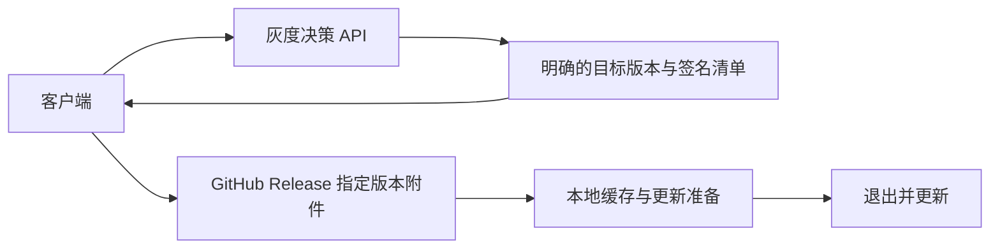

# 使用 GitHub Releases 分发更新

状态：建议接入方案，尚未实施。整理于 2026-10-14。返回 [OTA 文档入口](README.md)。

## 是否需要对象存储或 CDN

不需要。现有仓库的 GitHub Releases 可以托管首次安装包、全量更新包、差分包与版本清单。GitHub 提供文件下载，客户端使用 HTTPS 获取它们；本项目无需因此额外购买存储或部署 CDN。

需要区分文件托管与更新决策：GitHub 可以承担文件分发，自建服务可以只负责名单、比例和撤回，不转发大文件。公开 Release 附件可匿名访问；私有仓库要单独设计认证，不能把维护者的访问令牌硬编码到所有客户端。

## 两种接入方式

| 模式 | 检查版本 | 下载产物 | 是否需要自己的服务 |
| --- | --- | --- | --- |
| 直接连接 GitHub | Velopack `GithubSource` 读取仓库 Releases 和渠道清单 | GitHub Release 附件 | 普通自动更新不需要 |
| 自定义灰度 + GitHub | 自建 API 决定精确目标，自有 `UpdateSource` 适配 | 被选定 Release 的附件链接 | 需要轻量决策服务，不需要另建文件存储 |

直接连接模式通常配置仓库 URL。SDK 查询 Releases 中的 `releases.{channel}.json`，再定位清单中的 `.nupkg` 附件。它不是把一个任意 ZIP 地址传给安装函数就能更新。

自定义模式可以直接下载 GitHub 的具体附件链接，但仍需提供正确的更新包、可信清单和目标版本信息。官方 `GithubSource` 的完整公共 feed 不应在灰度判断后再次独立选择最新版，否则可能越过指定范围。



## 当前打包流程要增加什么

当前 [发布工作流](../../.github/workflows/check.yml) 只在 `release` 分支 push 时构建 Mac ARM64、Mac Intel 和 Windows x64 ZIP，[发布脚本](../../scripts/publish-release.sh) 上传三个 ZIP 与 `SHA256SUMS.txt`。这些现有 ZIP 尚不是 Velopack 更新产物。

接入时扩展这条流程：

1. 应用加入 Rust 更新 SDK 与启动 hook，统一版本、应用身份和更新渠道。
2. CI 正常编译，再使用锁定版本的 `vpk` 打包。初期只生成全量更新；开启差分前取得上一版本完整包。
3. 按平台完成代码签名、公证及更新元数据的可信签名流程，验证最终产物。
4. 每个平台/架构使用独立渠道；上传对应完整包、可选差分、渠道清单和首次发行包。
5. 多个构建任务的附件汇总到同一个草稿 Release，全部验证成功后才公开，避免某个平台提前发布不完整版本。
6. 灰度模式下，附件就绪后登记后台版本草稿，再单独开始灰度。Release 公开与允许所有客户端更新不是同一个动作。

例如单个渠道的附件可以包含以下种类；确切文件名由锁定版本的 `vpk` 生成，不应手工猜测并写死：

```text
首次安装或便携发行包
...-full.nupkg
...-delta.nupkg                    # 可选
releases.win-x64-stable.json
签名清单及必要验签材料              # 按项目可信更新方案提供
```

建议渠道为 `win-x64-stable`、`osx-arm64-stable`、`osx-x64-stable`，Linux 完成适配后增加 `linux-x64-stable`。不要让两个 Mac 架构写同一个渠道清单。

## 下载链接和灰度约束

- 使用绑定具体 Release 和文件的下载信息，目标已选定后避免使用随时变化的 `latest` 链接。
- 包和清单保持不可变；修复发新版本，不覆盖已发布版本的同名附件。
- 灰度适配器只向 SDK 提供目标完整包及必要差分链，并验证目标、渠道、架构、摘要与签名。
- 客户端“看不到更新”不意味着公开附件不可访问。若测试包内容需要保密，不能依赖公开 Release 加灰度名单实现访问隔离。
- GitHub 托管并不替代客户端的更新可信性校验。当前 SHA256SUMS 只提供完整性信息。

## 使用限制与验收

公开 GitHub API 有匿名访问限流，同一出口 IP 的多台设备可能共享配额。检查应限频、加入抖动，并处理离线和服务错误。客户端的实际网络必须能稳定访问 GitHub 及其下载重定向域名；源码托管可访问不等于大包下载体验已合格。

本次核对的 Rust 1.2.161 `GithubSource` 读取最近一页、最多 10 个 Release；版本清单/产物保留策略需要考虑旧客户端和所需差分是否仍能发现。过旧客户端应有可直接升级的全量路径，自定义服务可返回固定版本附件，避免依赖无限遍历历史 Release。

至少验证两个真实发行版之间的升级、平台/架构隔离、下载失败、缺少差分的全量回退、验签失败、草稿可见性和旧客户端升级。GitHub Releases 无法让当前没有更新代码的旧安装自动获得 OTA，仍需首次手动迁移。

## 参考资料

- [官方 GitHub Actions 发布示例](https://docs.velopack.io/distributing/github-actions)
- [GitHub 与其他自托管更新源](https://docs.velopack.io/distributing/self-hosting)
- [渠道与跨平台分发](https://docs.velopack.io/packaging/channels)
- [Rust 1.2.161 GithubSource 源码](https://docs.rs/crate/velopack/1.2.161/source/src/sources/github.rs)
