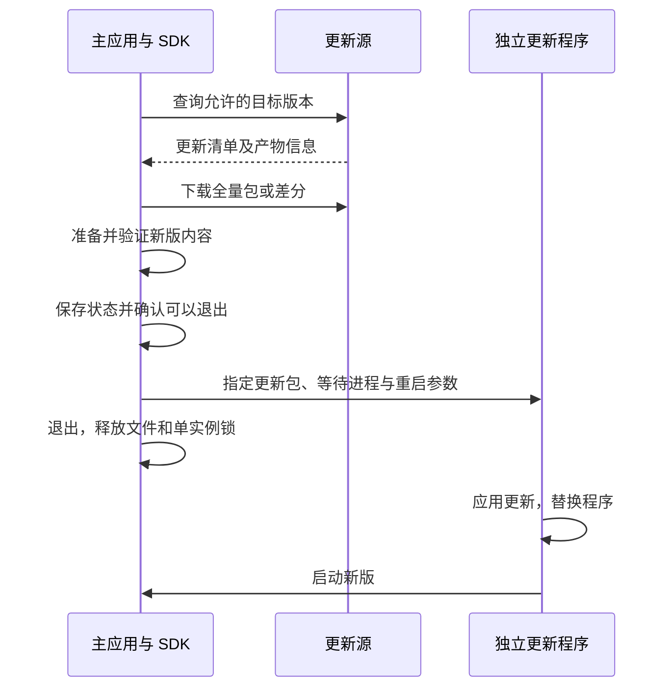

# 更新包与本地替换原理

状态：原理说明，2026-10-14。返回 [OTA 文档入口](README.md)。

## Velopack 的作用

Velopack 提供打包、客户端更新接口和平台更新辅助程序。它可以接入普通 Rust 应用，不要求把 GPUI 界面迁移为 WebView。

| 组件 | 在哪里运行 | 作用 |
| --- | --- | --- |
| `vpk` | 开发电脑或 CI | 将编译产物制成首次发行包、更新包、可选差分包和更新清单 |
| Rust SDK | 主应用进程内 | 查询更新源、比较版本、下载与准备更新、报告进度、发起应用更新 |
| 更新辅助程序 | 用户电脑上的独立进程 | 等待旧应用退出，替换本地程序，并按参数启动新版 |
| 更新源或决策服务 | GitHub / HTTP 服务端 | 提供版本和文件信息；自定义服务还可决定哪些安装有资格升级 |

独立更新程序随应用一起交付，是应用的一部分。“独立”表示它能在主进程退出后继续运行，无需用户单独安装一个软件，也不要求长期作为系统后台服务运行。Windows 上通常是 `Update.exe`，其他平台名称与路径由打包工具安排。

Windows 安装布局可简化为：

```text
应用安装目录/
├── Update.exe
└── current/
    ├── 主程序.exe
    └── 程序资源与依赖
```

辅助程序一般继承当前用户权限；目标目录不可写时仍可能需要系统授权。它负责本机文件操作，不能代替服务端灰度、产品更新提示或应用自己的数据保存逻辑。

## 下载的是什么包

| 文件 | 内容 | 用途 |
| --- | --- | --- |
| Setup / 便携发行包 / AppImage 等 | 初次运行所需应用与更新布局，具体格式依平台而定 | 首次安装或迁移旧版 |
| `*-full.nupkg` | 目标版本完整更新内容和元数据 | 全量更新，也作为差分无法使用时的兜底 |
| `*-delta.nupkg` | 从旧包还原新版所需的差异 | 减少下载量，需要可用的旧包和差分链 |
| `releases.{channel}.json` | 版本、包名、类型、摘要等 | 更新器发现可用版本和对应产物 |

`.nupkg` 底层是 ZIP 归档，但具有规定布局和元数据。现有普通 ZIP 改扩展名不能成为有效的 Velopack 更新包。首次安装包与更新包是不同用途的产物；日常 OTA 不要求用户重新运行首次安装向导。

示例只说明数据关系，不代表实际包大小或压缩率：

```text
全量下载：下载新版完整包 → 准备目标应用
差分下载：本地旧包 + 下载的差分 → 还原新版完整包 → 准备目标应用
```

Velopack 可根据本地基包、差分链和下载量选择方案，差分处理失败可退回全量。包内一个大二进制只改少量代码，也不保证差分一定很小，需用本项目产物测量。

## 更新如何落到本地



下载先落到缓存，主应用仍可运行旧代码。缓存中准备好新版本后，辅助进程等待主程序退出，再执行相应平台的文件操作。Windows 的运行中 EXE、DLL 或其他程序占用可能阻止替换，这也是独立辅助进程的重要作用。

| 平台 | 主要替换对象 |
| --- | --- |
| Windows | 安装布局中的 `current` 应用目录 |
| macOS | 整个 `.app` bundle；Finder 中像单文件，实际是目录 |
| Linux / AppImage | AppImage 文件 |

“差分下载”描述网络传输，“整体替换”描述新应用如何生效，二者并不矛盾。具体临时目录、重命名与复制步骤依平台和工具版本而异，不能把整套过程理解成运行中逐条替换机器指令，也不能承诺所有平台的更新都是单次原子文件操作。

## 与本项目状态和数据的关系

本项目设置、历史记录和单实例锁位于用户数据目录，应保持与程序安装目录分离。更新器替换程序不应删除这些数据；数据库结构变化仍需应用自己的迁移策略。

GPUI 界面、业务逻辑和内嵌资源编译在 Rust 原生程序中，需要重启应用才能执行新代码。现有退出超时信号不等于写盘成功，更新入口应等待明确的保存结果，并推迟正在休息或存在未保存设置时的安装。

文件替换失败恢复、新版启动健康确认、数据库回退是三项不同能力，不能因为调用更新 API 成功就认定三项均受保障。灰度场景下还应保证缓存包不会绕过最新撤回策略，见 [平台设计](../architecture/OTA_PLATFORM_DESIGN.md)。

## 参考资料

- [Velopack 打包产物](https://docs.velopack.io/packaging/overview)
- [差分更新](https://docs.velopack.io/packaging/deltas)
- [Windows](https://docs.velopack.io/packaging/operating-systems/windows)、[macOS](https://docs.velopack.io/packaging/operating-systems/macos)、[Linux](https://docs.velopack.io/packaging/operating-systems/linux)
- [Rust 1.2.161 更新管理实现](https://docs.rs/crate/velopack/1.2.161/source/src/manager.rs)
