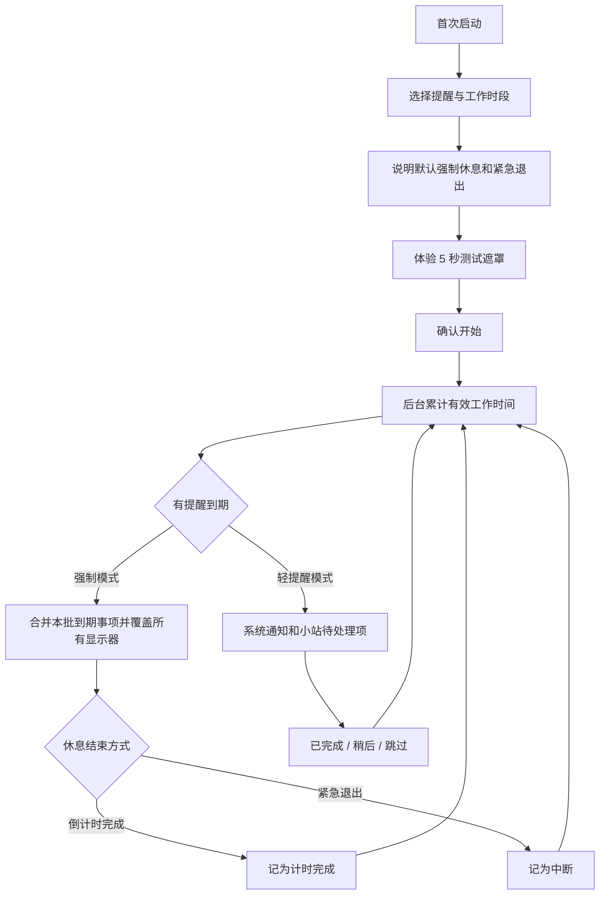
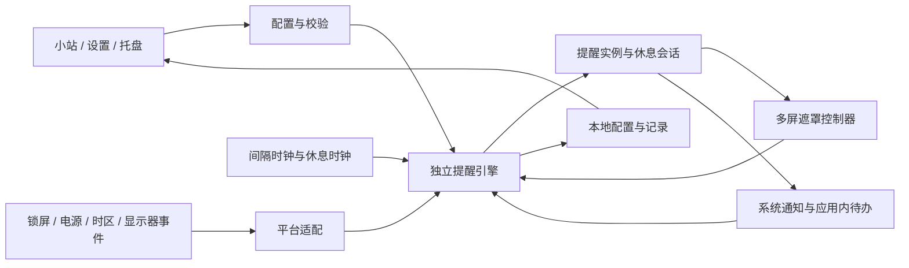

# 咕嘟扭扭放风站｜产品需求文档

> 英文名：GuluTwist Break Station  
> 简称：咕嘟扭扭  
> Slogan：**咕嘟一口，扭扭两下，放风三分钟。**  
> 文档版本：1.0（已确认实施基线）  
> 更新日期：2026-10-13  
> 状态：用户于 2026-10-13 确认，进入实施规划；初始参数按本文执行，技术与性能假设仍须验证。

本文件是产品、交互、开发和验收共用的需求基线。标记为“已确认”的内容来自用户明确输入；“建议基线”已随本次文档确认纳入首版初始方案，可根据验证结果记录调整；“待验证”表示需要技术实验或目标系统实测。需求确认不等于技术验证通过，本文不包含已实现或已通过测试的声明。任务分解与阶段门槛见[实施计划](../../task_plan.md)。

> 实施顺序调整（2026-10-13）：用户已授权先完成当前 M4 本机实现与验证，同时实现 Windows 10 / Intel Mac 代码和构建支持；外机真实运行后移，由用户按交付文档手动验证。此前 M1 的外机前置门槛不阻塞本机开发，最终兼容结论仍需实机证据。

## 1. Executive Summary（执行摘要）

### 1.1 问题定义

用户在使用电脑工作时，容易忘记喝水、活动颈肩、按需上厕所和起身活动。需要一个兼容 Windows 和 macOS、能够在合适时间提醒并方便暂停的桌面工具，帮助把照顾自己的小动作融入工作节奏。

首版面向产品提出者本人，离线使用、免登录。文档不假设已经开展外部用户访谈或验证健康改善效果。

### 1.2 产品方案

以“桌面小基地”为产品意象，提供四类提醒、可配置的间隔规则和后台常驻入口。默认到期后以多屏遮罩和倒计时启动强制休息，始终保留紧急退出；用户可以在设置中切换为轻提醒。提醒间隔仅在工作时段内累计，锁屏或休眠时暂停；已开始的休息倒计时继续按真实经过时间流逝。

### 1.3 品牌定义与文案原则

| 名称 | 含义 | 产品中的表达 |
| --- | --- | --- |
| 咕嘟 | 喝水的声音，可爱且直观 | 喝水提醒与完成反馈 |
| 扭扭 | 活动脖子、肩膀 | 颈肩活动提醒 |
| 放风 | 上厕所、离开工位走动，不尴尬 | 放风为品牌文案；设置中保留明确的功能名称 |
| 站 | 一个专门照顾用户的桌面小基地 | 主窗口、系统托盘和菜单栏入口 |

- 首次启动、关于页显示完整名称；托盘菜单、窗口标题等空间受限处可以显示“咕嘟扭扭”。
- 设置项使用“喝水”“颈肩活动”“如厕提醒”“站立活动”等清晰名称，不要求用户猜测品牌词含义。
- 文案温和、简短，不用惩罚、羞辱、连续打卡压力或健康焦虑驱动用户。
- Slogan 中的“三分钟”是品牌表达，不是所有提醒必须持续三分钟的规则。
- 如厕提醒表达为“有需要的话，去放个风”，不要求用户按固定频率排尿。
- 不提供诊断、治疗承诺、个性化饮水处方或颈部大幅旋转等动作指导。

### 1.4 目标与成功标准

以下为首版的建议验收目标。它们是待验证的产品要求，不代表现有实现已经达到。

| 编号 | 目标 | 评价口径 |
| --- | --- | --- |
| KPI-01 | 首次配置可在 3 分钟内完成 | 从首次打开到开启至少一个提醒；不包含系统授权等待与下载时间 |
| KPI-02 | 合格运行条件下，到期事件进入提醒队列的延迟 P95 ≤ 2 秒 | 合格条件为进程运行、系统唤醒、处于有效提醒时段且未暂停；通知合并与系统展示另行计量 |
| KPI-03 | 重复提醒和补发风暴为 0，紧急退出成功率 100% | 同一提醒实例最多存在一个有效待处理项；恢复后不补发旧事件；每个支持平台均验证退出所有遮罩 |
| KPI-04 | 核心行为在 Windows、macOS 上均通过验收 | 包含安装、后台常驻、通知、暂停恢复、配置持久化和退出；系统及架构清单见第 4 节 |
| KPI-05 | 后台资源占用达到明确预算 | 按第 4 节规定的测试条件实测 CPU、内存与稳定性，不以框架宣传代替测量 |

## 2. User Experience & Functionality（用户体验与功能）

### 2.1 用户与使用场景

| 场景 | 用户需要 | 体验要求 |
| --- | --- | --- |
| 专注办公 | 到时间知道该照顾自己 | 常驻后台；提醒内容一眼可辨 |
| 开会或临时忙碌 | 暂时不被打断 | 可提前暂停，或切换轻提醒；强制休息中可以紧急退出 |
| 已经主动喝水、活动 | 记录已经完成的动作 | 支持主动完成，并合理更新下一次时间 |
| 锁屏、休眠、午休、下班 | 不收到失效的提醒 | 规则明确，恢复后不补发大量旧事件 |
| 关闭主窗口 | 继续使用提醒功能 | 关闭与退出含义不同，首次操作给出解释 |
| 第二天或重新开机 | 继续沿用自己的设置 | 配置持久化，后台运行状态可见 |

### 2.2 需求状态与决策边界

| 事项 | 当前状态 | 依据或建议 |
| --- | --- | --- |
| 品牌、名称、Slogan | 已确认 | 用户明确提供 |
| 喝水、颈肩、如厕、站立四类提醒 | 已确认 | 用户明确提出 |
| Windows 和 macOS 兼容 | 已确认 | Windows 10、当前 Mac 环境和 Intel Mac；细分基线见 4.2 |
| 使用 GPUI Kit | 技术候选 | 推荐方案；框架未被指定为不可更改的约束，以平台验证结果为准 |
| 首版目标用户及公开分发范围 | 已确认 D-01 | 个人使用、离线免登录，包含本地设置、托盘和今日记录 |
| 提醒强度及窗口形式 | 已确认 D-02 | 默认强制遮罩和倒计时，保留紧急退出；可切换轻提醒 |
| 间隔与固定时刻规则 | 已确认 D-03 | 工作时段内按间隔提醒，锁屏和休眠暂停间隔 |
| 系统版本及架构 | 已确认目标 D-04 | Windows 10；当前 macOS 环境；额外支持 Intel Mac。细分版本基线见 4.2 |
| 休息倒计时的暂停规则 | 已确认 D-05 | 锁屏和休眠期间继续；回来时已到时则结束遮罩 |
| 工期与预算 | 未指定 | 按里程碑安排，不虚构日期或预算 |

### 2.3 首版建议范围

**必须完成（P0）：**四类提醒的独立开关与配置、工作时段内的间隔计时、默认强制遮罩与倒计时、紧急退出、轻提醒模式、全局暂停、多屏行为、Windows 托盘与 macOS 菜单栏入口、通知与降级说明、今日记录和主动完成、配置持久化、锁屏与睡眠恢复、单实例、三个目标平台架构的安装运行与卸载说明。

**建议完成（P1）：**可选提示音、开机启动设置、浅色/深色/跟随系统主题、设置恢复默认。公开发布时，必要的签名、隐私说明和升级验证提升为发布门槛。

P0 为首版发布门槛；P1 是可裁剪范围。用户在澄清中选定的必要交互应提升至 P0，不能仅因原本归类 P1 而省略。

### 2.4 首版非目标

以下为已确认个人离线方向下的首版范围边界。

- 账号、服务器、跨设备同步、社交排名、团队监督和广告。
- 手机端、浏览器端、Linux 端，以及跨设备通知联动。
- 自动识别用户是否喝水、是否如厕、颈部姿势或真实站立时长。
- 医疗建议、健康效果预测、摄像头监测及可穿戴设备接入。
- 番茄钟、待办清单、桌面宠物养成、积分商店等独立产品体系。
- 自动监听会议、读取应用标题、捕获屏幕内容、键盘内容或麦克风。
- 操作系统级锁定、禁用系统快捷键、阻止强制结束进程或要求管理员权限才能退出。产品“强制休息”指当前用户桌面的应用遮罩，不是系统安全锁屏。
- 每天固定时刻、按日历节假日调整、跨时区同步日程，以及每个提醒分别指定不同提醒模式；首版使用全局强制/轻提醒模式。

### 2.5 信息架构与页面职责

| 界面 | 主要内容 | 主要操作 |
| --- | --- | --- |
| 首次引导 | 品牌、选择提醒、提醒时段、提醒方式、通知测试 | 启用提醒、跳过可选设置 |
| 今日小站 | 全局运行状态、四类提醒卡片、下一次提醒、今日完成次数 | 主动完成、编辑单项、暂停/恢复 |
| 提醒设置 | 单项开关、间隔、强制休息时长 | 保存、取消 |
| 偏好设置 | 工作时段、全局提醒模式、启动与关闭行为、本地数据，以及已交付的 P1 项 | 保存、测试通知、清理记录 |
| 强制休息遮罩 | 本次事项、剩余时间、温和文案、紧急退出 | 等待计时完成、紧急退出 |
| 轻提醒详情 | 到期事项、合并提醒列表 | 已完成、稍后、跳过 |
| 托盘/菜单栏菜单 | 当前状态、下一次提醒、快捷入口 | 打开小站、暂停、恢复、退出 |
| 关于与帮助 | 名称、版本、数据说明、通知问题排查 | 查看本地数据位置、打开系统通知设置（可行时） |

仅展示已纳入首版的功能。隐藏或禁用的 P1 功能不得保留无法使用的入口；未启用的提醒不展示倒计时。

### 2.6 初始配置与输入规则

下表中四类提醒的间隔与休息时长均为可在设置中修改的建议默认值；不是医疗建议，也不是用户已确认的健康频率。

| 提醒 | 默认间隔 | 默认强制休息时长 | 提醒文案示例 |
| --- | --- | --- | --- |
| 咕嘟喝水 | 60 分钟 | 30 秒 | 咕嘟一口，给自己一点水分。 |
| 扭扭颈肩 | 45 分钟 | 60 秒 | 放松一下肩膀，轻轻活动到舒适的位置。 |
| 如厕放风 | 120 分钟 | 180 秒 | 有需要的话，去放个风，顺便离开工位走走。 |
| 站立活动 | 60 分钟 | 120 秒 | 站一站，让身体换个姿势。 |

| 设置项 | 初始值或约束 |
| --- | --- |
| 提醒启用 | 首次引导预选四项；用户点击“开始照顾自己”后才启动计时 |
| 全局模式 | 强制休息；可切换轻提醒 |
| 工作日 | 周一至周五，可多选任意星期 |
| 工作时段 | 09:00–12:00、13:00–18:00，跟随系统本地时区；首次引导可修改 |
| 时段数量 | 每个选中工作日共用 1–4 个时段；开始含边界、结束不含边界 |
| 全天配置 | 支持 00:00–24:00；跨午夜时段需拆成两个时段 |
| 间隔输入 | 整数分钟，5–240 分钟；空值、负数、非整数与越界值不可保存 |
| 休息时长输入 | 5–1800 秒，以“分、秒”输入，秒字段为 0–59；保存时校验总秒数 |
| 轻提醒稍后选项 | 5、10、15 分钟，默认 5 分钟 |
| 全局暂停选项 | 15 分钟、1 小时、直到下一工作日、手动恢复 |
| 恢复缓冲 | 解锁、唤醒或一场强制休息结束后，新的提醒至少等待 60 秒；不延迟关闭已经到时的休息遮罩 |
| 提示音 | 默认关闭；仅交付 P1 提示音功能后提供开关 |
| 开机启动 | 默认关闭；仅用户主动打开后注册系统启动项 |
| 记录保留 | 本地保留最近 30 个自然日，主界面首版只展示今日 |

时段不能为空、不得重叠；相邻时段合并为一个连续区间。未选择任何工作日时不可开启提醒，须提示“请选择至少一个提醒日”；需要暂时不用应使用暂停功能。所有提醒均关闭属于有效状态，显示“所有提醒已关闭”。恢复缓冲、记录保留、暂停选项集合和输入上下限为首版内置规则，不增加对应高级配置入口。

### 2.7 核心用户流程

- 测试遮罩为可跳过的演示，始终可紧急退出；不计入今日记录，不消耗正式提醒间隔。
- 首次引导不要求登录或网络访问；强制模式不依赖系统通知授权才可使用。
- 切换轻提醒时说明通知用途，提供“发送测试通知”和系统设置入口；拒绝授权不反复弹请求。
- 进入小站后，用户在不超过两次操作内完成全局暂停，在不超过三次操作内切换提醒模式。

### 2.8 计时、合并与恢复规则

**两个独立时钟：**“提醒间隔”累计符合条件的使用时间；“休息倒计时”累计休息开始后的真实经过时间。前者在锁屏、休眠和强制休息期间暂停，后者在锁屏或休眠期间继续。未操作键鼠不等于离开电脑，首版不采集输入活动来推断空闲。

| 规则 | 明确行为 |
| --- | --- |
| S-01 有效时间 | 进程运行、处于工作时段、电脑未锁屏/休眠、未全局暂停且没有正在进行的强制休息时，累计各已启用提醒的间隔 |
| S-02 首次/再次启动 | 在工作时段内从完整间隔开始；在时段外等待下一时段。应用退出期间不累计，不追溯补发 |
| S-03 工作时段切换 | 时段结束后停止计时、撤回应用内提醒、结束尚未完成的遮罩；未处理项记为“已取消：时段结束”。已经在边界前到时的休息仍按完成结算。下一时段各项从完整间隔开始 |
| S-04 完成后的间隔 | 用户手动完成、强制计时完成、主动完成、跳过或紧急退出后，该项重置为完整间隔；其他项保留剩余间隔，但强制休息结束或退出后须满足 S-12 的缓冲 |
| S-05 强制休息期间 | 暂停全部提醒间隔，不产生新的强制休息队列。合并事项共享一场休息，时长取其中最大值，不相加；结束后全部合并事项按同一结束原因结算 |
| S-06 同批到期 | 同一调度轮次、相差不超过 1 秒的事项合为一批，不提前拉入尚未到期的事项。首个到期事项等待合并不超过 1 秒 |
| S-07 轻提醒防刷屏 | 首次通知后 60 秒内的新事项加入待处理列表，不追加声音或弹窗；冷却结束后对尚未通知且仍待处理的事项发送一次摘要。通知延迟须与正常到期误差分开统计 |
| S-08 稍后提醒 | 仅轻提醒提供；5/10/15 分钟按有效时间累计，期间不再生成该项常规实例。允许再次稍后，不计为完成；跨工作时段则取消并按 S-03 重置 |
| S-09 无响应 | 轻提醒实例在发出通知请求后 2 分钟有效时间内未被处理，记为“未处理”，撤销其应用内待办并重置间隔；不升级为强制模式，不反复响铃。OS 是否展示不可推断 |
| S-10 锁屏/休眠 | 保存等待中间隔与稍后倒计时的剩余值并暂停。普通轻提醒待处理项取消并重置本项间隔；已开始的强制休息按 S-11 处理 |
| S-11 休息中锁屏/休眠 | 休息继续经过；解锁时已到时则记为“计时完成”，不得再次显示遮罩。尚未到时则只显示剩余时间，不重新开始；若跨工作时段，按休息到时与时段结束的实际先后结算，同刻时段结束优先 |
| S-12 恢复缓冲 | 解锁、唤醒或强制休息完成/退出后，等待中事项保留剩余值，但距离新一次提醒不得少于 60 秒；以两者较大值继续累计有效时间。正在恢复的同一场休息不属于新提醒，不适用此缓冲 |
| S-13 全局暂停 | 等待中事项冻结剩余值；稍后项冻结剩余值；普通待处理项与强制休息取消，不计完成，涉及事项重置间隔。定时暂停按真实经过时间到期；恢复后仍须满足工作时段和解锁条件 |
| S-14 修改设置 | 改间隔或开关：取消该项旧实例并从新完整间隔开始；改工作时段：重置全部间隔；改全局模式：取消当前实例和遮罩，全部重新计时；改休息时长：下一实例生效 |
| S-15 日期/时区变化 | 工作时段按新的本地时间重算，不补发过去事件；同一工作时段内的手动调时不改变已累计的有效时间或休息剩余时间；跨出工作时段则 S-03 优先 |
| S-16 幂等处理 | 每个实例有唯一标识。重复点击、延迟到达的通知回调、旧设置产生的回调，最多结算一次；过期回调仅打开小站并提示“这条提醒已结束” |

**事件裁决：**首先按实际发生时间处理；同刻采用“退出/暂停/禁用/时段结束等取消条件 → 锁屏与休眠状态 → 现有休息完成 → 用户处理 → 新事项到期”的顺序。边界取消与完成发生在同一时刻时记取消；已经提交的终态不再改写。休眠后补算休息终态时，使用推算的实际结束时间而非唤醒时间记账。开发测试须固定时钟验证这些竞态。

**算例：**仅启用喝水提醒，10:00 开始一个 60 分钟的间隔，10:20 锁屏，10:40 解锁；其他条件不变时，喝水在 11:20 到期。若用户将该项休息时长设为 2 分钟，在 11:20 开始休息，11:20:30 锁屏、11:25 解锁，这场休息已在 11:22 完成，不能再要求用户等待 90 秒。若 11:59 开始 3 分钟休息而工作时段在 12:00 结束，则在 12:00 取消，不记计时完成。

### 2.9 强制休息模式（默认）

#### 2.9.1 遮罩与多屏

- 到期后在当前用户会话的全部活动显示器上显示应用遮罩，遮挡下方普通应用；无边框，禁止点击穿透。不能使用截图作为背景，也不请求录屏权限。
- 主交互面板优先显示在当前鼠标所在显示器，其余显示器显示同一场休息的状态、倒计时和紧急退出按钮。任意显示器退出应关闭全部遮罩。
- 倒计时是全局共享状态，不因屏幕数量产生多次记录；各屏显示误差不超过 1 秒。
- 覆盖内容包括事项名称、剩余时间、简短提示和始终可见的“紧急退出本次休息”按钮。时间使用“分:秒”，不只用进度环表达。
- 原则上每秒更新可见倒计时，不使用常驻高帧率动画；尊重系统减少动态效果设置。
- 屏幕接入、拔出、主屏切换、分辨率或缩放变化时重新布局，保持计时；活动屏幕上的退出入口不可丢失。
- macOS 多 Space、全屏应用和 Windows 虚拟桌面是专项验证项。首版不承诺覆盖登录界面、安全桌面、系统授权窗口，或拦截操作系统保留快捷键。

#### 2.9.2 开始、完成和退出

- 强制模式不提供常规“稍后”或“提前完成”按钮；计时结束自动撤下全部遮罩，恢复此前可恢复的窗口焦点。
- “紧急退出本次休息”按钮单击生效；遮罩拥有焦点时，`Esc` 同样立即解除，不要求输入密码、长按、二次确认或额外等待。
- 紧急退出只结束本次休息，不退出整个应用；本次记录为“中断”，关联事项重新计时，不在下一秒再次遮罩。
- 强制模式属于用户选择的应用级约束，用户仍可通过系统操作切换或结束进程。不得为阻止绕过而拦截系统恢复能力。
- 休息完成只表示计时完成，不能表示应用检测到了喝水、如厕或颈肩动作。记录中区分“计时完成”和“手动完成”。
- 会话开始时固定涉及事项和时长；用户修改其他配置或重复收到系统事件，不得延长当前休息。
- 遮罩创建不完整、焦点或退出路径不可用时，应撤销整场遮罩并降级为本次轻提醒，保留同一实例标识；提示故障原因。不得留下透明但截获输入的窗口。

#### 2.9.3 休息文案

| 位置 | 文案示例 |
| --- | --- |
| 单项标题 | 咕嘟时间到了 |
| 合并标题 | 一起放个风吧 |
| 合并说明 | 喝水 · 站立活动，本次休息 2 分钟 |
| 常驻提示 | 有急事可随时退出本次休息 |
| 正常结束 | 这次休息结束了，慢慢回到工作中。 |
| 紧急退出后 | 已结束本次休息，下次提醒时间已更新。 |

### 2.10 轻提醒、暂停和桌面入口

**轻提醒：**到期后提交系统通知，并在小站保留同一待处理项；不抢占焦点、不创建遮罩。点击通知打开小站的对应事项。系统通知操作按钮在不同系统上可能不同，完整的“已完成 / 稍后 / 跳过”始终在应用内提供，不依赖系统按钮。

**通知权限与免打扰：**不将 API 调用成功写成“已送达”；未能确认系统是否展示时标记为“已发出提醒”。权限关闭时显示固定状态提示和可操作的设置入口；保留应用内待处理列表，不能在用户选了轻提醒后自动升级为强制遮罩。无法直接检测权限的平台显示“状态未知，请发送测试通知”。

**全局暂停：**小站和托盘都显示原因与截止时间。暂停 15 分钟/1 小时按现实经过时间计算；“直到下一工作日”指下一个选中的星期对应日期的首个工作时段，不是当天午休后的时段。用户可随时手动恢复。不同暂停条件重叠时，只有全部解除才可提醒。

**托盘/菜单栏：**固定提供“打开咕嘟扭扭”“下一次提醒/当前状态”“暂停提醒”“恢复提醒”“退出”。不同系统使用其自然的点击/菜单行为，不强行统一单双击。菜单打开时更新状态，不每秒更换托盘图标或文字。

**关闭与退出：**主窗口关闭后隐藏到托盘/菜单栏并继续计时，首次关闭只说明一次；菜单“退出”才结束进程并关闭全部遮罩。再次启动不补发退出期间的提醒。重复启动只激活现有实例，不启动第二个调度器。

**主动完成：**用户可在小站点击某项“我已完成”，记一条手动记录并重置该项间隔。相同提交只计一次；存在待处理或稍后实例时一并结算；强制休息期间须先紧急退出，不能通过其他窗口悄悄提前完成。

### 2.11 今日记录与数据规则

- 按事项展示今日“计时完成”“手动完成”次数及最近一次时间；“跳过”“中断”“未处理”可在今日列表查看。
- 首页汇总同时显示“休息场次”和“事项完成次数”：合并两项的一场休息，场次为 1，事项计时完成次数为 2，不能混用。
- 测试遮罩、通知测试、取消的旧实例不增加完成次数；重复回调不重复计数。首版不展示无法可靠定义的健康达标率。
- 记录按事件结束时的本地日期归属，保存当时 UTC 时间、时区/偏移和本地日期；之后更改时区不重写历史日期。
- 00:00 后今日统计切换到新一天；跨日会话在结束日结算，不因日期切换重复结束。
- 用户可清空全部记录，需二次确认；保留提醒配置。历史保留最近 30 个自然日，到期自动清理，不上传。
- 恢复默认设置与清空记录是两个不同操作；若交付恢复默认功能，必须说明影响并二次确认。

### 2.12 用户故事与验收标准

| 编号 / 优先级 | 用户故事 | 可验证的验收标准 |
| --- | --- | --- |
| US-01 / P0 | 作为首次使用者，我希望快速配置小站，以便当天开始使用。 | 无网络可完成引导；四类提醒可独立选择；默认强制模式说明清晰；测试遮罩可退出且不写记录；确认前不启动正式提醒 |
| US-02 / P0 | 作为使用者，我希望分别设置提醒间隔和休息时长，以便符合自己的节奏。 | 使用 2.6 的校验；错误显示在字段旁并保留输入；保存后按 S-14 生效；取消不修改配置；重启后配置一致 |
| US-03 / P0 | 作为使用者，我希望只在工作时段被提醒，以便午休和下班不受影响。 | 支持星期与多时段；边界按 S-03；锁屏和休眠不累计间隔；午休、调时及跨日测试无旧事件补发 |
| US-04 / P0 | 作为容易忽视通知的人，我希望默认遮罩并倒计时，以便停下工作休息。 | 到期在活动显示器显示遮罩；时长与配置一致；普通下层应用不接收点击；合并不叠加时长；到时关闭全部遮罩 |
| US-05 / P0 | 作为遇到紧急工作的人，我希望立即退出休息，以便处理当前事务。 | 任意遮罩按钮和获得焦点时的 Esc 均可退出；所有遮罩在 1 秒内关闭；只记一次中断；不立即重弹；不结束后台进程 |
| US-06 / P0 | 作为在会议中的使用者，我希望切换轻提醒，以便保持工作连续性。 | 模式切换取消旧会话并重新计时；轻提醒不遮罩、不抢焦点；通知点击打开对应事项；三种处理操作齐全；拒绝通知授权不崩溃 |
| US-07 / P0 | 作为临时离开的人，我希望快速暂停并恢复，以便不用关闭软件。 | 小站与托盘均可操作；显示暂停期限；期限过去但仍锁屏/非工作时段时不提醒；按规则恢复剩余时间 |
| US-08 / P0 | 作为离开电脑休息的人，我希望锁屏后仍计算休息，以便回来不用重复等待。 | 休息中锁屏/休眠前后的时长一致；到时后解锁没有旧遮罩；未到时只显示剩余值；实例仅结算一次 |
| US-09 / P0 | 作为希望桌面整洁的人，我希望关闭窗口后提醒继续，以便不占用工作区。 | 首次关闭说明明确；隐藏后计时与提醒正常；托盘能重开；退出后不再有进程发提醒；重复启动不产生重复通知 |
| US-10 / P0 | 作为已经主动活动的人，我希望记录完成情况，以便下一次提醒更合理。 | 主动完成重置本项；今日计时完成与手动完成可区分；合并场次与事项次数正确；跨日与清空记录符合 2.11 |
| US-11 / P0 | 作为使用不同电脑的人，我希望 Windows 与两类 Mac 行为一致，以便无需重新学习。 | Windows 10 x64、macOS Apple Silicon、macOS Intel 的安装包分别完成第 4.2 和 5.3 节验收；仅交叉编译成功不算通过 |
| US-12 / P0 | 作为担心应用影响工作的人，我希望错误可恢复，以便不会被失效遮罩困住。 | 遮罩部分创建失败会撤下全部遮罩；旧通知点击不会再结算；配置损坏有可恢复提示；应用崩溃后 OS 释放遮罩窗口；重新启动按 S-02 |
| US-13 / P1 | 作为每天使用的人，我希望登录后自动启动，以便不用记住打开软件。 | 默认关闭；打开/关闭设置分别注册/移除启动项；失败不显示为已开启；启动后按工作时段计时；卸载不残留启动项 |
| US-14 / P1 | 作为有外观或声音偏好的人，我希望调整主题与提示音，以便适合自己的环境。 | 主题跟随/切换不丢配置；默认无声；合并提醒只响一次；静音和减少动态效果生效；未交付功能不显示空入口 |

### 2.13 交互、无障碍与异常状态

- 风格采用温和、可爱的桌面小基地表达；功能名称和操作文字优先于装饰。具体配色、插画和吉祥物由后续设计确定，不在 PRD 中虚构已批准的视觉稿。
- 主窗口建议初始 800×600 逻辑像素，最小 640×480；较小可用工作区允许滚动。不同 DPI 下不截断保存、取消和紧急退出入口。
- 支持键盘 Tab/Shift+Tab 导航与明确焦点样式；按钮具有无障碍名称。倒计时不每秒向读屏器重复播报，开始、结束和主动查询提供可理解信息。
- 正文和按钮标签对比度目标符合 WCAG 2.2 AA 的适用要求；状态不能仅通过颜色区分。强制遮罩仍应能读出紧急退出入口。
- 首版界面为简体中文，英文产品名用于品牌与包信息；完整英文翻译不作为首版门槛。

| 状态 | 用户看到什么 | 恢复方式 |
| --- | --- | --- |
| 非工作时段 | 现在休息中，下次开始：周一 09:00 | 修改时段或等待，不误显示“暂停到某时” |
| 全部提醒关闭 | 所有提醒已关闭 | 打开至少一项 |
| 手动暂停 | 已暂停，等待手动恢复 | 恢复按钮 |
| 通知不可用 | 系统通知可能无法显示 | 测试通知、系统设置、应用内待处理项 |
| 多屏遮罩失败 | 本次已改为轻提醒，强制休息未成功启动 | 正常处理本次提醒；保留诊断信息，不静默反复重试 |
| 保存失败/磁盘满 | 未保存，当前设置未改变 | 保留表单输入，允许重试；不显示成功 |
| 配置文件损坏 | 上次设置无法读取，提醒暂未启动 | 从上个有效配置恢复或确认使用默认配置；不自动强制遮罩 |
| 记录写入失败 | 本次记录未保存 | 优先解除遮罩，保留内存待重试记录；不因写盘失败困住用户 |

## 3. AI System Requirements（AI 系统需求）

本产品首版不包含 AI 功能，不依赖模型、AI API 或在线推理；无需编写 AI 评测方案。提醒内容采用可审核的本地文案，不通过 AI 生成健康建议。

## 4. Technical Specifications（技术约束与规格）

### 4.1 技术候选及验证边界

- 语言与框架候选：Rust + GPUI Kit；Cargo 用于依赖管理、构建与测试。
- 提醒规则和计时状态应独立于界面框架，避免关闭窗口导致提醒停止，也便于验证计时行为。
- Windows 托盘、macOS 菜单栏、开机启动、锁屏和电源事件属于平台适配工作，不能仅凭 GUI 框架支持平台便认定完成。
- GPUI Kit 官方安装文档当前列出 Windows 10+、macOS 15+ 的开发环境要求。此处记录的是官方安装指南，不将其直接等同于已验证的应用最低运行版本。
- 实际最低系统版本、Intel Mac 支持及 GPU/驱动要求必须通过打包程序在目标系统上验证后确定。
- GPUI Kit 的系统通知能力已存在官方文档，但 macOS 需要真实 `.app` 包和授权环境进行验证；普通开发进程调用成功不等于用户收到通知。

### 4.2 平台、架构与分发要求

2026-10-13 本机只读检查结果：**macOS 15.7.3（24G419）、arm64、Apple M4**。系统版本满足当前 GPUI Kit 安装指南的 macOS 15+ 要求。这是环境核对，不是应用运行验证；当前电脑也不能替代 Intel Mac 的实机验收。

| 目标 | 首版基线 | 验证要求 | 分发形式 |
| --- | --- | --- | --- |
| Windows x64 | Windows 10，建议以 22H2 作为最低测试版本 | 干净用户环境完整验收；Windows 11 x64 追加兼容冒烟 | 含程序、图标、卸载入口的用户级安装包；不要求用户安装 Rust |
| macOS Apple Silicon | macOS 15 系列；首台验收机为 15.7.3 / M4 | arm64 原生包完整验收 | 正确的 `.app` 包，个人版可使用 ZIP 或 DMG 分发 |
| macOS Intel | macOS 15 系列，Intel x86_64 | Intel 实机运行通知、遮罩、睡眠恢复、托盘与安装包；不能只依赖交叉编译 | x86_64 独立包或经验证的 Universal 包 |

- Windows 10 的细分版本及 macOS 15 系列为文档建议基线；不承诺 macOS 14 及更早系统。新系统版本需要回归后列入发布支持清单。
- 首版不包含 Windows ARM 原生包；Apple Silicon 支持采用原生 arm64，不以 Rosetta 作为默认方案。
- GPU/驱动最低要求以最小验证程序实测及所锁定 GPUI 版本要求为准。兼容性门槛未通过时，不得仅通过更改 PRD 宣称已兼容；应调整实现或记录明确的需求变更。
- 包名、显示名、Bundle ID/应用标识、数据目录和通知身份在首次可用包前确定并保持稳定；标识为实现决策，不擅自指定用户持有的域名。
- 卸载退出进程、关闭遮罩并移除本应用注册的启动项；明确告知本地设置与记录是否保留，清除个人数据由用户显式选择。
- 首版个人分发不依赖应用商店、付费订阅或发布服务器。公开发布时补齐适用的签名、公证、发布说明和安装信任流程。
- 更新采用用户手动下载并覆盖安装，需保留设置和历史；首版不后台下载更新。迁移前保留可恢复的数据备份。

### 4.3 架构与模块边界

| 模块 | 职责与边界 |
| --- | --- |
| 提醒引擎 | 执行 S-01 至 S-16，输出明确事件；不直接创建窗口；可注入测试时钟 |
| 工作时段服务 | 解释本地星期和时段；计算下个边界；处理时区/日期变化 |
| 休息会话管理 | 合并事项、固定时长、幂等结算；同一时间最多一场强制休息 |
| 遮罩控制器 | 在主线程管理所有显示器窗口和焦点；成功/失败回传；任意退出关闭整组窗口 |
| 平台适配 | 托盘、通知、锁屏、休眠、显示器、自动启动、安装身份与相关权限差异 |
| 本地存储 | 配置事务保存、记录写入、保留期清理和版本迁移；存储失败不阻塞遮罩解除 |
| 展示层 | 渲染共享状态并提交用户意图；不在窗口内单独维护第二套计时器 |

间隔使用不受系统时间手动调整影响的时间源，且只累计有效区间。休息时钟必须计入休眠经过时间，同样不能被手动改系统时钟任意延长或提前；选择平台支持的连续时钟或等价适配方案，并以休眠与调时测试验证，不能假设所有平台的普通单调时钟都计入休眠。

休眠期间进程可能完全不执行代码。所谓“倒计时继续”指恢复后根据可信经过时长立即结算，不要求进程在机器休眠时唤醒 CPU。若恢复时工作时段已经改变，先比较休息到时与原工作时段结束的实际先后：先到时则完成，先结束时段则取消；不得补弹旧遮罩。

应用关闭前和关键状态变更时保存必要状态；冷启动总是按 S-02 重新计时。若检测到上次未正常结束的会话，记录为“中断：应用退出/异常恢复”，不恢复旧遮罩，不补记计时完成。

### 4.4 数据对象与持久化

存储建议使用本地 SQLite 或具有同等事务能力的嵌入式存储；最终库由工程验证决定。无需后端、身份认证、远程 API 或云数据库。

| 对象 | 最小字段 |
| --- | --- |
| AppSettings | schema_version、onboarding_completed、global_mode、工作日与时段、暂停状态/截止时间、已交付偏好项 |
| ReminderConfig | stable_id、类型、enabled、interval_seconds、break_duration_seconds、配置版本 |
| ReminderInstance | instance_id、reminder_id、配置快照、到期时间、通知请求时间、状态、稍后剩余时间、结束原因 |
| BreakSession | session_id、关联实例列表、开始时间与连续时钟基准、总时长、状态、结束时间/原因 |
| ActivityRecord | record_id、实例/会话关联、事项类型、计时/手动来源、终态、UTC 时间、时区偏移、归属本地日期 |

- `ReminderInstance` 建议状态：待处理、稍后、休息中、计时完成、手动完成、跳过、中断、未处理、取消。后六类为终态，不能再次转为待处理。
- 主动完成也使用唯一事件标识；更新本项间隔和写入记录采用事务或等价幂等机制。
- `BreakSession` 与事项记录分开，避免把一场合并休息误计为多场。
- 暂停截止时间需要持久化；重启后未到期的手动/定时暂停仍生效。未暂停的事项按 S-02 重新计时，不沿用无法核实的旧进程计时基准。
- 配置保存成功后才替换运行配置；保存失败保留旧运行规则。旧版本数据迁移失败不得静默删除，保留备份并停止自动强制提醒。
- 计时与记录所需时间精度为秒；对用户展示本地时间，内部事件保留足够精度处理同批到期和去重。

### 4.5 安全、隐私和系统权限

- 首版全离线，核心功能不发起网络请求；没有遥测、第三方分析、账号、广告或远程日志上传。
- 不采集摄像头、麦克风、录屏、键盘内容、应用标题、浏览记录和真实健康状态。
- 只监听实现计时所需的锁屏、电源及显示器状态；不为“强制休息”申请设备管理权限或安装系统驱动。
- 系统通知和开机启动按用户选择启用；若平台 API 需要额外权限，先说明用途、拒绝后影响，并提供可用的降级路径。
- 强制遮罩不可阻止系统紧急操作；无隐藏退出入口、无密码锁定、无篡改系统免打扰设置。
- 本地数据位于当前用户的标准应用数据目录，正常运行不需要管理员权限。
- 日志只记录定位问题必要的事件与错误，避免输出自定义私人文本和完整路径；默认不记录其他应用信息。诊断日志轮转并限制总量，建议上限 10 MiB。
- “今日记录”为本地行为记录，不宣称检测或证明实际健康动作；隐私说明在关于页可查看。

### 4.6 非功能要求与测量方法

以下数值为建议工程预算；阶段 M1 应取得基线实测，若无法满足需明确提出差异与调整方案，不能直接写成“已优化”。

| 编号 | 要求 | 测量方法与通过条件 |
| --- | --- | --- |
| NFR-01 | 到期处理可靠 | 注入时钟验证全部边界；实机正常唤醒环境连续运行 8 小时，到期入队延迟 P95 ≤ 2 秒，无重复实例 |
| NFR-02 | 遮罩解除可靠 | 支持平台逐项执行按钮、Esc、计时完成、暂停、退出、异常降级；触发到全部应用遮罩撤下 ≤ 1 秒 |
| NFR-03 | 常驻 CPU | Release 构建，主窗口隐藏、无活动遮罩，稳定 5 分钟后采样 30 分钟；总进程 CPU 平均 ≤ 单个逻辑核的 0.5%；报告归一化方式 |
| NFR-04 | 常驻内存 | 同上条件，统计本应用及辅助进程；Windows 工作集/macOS RSS 的 P95 目标 ≤ 200 MiB，注明指标差异；不把活动多屏帧缓冲计入空闲样本 |
| NFR-05 | 长时间稳定 | 连续 8 小时包含至少 20 次遮罩开关、10 次锁屏恢复；无崩溃、无残留窗口，预热后空闲内存增长 ≤ 30 MiB |
| NFR-06 | 启动与响应 | Release 本地安装版冷启动到主窗口可操作 ≤ 3 秒；常规界面操作反馈 ≤ 200 毫秒，不包含系统授权与磁盘故障 |
| NFR-07 | 后台节能 | 无可见倒计时时不运行每秒 UI 重绘；按最近有效截止时间和系统事件唤醒；托盘无持续动画 |
| NFR-08 | 显示与输入 | 100%、150%、200% 缩放，单屏/双屏/混合 DPI 下文字与退出入口可见；快捷键、Tab 和读屏名称可用 |
| NFR-09 | 数据可靠性 | 保存后重启一致；重复事件只记一次；清理历史不改配置；磁盘满/配置损坏不产生失控遮罩 |
| NFR-10 | 离线可用 | 断网后引导、设置、计时、遮罩、记录、暂停和退出均可用；无网络重试导致的后台资源异常 |

测量报告必须记录 OS 版本、CPU/GPU、内存、屏幕数量和分辨率、构建版本、采样工具。M4 本机是首个基准；Windows 10 与 Intel Mac 基准机需在 M1 准备，不能用单台 M4 的结果代替其余平台。

## 5. Risks & Roadmap（风险与路线图）

### 5.1 决策记录与假设清单

| 编号 | 决策问题 | 结论 | 对需求的影响 |
| --- | --- | --- | --- |
| D-01 | 首版用户与范围 | 用户确认个人离线、免登录，做好核心功能 | 不做账号、云端和公开运营体系 |
| D-02 | 默认提醒方式 | 用户确认默认强制遮罩与倒计时、保留紧急退出，设置可切换轻提醒 | 强制与轻提醒均为 P0；首版不默认温和模式 |
| D-03 | 提醒规则 | 用户确认工作时段内按间隔、锁屏休眠暂停间隔 | 不做固定时刻；保留有效时间模型 |
| D-04 | 系统兼容目标 | 用户要求 Windows 10、当前 Mac 可用，并额外支持 Intel Mac | 建议采用 4.2 的版本/架构清单；本机已核对为 M4 + macOS 15.7.3 |
| D-05 | 休息中锁屏或休眠 | 用户确认休息倒计时继续，到时后恢复不再遮罩 | 独立休息时钟；休眠恢复成为 P0 验收 |

| 假设 | 状态 | 处理方式 |
| --- | --- | --- |
| GPUI Kit 能满足多屏遮罩、Windows 10 和 Intel Mac | 待技术验证 | M1 先完成最小验证；失败时允许调整适配或框架，保持已确认体验目标 |
| 默认间隔、休息时长、工作时段、暂停选项适合首位用户 | 已采纳的初始方案，适用性待试用 | 可配置项由用户调整；内置选项按 2.6 执行，变更时同步需求，不视为健康标准 |
| macOS 15 系列可以作为首版最低目标 | 建议基线 | 符合本机系统和框架安装文档；Intel 实机验证；更旧系统暂不承诺 |
| 有可访问的 Windows 10 与 Intel Mac 测试设备 | 待准备 | 发布前必须取得实测证据，不把缺少设备当作已兼容 |
| 性能预算可达成 | 待实测 | 先取 Release 基线，识别常驻、可见倒计时与多屏遮罩的差异 |
| 截止日期和付费发布预算 | 用户未指定 | 使用里程碑，不承诺日期；个人版不引入不必要的付费服务 |

### 5.2 风险与应对

| 风险 | 影响 | 应对及通过门槛 |
| --- | --- | --- |
| GPUI Kit/GPUI 的平台或 API 差异 | Intel 或 Windows 10 无法运行，升级引入回归 | 锁定依赖；M1 在目标架构运行安装包；先验证再确定框架版本 |
| macOS 全屏 Space、虚拟桌面或多屏遮罩不完整 | 看似强制但部分屏幕可继续操作，或残留窗口 | 明确正常用户桌面的保证边界；热插拔与 Space 专项测试；失败撤下整组遮罩并告知降级 |
| 遮罩控制器故障 | 用户无法继续工作 | 所有屏幕有退出按钮；Esc；窗口生命周期统一管理；错误路径优先撤下窗口 |
| 系统通知权限/免打扰 | 轻提醒可能不可见 | 本地待处理项和通知测试；不声称已送达；不擅自升级提醒强度 |
| 休眠、调时和工作时段叠加 | 误计时、补发、重复遮罩 | 双时钟、裁决优先级、去重标识、可注入时钟测试和实机睡眠测试 |
| 默认强制模式干扰工作 | 用户直接退出或停用 | 首次说明、可演示、紧急退出、托盘暂停、轻提醒切换；默认间隔可配置 |
| 常驻 GPU/UI 消耗偏高 | 电量与内存不符合小工具预期 | 隐藏时不持续绘制、事件驱动调度；用 NFR 预算实测 |
| 签名/应用身份或打包问题 | macOS 通知失效、升级丢设置 | 稳定应用身份；使用真实包验证；公开分发阶段补足签名与公证 |
| 数据保存或迁移失败 | 配置丢失或记录重复 | 事务、版本号、备份、错误提示；存储失败不阻塞紧急退出 |

### 5.3 验收场景与需求追踪

下表是实现完成后的执行清单，目前均未执行。自动化验证规则与状态，桌面实测验证系统行为；不能以单测通过替代多屏、通知或睡眠测试。

| 场景 | 操作与预期结果 | 关联需求 |
| --- | --- | --- |
| AT-01 首次启动/离线 | 断网完成引导；测试遮罩立即可退出；确认前无正式计时或记录 | US-01、NFR-10 |
| AT-02 表单边界 | 间隔 4/5/240/241、休息 4/5/1800/1801 秒、空值和重叠时段；仅合法值可保存 | US-02、2.6 |
| AT-03 常规到期 | 保持有效运行，检查队列延迟、遮罩启动及唯一实例 | S-01、S-06、NFR-01 |
| AT-04 合并到期 | 喝水与站立同批到期；一场休息取最长时长，记录 1 场/2 项，声音最多一次 | S-05、S-06、2.11 |
| AT-05 紧急退出 | 分别点击每屏退出按钮、在遮罩焦点下按 Esc；全部窗口 ≤ 1 秒撤下，只结算一次中断 | US-05、NFR-02 |
| AT-06 多屏变化 | 休息中外接/断开显示器、切换主屏与混合 DPI；计时不重启、退出入口可用 | US-04、2.9、NFR-08 |
| AT-07 桌面模式 | Windows 虚拟桌面、macOS Space/全屏应用下触发；记录覆盖能力和系统保留操作边界 | 2.9、4.2 |
| AT-08 间隔中锁屏 | 60 分钟间隔运行 20 分钟，锁屏 20 分钟；解锁后还剩 40 分钟 | S-10、US-03 |
| AT-09 恢复缓冲 | 到期剩 10 秒时锁屏，或另一项强制休息刚结束；恢复后新提醒至少等待 60 秒 | S-12 |
| AT-10 休息中锁屏/休眠 | 分别在倒计时结束前、结束后恢复；只显示剩余值或无旧遮罩，不重复完成 | S-11、US-08 |
| AT-11 工作时段边界 | 待处理、稍后、遮罩中进入午休/下班；结束旧会话，下时段完整计时 | S-03、US-03 |
| AT-12 暂停与重启 | 各暂停选项、暂停期间重启/锁屏/跨工作日；恢复条件及剩余值符合规则 | S-13、US-07、4.4 |
| AT-13 模式和配置变化 | 强制改轻提醒、禁用事项、改间隔/时段/休息时长；旧实例取消且无迟到回调重弹 | S-14、S-16 |
| AT-14 通知受限 | 授权允许/拒绝/状态未知、免打扰、macOS 打包通知；界面不假报送达，点击路由正确 | US-06、2.10 |
| AT-15 轻提醒处理 | 已完成、稍后多次、跳过、无响应、60 秒内连续到期；只保留一个有效实例，无通知风暴 | S-07、S-08、S-09 |
| AT-16 主动完成与去重 | 有待办或稍后时主动完成；双击和旧通知点击；只结算一次并重置本项 | US-10、S-16 |
| AT-17 日期和时区 | 跨午夜、跨工作日、切时区、夏令时、手动前后调时；无负数倒计时、旧事件补发或历史日期重写 | S-15、2.11、4.3 |
| AT-18 窗口生命周期 | 关闭主窗口、重复启动、明确退出、强制结束再启动；常驻符合预期，无残留遮罩/双调度器 | US-09、US-12 |
| AT-19 存储故障 | 模拟损坏配置、只读目录、磁盘满、迁移失败；不假报保存、不丢备份、不困住用户 | US-12、NFR-09 |
| AT-20 记录与清理 | 合并完成、手动完成、中断、取消、跨日、清空与保留期；统计口径一致且配置不被清除 | US-10、2.11 |
| AT-21 性能稳定 | 三个架构环境执行 Release 常驻采样和 8 小时恢复/遮罩循环 | NFR-03 至 NFR-07 |
| AT-22 真实分发包 | Windows 10 x64、M4、Intel Mac 分别安装、离线运行、覆盖升级和卸载；Windows 11 冒烟 | US-11、4.2 |
| AT-23 降级与可访问性 | 模拟一个遮罩创建失败，检查整组撤下、轻提醒降级、Tab/读屏/缩放以及所有退出路径 | US-12、2.13 |

### 5.4 里程碑与版本规划

| 阶段 | 交付内容 | 退出标准 |
| --- | --- | --- |
| M0 需求评审 | 本 PRD、决策记录、默认参数和验收口径 | 核心行为无冲突；未验证技术假设可识别 |
| M1 技术可行性 | 最小窗口、托盘、多屏遮罩/退出、休眠计时、系统通知；Windows 10 和 Intel 验证 | P0 系统集成有实机证据，明确所选框架/版本、性能基线和支持清单 |
| M2 核心 MVP | 工作时段、四类提醒、双时钟、默认强制/可选轻提醒、配置和记录 | 规则测试通过；目标系统的核心流程可运行，无退出或重复提醒缺陷 |
| M3 个人首版 v1.0 | 完成全部 P0，提供真实安装包、数据说明、使用说明和验收报告 | AT-01 至 AT-23 对应首版部分通过；无阻塞缺陷；未交付 P1 无空入口 |
| v1.1 | 根据个人试用结果补齐 P1，优化默认频率、外观和操作效率 | 先验证使用价值，再扩展；核心提醒和恢复行为无回归 |
| v2.0 候选 | 公开分发、自动更新、更多统计或自定义提醒类型 | 只有出现明确需求后启动；重新评审数据、支持范围与维护成本 |

公开分发、云同步、移动端等未确认能力不随版本号自动成为承诺。工期与预算未设定，阶段顺序是依赖关系，不是预计完成日期。

### 5.5 首版完成定义

- 已确认需求和全部 P0 用户故事均有可执行验收证据；Windows 10、Apple Silicon Mac、Intel Mac 缺少任何一类运行证据，都不能宣称完整兼容。
- 默认强制模式、全局轻提醒切换、紧急退出、休眠后计时和多屏行为与本文一致；不允许隐藏的强制锁定或无法退出路径。
- 发布包可独立安装和离线运行，不依赖开发环境；升级保留配置，卸载无后台进程或启动项残留。
- 记录来源与统计口径清楚，不把计时结束解释为检测到真实健康行为。
- 性能报告、已知限制、暂未实现的 P1 和实际支持系统清单随版本保留；不使用未经验证的兼容或性能表述。

### 5.6 资料来源

以下资料仅用于约束识别；它们不能替代本应用的兼容性测试。查阅日期：2026-10-13。

- 用户在当前对话提供的品牌说明、提醒类型与 Windows/macOS 兼容要求。
- [GPUI Kit 官方介绍](https://gpui-kit.com/)
- [GPUI Kit 安装与开发环境](https://gpui-kit.com/docs/installation)
- [GPUI Kit 系统通知](https://gpui-kit.com/docs/system-notification)
- [GPUI Kit 应用打包](https://gpui-kit.com/docs/packaging)
- [Floem 官方仓库](https://github.com/lapce/floem)：技术候选的备选参考。
