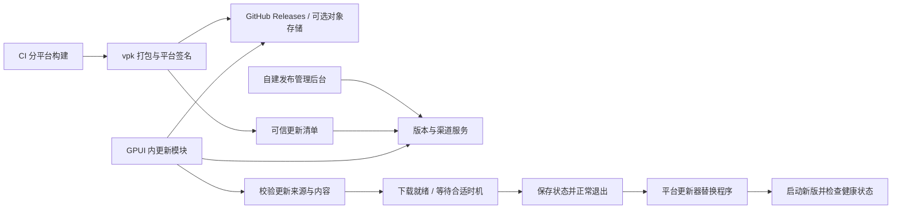

# 跨平台 OTA 自动更新调研

调研日期：2026-10-14（北京时间）。最初检查基线：`12d3eca`；文档整理时在 `f0e33eb` 复核更新依赖、平台导出与发布配置，应用版本仍为 `0.1.0`。状态：调研与建议，尚未实施。文档入口见 [OTA 自动更新](../ota/README.md)。

后续需求已收敛，实施范围以 [OTA 需求与设计](../plans/2026-10-14-github-ota-design.md) 为准：Windows x64 与两种 Mac 使用 Velopack + GitHub Releases，全量更新、草稿手动发布；本轮不做灰度、Linux、正式平台签名／公证或额外的更新清单签名验证。本报告保留较广的技术建议供参考，其中签名层等建议不构成本轮交付要求。

## 结论

**当前项目没有 OTA，但可以保留 Rust + GPUI 技术栈，接入覆盖 Windows、macOS、Linux 的自动更新机制，也可以自建 OTA 平台。推荐优先验证 Velopack 官方 Rust SDK + GitHub Releases 分发，需要自定义灰度时再接自建决策服务。**

用户首次安装后，后续可以在应用内检查更新、后台下载，点击“重启并更新”或下次启动时生效，无需再次手动访问下载页、解压或运行安装向导。客户端仍然需要下载全量更新包或差分包，也仍然会替换本地程序文件。

有三个前提：

1. **原生程序代码更新需要重启应用。** 当前 Rust / GPUI 界面与逻辑编译在可执行文件中，没有运行时替换业务代码的机制。这里推荐的 OTA 是自动更新，不是保持同一进程运行的代码热替换，也不需要重启操作系统。
2. **Linux 需要另外补齐应用适配。** 项目现在只有 macOS、Windows 平台实现；框架支持 Linux 更新，不代表本应用已经支持 Linux。
3. **已分发的旧版本需要手动升级一次。** 当前客户端没有更新入口，无法仅靠部署服务器让旧程序获得 OTA 能力。首次迁移到带更新器的发行版后，后续才能自动更新。

本结论来自仓库静态检查、官方文档和已发布 Rust crate 源码核对；本次未修改运行代码，未执行三平台 OTA 实机验证。

## 项目现状与证据

| 检查项 | 当前情况 | 对 OTA 的影响 |
| --- | --- | --- |
| 技术栈 | `crates/gulu-app/Cargo.toml` 使用 `gpui-kit = 0.7.3`，不是 Electron / Tauri | 应优先使用能嵌入普通 Rust 程序的更新器 |
| 现有更新功能 | `README.md` 明确首版没有自动更新；应用依赖与入口未发现更新模块 | 需要新增客户端更新状态与交互 |
| 发布流水线 | `.github/workflows/check.yml` 构建 Mac ARM64、Mac Intel、Windows x64，并发布 GitHub Release | 有构建与分发基础，可以扩展产物类型；这是三个目标，不是三个操作系统 |
| Mac 产物 | `.app` + ZIP，`scripts/package-macos.sh` 使用 ad-hoc 签名 | 公开分发应补 Developer ID 签名、公证及完整 bundle 更新 |
| Windows 产物 | CI 发布便携 ZIP；本地另有 Inno Setup 脚本，使用用户级目录 | 使用 Velopack 时需要调整打包布局，现有 ZIP 不会自动变成可更新包 |
| Linux | `src/platform/mod.rs` 仅导出 macOS / Windows 模块，主程序无条件调用 `platform::clock()` 等接口 | 缺少 Linux 适配，当前源码不具备完整 Linux 构建路径；也没有 Linux 打包与验证任务 |
| 资源 | UI 与图片在 Rust 代码或 `include_bytes!` 中 | 下载新图片文件不能自动替换现有内嵌资源；多数 UI 改动仍需发布新程序 |
| 数据 | SQLite 放在 `ProjectDirs` 数据目录，独立于程序目录 | 适合程序整体替换后保留用户数据，但迁移和回退仍需设计 |
| 退出 | `begin_quit()`、存储 Flush 和单实例文件锁已存在 | 可以接入更新退出流程；不能直接强制退出后假定数据已保存 |
| 版本 | Cargo 版本、Mac build、GitHub 发布序号彼此独立，Windows 文件名还有硬编码版本 | 必须统一更新器使用的版本来源与排序规则 |

关键本地证据：

- [应用依赖](../../crates/gulu-app/Cargo.toml)
- [平台导出](../../crates/gulu-app/src/platform/mod.rs)
- [启动、单实例和退出流程](../../crates/gulu-app/src/main.rs)
- [数据库版本检查](../../crates/gulu-storage/src/lib.rs)
- [发布工作流](../../.github/workflows/check.yml)
- [发布脚本](../../scripts/publish-release.sh)
- [现有打包说明](../packaging.md)

## 候选方案比较

| 方案 | 三平台与自建服务 | 对本项目的适配 | 结论 |
| --- | --- | --- | --- |
| **Velopack + 官方 Rust SDK** | Windows、macOS、Linux；支持 HTTP、自有对象存储、GitHub 等更新源；支持差分更新 | 可接入 GPUI；统一处理打包和更新；需要迁移发行包布局，Linux 使用 AppImage | **首选 PoC**：最符合三平台统一 OTA 的目标 |
| **self_update + 自有更新流程** | Rust 库，可使用静态 manifest / 自定义服务；底层覆盖 Windows、Unix | 对当前 ZIP 流程侵入较小；1.3.0 已支持完整 `.app` bundle 更新和可选签名验证 | **备选**：适合优先保留现有打包方式；需自管提权、安装布局、退出协调与失败恢复 |
| **Sparkle + 其他平台更新器** | Sparkle 面向 macOS，可自建 appcast；Windows、Linux 另选组件 | Mac 更新链路成熟，但要维护多个客户端后端和产物协议 | Mac 体验优先时可选，不作为统一三平台方案首选 |
| **Tauri updater** | 支持桌面三平台、自建动态服务或静态 JSON，更新签名为必需 | 官方接入基于 Tauri 应用与打包配置，本项目是 GPUI | 不建议仅为 OTA 引入 Tauri 运行时或迁移 GUI；提取复用也需额外验证 |

### 为什么优先 Velopack

- 官方 Rust 入门直接提供 `VelopackApp`、`UpdateManager`、HTTP 更新源与更新重启示例，不要求把界面改成 WebView。[1]
- 同一工具链生成平台发行包、全量更新包和差分更新包。差分链不合适或下载/应用差分失败时，可以退回全量下载；省流量效果要用本项目实际构建产物测量。[2]
- 自托管只需要能提供 `releases.{channel}.json` 和 `.nupkg` 的 HTTP 服务。可以用自己的域名、Nginx、对象存储和 CDN，不强制使用 Velopack Flow 托管平台。[3]
- 开源框架采用 MIT 许可。构建工具 `vpk` 的官方安装方式需要 .NET SDK，这是构建侧工具依赖，不意味着 GPUI / Rust 客户端要改成 .NET 应用。[1][4]

调研时 crates.io 返回的 Velopack Rust 最新稳定版为 **1.2.161**，发布于 2026-09-29；`self_update` 为 **1.3.0**，发布于 2026-09-02。本文核对了这两个发行版源码。Velopack 在线文档已有涉及 1.3 的内容，实施时应锁定并核对 Rust SDK 与 `vpk` 的兼容版本，不能直接假定所有在线文档特性已存在于 1.2.161。[4][10][11]

### self_update 的实际边界

不能沿用“self_update 只会替换一个 EXE，所以完全不能更新 Mac 应用”的旧判断：本次核对的 1.3.0 提供 `bundle_path_in_archive`，可以将整个 `.app` 目录进行暂存、替换和失败恢复，也支持 `signatures` 特性验证更新归档。[11]

但它不会自动提权、签名或公证；只读目录、Mac App Translocation、Windows DLL/资源占用、安装器执行仍需要项目处理。其目录替换失败恢复也不等于“新版本启动失败后自动恢复旧版本”。如果采用此方案，需要更多自有客户端工程，差分下载也不应按已具备能力承诺。

## 推荐的 OTA 架构

**服务端可以自研；程序替换、打包等客户端底层优先复用现成框架。**

第一阶段无需先做完整管理平台。现有 GitHub Releases 可以托管更新清单与包，直接接入 Velopack GitHub 更新源即可验证 OTA 闭环，无需额外购买对象存储或 CDN。之后按需要加入版本管理、stable/beta 渠道、灰度、撤回、更新说明和发布审计；决策服务与文件托管可以分开。具体见 [GitHub Releases 分发方案](../ota/GITHUB_RELEASES.md)。

建议的发行渠道为 `win-x64-stable`、`osx-arm64-stable`、`osx-x64-stable`、`linux-x64-stable`；以后按需增加 beta 和 Linux ARM64。每个操作系统、CPU 架构、发布渠道必须有独立的更新选择范围，防止 Mac 双架构互相覆盖。Velopack 官方渠道文档也要求跨平台/架构避免渠道冲突。[5]

如果后台返回自定义 API，需要适配为 Velopack feed，或实现其 `UpdateSource` trait；并非服务端返回任意 JSON 即可使用。灰度、版本撤回和业务健康回退属于要建设的产品能力，不能因为框架支持下载、安装就假定它们全部现成可用。

发布顺序建议为：上传不可变包 → 校验完整性和签名 → 最后切换更新清单。客户端断网、检查失败或下载失败时，继续运行当前版本；更新网络不应成为本地提醒功能的启动依赖。

## 三个平台分别需要做什么

| 平台 | 建议发行方式 | 必须处理的事项 |
| --- | --- | --- |
| Windows | Velopack 用户级安装包；需要便携版时使用其生成的可更新便携包 | 原进程退出后替换；占用文件和杀毒软件干扰；快捷方式、卸载项、通知 AUMID 与旧发行版迁移；正式代码签名 |
| macOS | 保留 `.app` 形态，接入 Velopack 打包，可分发 ZIP / PKG 等 | 更新整个 bundle；保持 bundle ID 和 `LSUIElement`；Developer ID、Hardened Runtime、公证；应用所在目录的写权限；ARM64 / Intel 分渠道 |
| Linux | 首先定义支持范围，建议先做 x86_64 AppImage | 补平台适配与 CI；验证目标发行版、glibc/动态库、图形后端、托盘、锁屏与睡眠；AppImage 可执行权限、挂载环境和所在目录的写权限 |

Velopack 在 Linux 的默认交付方式为 AppImage，更新时替换 AppImage；这不是对全部 Linux 发行版、CPU、桌面环境的兼容承诺。如果以后提供 deb/rpm/Flatpak 等包管理渠道，应由对应包管理机制负责升级，避免两个更新器竞争修改同一套安装文件。[6]

Windows 用户级安装通常不需要管理员权限；macOS `/Applications` 或 Linux 系统目录是否需要提权取决于实际权限。不能承诺“任何安装位置都完全静默、永无系统授权弹窗”。Velopack Mac 更新也不支持 App Sandbox；若以后上 Mac App Store，应另外规划商店更新渠道。[6][7][8]

## 当前项目的关键接入要求

### 1. 更新生命周期与单实例

`VelopackApp::run()` 应在应用业务启动和获取单实例锁之前执行，避免安装/更新 hook 被重复实例逻辑拦截。开发模式下应明确识别未经过 Velopack 打包的程序，不应把检查更新失败当作应用启动失败。

检查和下载放到后台任务，结果通过当前事件协调器回到 GPUI。建议暴露“检查更新”“后台下载”“重启并更新”“稍后”几个状态。

正在全屏休息、存在未保存设置或存储错误时，应推迟应用更新。1.2.161 的 `apply_updates_and_restart()` 会直接退出当前进程；本项目应优先评估 `wait_exit_then_apply_updates()`，与现有关闭窗口、清理托盘、存储写入和释放单实例锁的流程协调。[10]

现有普通退出逻辑在两秒后也会发送 `Event::Flushed`，因此这个事件不一定代表全部数据已成功持久化。更新路径需要区分“确实写入成功”和“退出超时”；不能原样复用它作为无数据损失的证据。锁释放、旧进程退出后再启动新版，也要验证不会触发“仅激活旧实例”。

### 2. 更新可信性

应具备 HTTPS、客户端内置信任公钥、更新元数据/包的签名验证，以及全量/差分包的完整性检查。公钥可随客户端发布；私钥应保留在受控签名环节。

**不能把 SHA256 校验等同于来源可信。** 当前项目的 `SHA256SUMS.txt` 用于完整性检查。核对的 Velopack 1.2.161 Rust HTTP feed 路径读取 JSON，包下载路径验证大小及 SHA256（缺少时回退 SHA1），这些本身不构成基于内置发布者公钥的签名验证。[10]

因此，若选该版本，应补可信更新清单验证或等效的更新签名层，并要求 SHA256；可通过自定义 `UpdateSource` 对签名清单验签后再向更新器提供资产信息。签名覆盖版本、渠道、架构、包名和摘要，同时规划密钥轮换与过期/回放策略。更新缓存、启动时自动应用和差分链都不能绕过验证；应用新包前的最终完整性验证需要一并纳入实现与测试。平台代码签名与这层验证各司其职，不能相互默认替代。

### 3. 版本、迁移与失败恢复

- 统一 Cargo、Mac plist、Windows 打包和 OTA 元数据的版本源。正式版使用递增版本，例如 `0.1.1 → 0.1.2`；不要只变化 GitHub 标签或文件名，也不要依赖 SemVer 的 `+build` 元数据决定升级优先级。
- 保持 `app.gulutwist.breakstation`、用户数据目录等身份稳定；Windows 的通知 AUMID 和新快捷方式要保持一致。
- 将程序更新失败恢复与业务回退区分开：前者恢复未成功替换的安装文件，后者涉及新版已启动、甚至已经迁移的数据。
- 本项目数据库目前会拒绝更新的 schema。若新版本改了 schema，仅恢复旧 EXE 不一定能运行。需要兼容迁移或一致性备份；SQLite WAL 模式下不应在写入期间只复制主数据库文件。
- 初期可优先“撤回问题版本的分发，再发布更高版本修复”。若必须自动回退，需另外设计启动成功确认、保留旧包、有限重试和数据库兼容策略，不能宣称框架默认保障业务回退。

### 4. 首次迁移

已存在的手工 ZIP / Inno Setup 安装不会仅因加入 crate 就获得 Velopack 所需安装布局。需要发布带更新器的新发行包，指导旧用户手动迁移一次；验证新旧快捷方式、卸载项、通知身份、单实例和用户数据不会冲突。

后台上线无法向没有更新代码的旧客户端“推入”更新功能。若接受一轮手工升级，这个限制不会影响后续 OTA。

## 建议执行顺序与验收

1. **先做 macOS + Windows 小范围 PoC。** 用实际 GPUI 应用打出两个递增版本，锁定 SDK / CLI 版本，用 GitHub Releases 更新源跑通检查、下载、正常退出、替换和重启。保持用户数据与常驻行为。
2. **完成公开分发要求。** 增加签名/公证、可信更新元数据、版本统一、失败处理、首轮迁移和 CI 发布顺序，再启用自动检查/下载。
3. **并行规划或单独完成 Linux 应用适配。** 明确要支持的发行版与桌面环境，补齐平台接口和 AppImage 构建后，进入同一更新协议。若首发必须三系统同时支持，这一步就是首发前置条件。
4. **有需要再建设 OTA 管理后台。** 管理版本、灰度、渠道、撤回等；差分下载在全量更新可靠后开启并测量收益。

最低验收场景：

- 全量升级、跨版本升级、无更新、不同渠道与架构隔离。
- 断网、下载中断、包损坏、签名不符、磁盘空间不足、安装目录不可写。
- Windows 文件被占用，Mac Intel / Apple Silicon，目标 Linux X11 / Wayland 与托盘环境。
- 休息进行中、设置未保存、数据库写入失败、重复启动与更新进程互斥。
- 更新后托盘、通知、悬浮窗、暂停状态与历史记录保留；不能重复弹首轮引导。
- 新版无法正常启动、数据迁移失败、问题版本撤回及旧客户端首次迁移。
- 开启差分后，验证差分失败可退回全量，以及最终待安装内容验证通过。

**选型意见：保留 GPUI，优先验证 Velopack + GitHub Releases；自定义灰度由可选的自建决策服务提供，以“后台下载、应用重启生效”作为产品目标。Linux 按独立适配工作计入范围。** 若最看重沿用当前归档格式、且可接受维护更多更新逻辑，则改选 `self_update` 1.3.0 路线；无需为了 OTA 更换 GUI 技术栈。

## 官方资料

以下资料于 2026-10-14 读取。在线文档会变化，实施应以最终锁定版本为准。

1. [Velopack Rust 官方入门](https://docs.velopack.io/getting-started/rust)
2. [Velopack 差分更新](https://docs.velopack.io/packaging/deltas)
3. [Velopack 自托管更新源](https://docs.velopack.io/distributing/self-hosting)
4. [Velopack 常见问题与工具版本](https://docs.velopack.io/troubleshooting/faq)、[MIT License](https://github.com/velopack/velopack/blob/develop/LICENSE)
5. [Velopack 渠道与跨平台分发](https://docs.velopack.io/packaging/channels)
6. [Velopack Linux / AppImage](https://docs.velopack.io/packaging/operating-systems/linux)
7. [Velopack macOS](https://docs.velopack.io/packaging/operating-systems/macos)
8. [Velopack Windows](https://docs.velopack.io/packaging/operating-systems/windows)
9. [Velopack 平台代码签名](https://docs.velopack.io/packaging/signing)
10. [Velopack 1.2.161 发行信息](https://crates.io/crates/velopack/1.2.161)、[Rust 更新管理源码](https://docs.rs/crate/velopack/1.2.161/source/src/manager.rs)、[HTTP 更新源源码](https://docs.rs/crate/velopack/1.2.161/source/src/sources/http.rs)
11. [self_update 1.3.0 说明与源码](https://docs.rs/crate/self_update/1.3.0/source/README.md)、[self-replace](https://github.com/mitsuhiko/self-replace)
12. [Sparkle 官方文档](https://sparkle-project.org/documentation/)
13. [Tauri v2 Updater 官方文档](https://v2.tauri.app/plugin/updater/)
