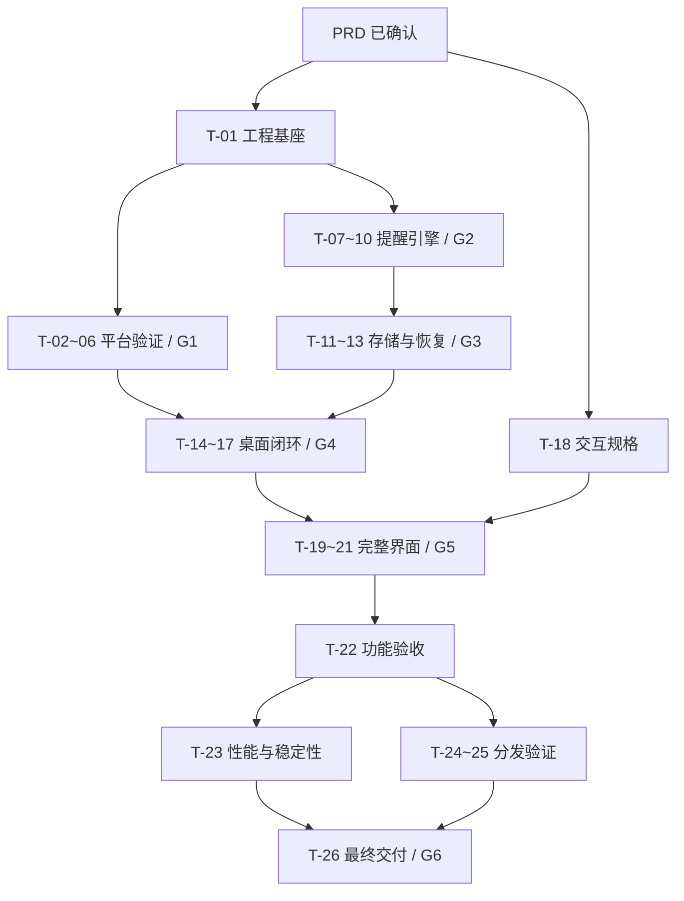

# 咕嘟扭扭放风站｜实施计划

> 版本：1.0  
> 日期：2026-10-13  
> 需求基线：[PRD 1.0](docs/requirements/PRD.md)，用户已于本日确认。  
> 当前阶段：P1–P6 实施中，按用户最新要求优先完成本机开发验证。

## 执行调整（2026-10-13）

新增功能计划：用户已确认 200 × 52、两端完整半圆的桌面胶囊外观。开发步骤、代码改动和验收要求见 [紧凑胶囊悬浮窗实现计划](docs/implementation/FLOATING_WIDGET_PLAN.md)。功能已在从 `origin/main` 创建的 `feat/compact-floating-capsule` 分支实现，46 项测试与静态检查、Mac 双架构打包通过。本轮桌面交互受锁屏阻挡，Windows 原生编译与 Intel 实机运行待完成。证据见[胶囊验证报告](docs/validation/FLOATING_WIDGET_REPORT.md)，后续按[专项手册](docs/validation/FLOATING_WIDGET_MANUAL_TESTS.md)补验；下文已有功能的执行记录保持独立。

用户已授权实施，并明确调整顺序：先在当前 M4 Mac 上实现、验证完整功能；同时实现 Windows 10 与 Intel Mac 的适配及构建配置。跨机器真实运行交由用户在本机版本稳定后手动执行，交付具体步骤和记录模板。下文原 G1 对 Windows/Intel 实测的前置限制因此后移，不阻塞 P4–P6 的本机实施；跨机器兼容仍须区分“已实现/可构建”和“用户实测通过”。无法在当前设备完成的多屏、真实睡眠和长期稳定性检查如实记录，不宣称不存在任何未知问题。

本机补测更新（2026-10-13 13:59）：已通过 `⌘W` / 红色关闭按钮、重新激活、暂停恢复、真实锁屏间隔冻结、120 秒合并自然结束、`⌘Q` / 关于页正常退出及重启保留。真实睡眠操作尚无系统睡眠证据，托盘图标点击等专项仍保留待验收，详细数值见本机报告。

## 1. 目标与实施边界

交付离线、免登录的桌面提醒工具，支持 Windows 10 x64、当前 Apple Silicon Mac 和 Intel Mac。实现四类提醒、工作时段、默认强制休息、可选轻提醒、紧急退出、托盘常驻、今日记录和可靠恢复。

本文件现用于实施追踪。应用代码、Mac 构建和本机验证已开始交付；逐项证据与尚未执行的检查见 `docs/validation/LOCAL_REPORT.md`。原表中的完成条件保留为最终验收要求。

需求变更以 PRD 为准；实施计划只分解任务，不降低已确认的强制休息、多屏、Windows 10 或 Intel Mac 要求。P1 功能独立排期，不影响 P0 的完成判定。

## 2. 阶段与当前进度

| 阶段 | 对应 PRD 里程碑 | 工作内容 | 状态 |
| --- | --- | --- | --- |
| P0 | M0 | 需求确认、实施分解、覆盖检查 | complete |
| P1 | M1 | 工程基座与跨平台可行性验证 | in_progress：Mac 双架构可构建，外机运行待测 |
| P2 | M2 | 独立提醒引擎与双时钟规则 | complete：自动化规则测试 |
| P3 | M2 | 持久化、恢复与今日记录 | complete：SQLite 集成测试 |
| P4 | M2 | 桌面集成与最小可用闭环 | in_progress：已实现并完成部分本机端到端验证 |
| P5 | M2 | 首次引导、设置与完整界面 | in_progress：已实现，读屏与极端 DPI 待验收 |
| P6 | M3 | 跨平台验收、资源优化与分发 | in_progress：双 Mac 包、Windows 脚本、外机文档 |

状态约定：`pending` 未开始；`in_progress` 执行中；`blocked` 某项依赖暂不可用；`complete` 已有相应交付与验证证据。阶段完成以本节后的门槛为准，不能只按代码量或编译通过判定。

## 3. 技术路线与目录规划

### 3.1 优先方案

| 领域 | 实施方案 | 决策时点 |
| --- | --- | --- |
| 语言与构建 | Rust、Cargo workspace；锁定 Rust 工具链并提交 Cargo.lock | T-01 |
| 图形界面 | 优先 GPUI Kit，使用其匹配的 GPUI 版本；不单独混入浮动 GPUI 依赖 | T-02 至 T-06 实测后确定版本 |
| 提醒规则 | 独立纯 Rust 引擎，输入事件与时钟快照，输出新状态和待执行动作 | T-07 至 T-10 |
| 时间处理 | 分离有效工作时间、计入休眠的连续时间、本地日历时间；系统差异由适配层处理 | T-03、T-08 |
| 本地存储 | 优先 SQLite + rusqlite；单一写入通道、事务与数据库迁移；不引入后台服务 | T-11 |
| 系统集成 | macOS/Windows 适配模块；优先复用已验证 API，缺口再用对应系统库 | T-02 至 T-06 |
| 运行模型 | 一套应用级状态和调度器；界面主线程接收事件，存储和耗时工作不阻塞退出 | T-14 |
| 数据交换 | 本地模块调用与进程内消息；单实例激活使用平台本地机制，无网络监听服务 | T-17 |
| 分发 | Windows 用户级安装包；macOS arm64、x86_64 分包优先，验证后再考虑 Universal | T-05、T-24 |

GPUI Kit 是优先验证路线。只有在有复现证据的兼容性缺口无法通过合理平台适配解决时，才评估 Floem 等备选；不得在没有验证的情况下同时维护两个 UI 框架。框架调整应记录原因与影响，提醒引擎和存储仍可复用。

### 3.2 计划中的目录

下列为原规划结构；实际工程保留相同三个 crate，源文件按实现需要合并，详见 README。首版采用三个 crate，平台适配先放在应用内部，避免提前拆成大量包。

```text
GuluTwistBreakStation/
├── Cargo.toml
├── Cargo.lock
├── rust-toolchain.toml
├── crates/
│   ├── gulu-core/
│   │   ├── src/{model,config,clock,schedule,engine,session}.rs
│   │   └── tests/{schedule,transitions,recovery,properties}.rs
│   ├── gulu-storage/
│   │   ├── src/{repository,migration,records,recovery}.rs
│   │   ├── migrations/
│   │   └── tests/
│   └── gulu-app/
│       ├── src/{main,app,commands,events}.rs
│       ├── src/ui/{onboarding,home,settings,break_overlay,reminder,about}.rs
│       ├── src/platform/{mod,macos,windows}.rs
│       ├── src/{tray,notifications,overlay_controller}.rs
│       └── examples/platform_probe.rs
├── assets/{icons,fonts}/
├── packaging/{macos,windows}/
├── scripts/{check,package}/
├── docs/
│   ├── requirements/PRD.md
│   ├── architecture/decisions.md
│   ├── design/UI_SPEC.md
│   ├── validation/
│   └── user-guide.md
├── task_plan.md
├── findings.md
└── progress.md
```

依赖方向为 `gulu-app → gulu-storage → gulu-core`，同时 `gulu-app → gulu-core`。`gulu-core` 不引用 GPUI、数据库连接或原生窗口句柄；`gulu-storage` 不弹窗、不控制平台生命周期。

### 3.3 状态与副作用约定

1. 应用入口将用户操作、系统电源/锁屏事件和定时到期转换为类型化事件，交给唯一的引擎入口处理。
2. 引擎计算实例/会话变化及动作，例如显示整组遮罩、撤下遮罩、提交通知、持久化记录；所有动作带实例或会话标识。
3. 平台适配层回传动作成功或失败。部分屏幕创建失败必须先撤销整组遮罩，再按 PRD 降级为同一实例的轻提醒。
4. 紧急退出和计时完成优先解除遮罩；记录写盘失败不得延迟解除。记录写入使用唯一约束与幂等重试，防止重复计数。
5. 设置采用“校验 → 持久化成功 → 替换运行配置”；配置版本用于拒绝旧回调。界面不另建计时器。
6. 休眠恢复按实际发生顺序补算休息完成与工作时段边界；不依赖普通系统墙钟做时长差，不假设所有平台的 `Instant` 都计入休眠。
7. 原生通知响应只有一个应用级路由所有者，验证 GPUI Kit 初始化是否注册/覆盖回调；点击通知恢复小站并定位实例，不依赖已销毁窗口的回调。

## 4. 任务分解与依赖

每项完成都需记录变更文件、执行的检查及结果。任务表中的文件均为计划产物；未执行任务在进度日志中保持 `pending`，不得提前勾选完成门槛。

### P0｜需求确认与计划

- [x] 用户确认 PRD 1.0，保留已确认的产品与兼容要求。
- [x] 记录当前环境与待验证假设，建立进度文件。
- [x] 完成任务依赖、需求覆盖和文档结构核对。

### P1｜工程基座与平台可行性（M1）

操作步骤、设备替代边界及记录方式见[跨平台专项验证方案](docs/validation/PLATFORM_VALIDATION_PLAN.md)。该文件是执行方案，尚非运行报告。

| ID | 任务与交付 | 前置 | 完成条件 |
| --- | --- | --- | --- |
| T-01 | 创建 workspace、工具链锁定、基础忽略规则、构建说明和检查入口；按实际仓库环境配置 CI | PRD 已确认 | 三个 crate 的最小结构可构建；记录 Rust/Cargo/SDK 版本；锁文件可复现；仓库中没有签名密钥或本地数据 |
| T-02 | M4 上的最小应用：GPUI Kit 窗口、托盘/菜单栏、关闭保活、通知测试；产物为 `platform_probe` 和真实 `.app` | T-01 | 打包后窗口与文字正常；关闭主窗仍有菜单入口；明确退出结束进程；通知可发起且点击路由可验证 |
| T-03 | 核对双时钟和系统事件适配；记录锁屏、休眠、唤醒、调时、时区变化事件语义 | T-01 | 真实休眠与手动调时后，能够区分有效工作时间与实际休息经过时间；重复/乱序事件可识别；确定平台接口 |
| T-04 | 最小多屏遮罩实验：全屏无边框、按钮/Esc 退出、共享倒计时、热插拔、部分创建失败清理 | T-02 | 单屏/多屏退出 ≤ 1 秒；无透明拦截窗口残留；测试 Space/全屏应用/混合 DPI；记录覆盖范围与失败路径 |
| T-05 | Windows 10 x64 与 Intel Mac 上运行同一验证程序；提前建立最小打包脚本与应用身份；Windows 11 冒烟 | T-02、T-03、T-04 | 在目标系统实际运行窗口、托盘、通知、遮罩、退出、睡眠恢复；记录 OS/CPU/GPU/包架构/构建版本，明确通过/失败/未执行 |
| T-06 | 汇总技术决策与平台验证矩阵，锁定框架、时钟、托盘、通知和打包方案；采集初步 Release 资源基线 | T-03、T-04、T-05 | `docs/architecture/decisions.md` 与 `docs/validation/platform-probe.md` 有证据；所有必需目标的关键能力可行；没有未解释的核心兼容缺口 |

**G1 最终兼容门槛（按顶部用户调整，不阻塞本机集成）：**T-01 至 T-06 完成，才把 GPUI Kit 路线标记为全部目标已验证。只在 M4 上运行成功、只完成 Intel 交叉编译或使用 Windows 11 CI，均不能替代 T-05。

如果设备暂不可用，T-05 保持 `blocked`，记录缺哪台设备及所需测试；可继续 T-07 至 T-13 和 T-18 的独立工作。依据用户最新授权，继续 P4–P6 本机集成；外机实测保持未完成，不提前宣称完整兼容。

### P2｜提醒引擎与双时钟（M2）

| ID | 任务与交付 | 前置 | 完成条件 |
| --- | --- | --- | --- |
| T-07 | 定义提醒配置、实例、会话、暂停原因、终态、配置版本；实现输入验证与默认配置 | T-01 | 4 类提醒及 PRD 2.6 参数完整；领域层验证不依赖 UI；非法值和相邻/重叠时段测试通过 |
| T-08 | 有效工作时间与工作时段调度；实现可注入时钟、星期/多时段/边界/本地时区计算 | T-07；平台对接时使用 T-03 结论 | 工作时段、锁屏暂停、休眠恢复、跨日和调时算例通过；不通过真实等待数小时测试纯规则 |
| T-09 | 实例与休息状态机：强制会话、同批合并、轻提醒冷却、稍后、无响应超时和完成重置 | T-07、T-08 | 合并时长取最大值；一个事项最多一个有效实例；全局最多一场强制休息；强制期间其他间隔暂停 |
| T-10 | 统一事件裁决、暂停恢复、模式/配置切换、主动完成和回调去重；补充关键序列性质测试 | T-08、T-09 | S-01 至 S-16 均有可追溯测试；同刻边界与多次回调只结算一次；恢复缓冲和历史终态规则不被破坏 |

**G2 门槛：**核心引擎测试通过，覆盖 PRD 全部 16 条规则，并且不依赖运行 GPUI 窗口。验证随机或组合事件序列时，重点断言“单实例、终态不可回退、间隔不为负、不会重复完成”等外部行为，不编写镜像实现的测试。

### P3｜本地持久化与记录（M2）

| ID | 任务与交付 | 前置 | 完成条件 |
| --- | --- | --- | --- |
| T-11 | SQLite 表结构、迁移版本和索引；设置、实例、会话、记录的事务与唯一约束 | T-07 | 临时数据库可建库/迁移；重复实例结算不增加第二条记录；合并场次与事项记录分开存储 |
| T-12 | 配置保存、暂停持久化、冷启动恢复、异常会话处理与迁移备份 | T-10、T-11 | 保存失败不改变运行配置；冷启动不恢复旧遮罩；损坏数据保留备份并停用自动强制提醒；未到期暂停正确保留 |
| T-13 | 今日查询、主动完成记录、来源区分、30 日清理和用户清空记录；写盘失败恢复 | T-11、T-12 | 计时/手动完成分开；一场两事项统计正确；跨日、时区变化不重写归属日期；清空记录不清配置；失败不阻塞遮罩撤下 |

**G3 门槛：**文件/数据库真实集成测试通过，包含只读、损坏、写入失败和迁移失败。不同 OS 的数据目录选择放在平台层验证，不把所有数据放在程序安装目录。

### P4｜桌面集成与首个可用闭环（M2）

| ID | 任务与交付 | 前置 | 完成条件 |
| --- | --- | --- | --- |
| T-14 | 应用级协调器连接引擎、平台事件、存储和最小界面；先打通一项提醒 | G1、T-10、T-12 | 可完成“配置一项 → 到期 → 休息 → 结束/紧急退出 → 写记录 → 下次计时”；真实时钟与测试时钟清楚区分 |
| T-15 | 正式遮罩控制器：显示器集合管理、焦点、共享会话、热插拔、退出和错误清理 | T-14 | 全屏退出入口常驻；所有结束路径撤下整组窗口；休眠期间到时后不重弹；创建失败按同一实例降级；无点击穿透 |
| T-16 | 轻提醒通知、应用内待办及点击路由；完成/稍后/跳过/过期处理；权限与未知状态 | T-14 | 不抢焦点、不升级强制模式；通知回调只路由一次；旧通知可打开小站但不能重写终态；实际 `.app`/Windows 包验证 |
| T-17 | 托盘菜单、关闭保活、显式退出、单实例激活、暂停状态显示与系统事件总线 | T-14；关闭/退出联调需 T-15、T-16 | 隐藏窗口后提醒继续；退出撤下遮罩且无残留进程；重复启动不产生双调度器；锁屏/时段/手动暂停叠加正确 |

**G4 门槛：**一项提醒的端到端流程和强制/轻提醒两条路径在真实桌面上通过；随后用同一引擎扩展四项。不得为每类提醒复制独立窗口计时逻辑。

### P5｜完整界面与交互（M2）

| ID | 任务与交付 | 前置 | 完成条件 |
| --- | --- | --- | --- |
| T-18 | 页面状态与视觉规格：小站、引导、设置、遮罩、轻提醒、关于；颜色/间距/字体和键盘焦点规则 | PRD 已确认；可提前开展 | `docs/design/UI_SPEC.md` 覆盖正常/暂停/非工作/禁用/错误状态，沿用品牌；设计能由 GPUI 实现，不引入产品未要求的新功能 |
| T-19 | 首次引导、四项配置、工作时段、模式切换、通知测试和表单错误状态 | T-18、T-14、T-17 | 确认前无正式提醒；测试遮罩不记账；所有输入边界有效；保存/取消、模式切换与引擎一致 |
| T-20 | 今日小站、四类卡片、下一次时间、暂停/恢复、主动完成、今日记录和提醒详情 | T-13、T-16、T-17、T-18 | 只读取统一应用状态；不存在第二套倒计时；合并/手动/中断统计正确；常用操作满足 PRD 步数要求 |
| T-21 | 关于与帮助、通知排查、清理记录、无障碍语义、空状态/错误状态、窗口尺寸与 DPI | T-19、T-20 | 简体中文完整；Tab 和退出焦点可见；读屏不每秒播倒计时；640×480 和混合 DPI 下关键按钮可操作；隐藏未交付 P1 入口 |

**G5 门槛：**US-01 至 US-12 的产品操作均可执行，界面和后台规则一致；P1 的按钮或菜单不会以空壳方式出现在首版。

### P6｜验收、性能与分发（M3）

| ID | 任务与交付 | 前置 | 完成条件 |
| --- | --- | --- | --- |
| T-22 | 执行完整功能矩阵；完成边界、故障注入、平台交互与无障碍检查，修复回归 | T-15 至 T-17、T-19 至 T-21 | AT-01 至 AT-20、AT-23 具有实际结果；P0 失败项修复并复验；有版本、设备和证据路径 |
| T-23 | Release 常驻 CPU/内存/启动时延测量与 8 小时稳定性测试；优化无效唤醒和绘制 | T-22 的阻塞问题已解决 | NFR-01 至 NFR-10 对应预算有结果；三类目标环境实测；活动遮罩与空闲数据分开；AT-21 通过 |
| T-24 | 完善真实分发包、稳定身份、图标与依赖许可；生成版本/架构信息、校验和和发布说明 | T-21、T-22；承接 T-05 的早期脚本 | Windows 用户级安装包、macOS arm64/x86_64 包可独立运行；不依赖源码路径或 Rust；公开发布签名需求不冒充已完成 |
| T-25 | 干净环境安装、旧版覆盖升级、卸载和离线验证；Windows 11 冒烟 | T-24 | AT-22 通过；设置/记录迁移不丢失；卸载无进程或启动项残留；数据保留/清除规则明确 |
| T-26 | 修复验收发现、冻结 v1.0 包、补用户指南、已知限制和完整验收报告 | T-23、T-25，全部 P0 场景通过 | 文档对应同一最终包；支持矩阵属实；P1 状态明确；最终改动影响的检查已重跑 |

**G6 门槛：**交付 PRD 的全部 P0 与三个目标架构运行证据，完成 NFR 和 AT 验收。仅产出可执行文件不算完成安装、升级与系统通知验证。产物先在本地形成可审阅包，公开发布属于单独的后续工作。

### P1 功能的后续任务

这里的“P1 功能”表示 PRD 优先级，不是前面的实施阶段 P1。默认排在 v1.0 核心闭环稳定后，可分别交付。

| ID | 任务 | 依赖与验收 |
| --- | --- | --- |
| X-01 | 开机启动开关与系统注册/移除 | T-17、T-24；覆盖 US-13；默认关闭、失败不假报开启、卸载清理 |
| X-02 | 浅色/深色/跟随系统主题和可选提示音 | T-21；覆盖 US-14；默认无声、合并只响一次、主题不影响状态 |
| X-03 | 恢复默认设置 | T-12、T-19；独立于清空记录，二次确认；按配置变更规则取消旧实例 |

### 4.1 关键依赖关系



图中表示阶段汇总依赖；具体任务以前述表格为准，例如 T-11 可在模型稳定后开始。依用户最新授权，当前先完成本机实现与检查，Intel/Windows 真实运行后移；以上图中的 G1 外机前置依赖以顶部执行调整为准。

## 5. 验证与验收策略

### 5.1 按对象选择验证方式

| 对象 | 验证方式 | 不可替代的证据 |
| --- | --- | --- |
| 计时与状态机 | 注入时钟的确定性单测；关键事件排列/性质测试 | 16 条规则的边界和去重结果，不以实时等待代替时间模拟 |
| 数据持久化 | 临时真实数据库、故障注入、迁移与回滚测试 | 事务/唯一约束/损坏恢复；不能仅 Mock 数据库成功返回 |
| 界面业务操作 | 引导、配置、提醒处理、暂停和今日记录的集成检查 | 保存与运行状态一致，关键操作可通过键盘完成 |
| 平台集成 | 真实桌面运行、锁屏/休眠、通知授权、多显示器和焦点测试 | OS 版本与架构匹配的实机结果；编译/无头测试不能证明 |
| 性能 | Release 构建，按 PRD 4.6 固定环境采样 | 原始数据、汇总指标与设备信息，不用 Debug 性能下结论 |
| 分发 | 对最终包执行安装、覆盖升级、卸载、离线与身份验证 | 下载/复制后的包本身可用，不只运行构建目录的二进制 |

核心模块变更时先运行受影响测试和静态检查；通过后进入对应桌面或安装包检查。仅在新改动、失败或尚未解决的风险需要时扩大或重跑验证。UI 颜色、静态文案等低影响可逆变更不额外堆叠镜像测试。

### 5.2 计划采用的检查入口

下列命令在 T-01 创建对应 workspace 后才成立，本轮未执行。默认在各自原生平台运行，不在 macOS 上把一次 Windows 交叉检查当作 Windows 运行证据。

```bash
cargo fmt --all -- --check
cargo clippy --workspace --all-targets --locked -- -D warnings
cargo test -p gulu-core -p gulu-storage --locked
```

原生构建矩阵：

| 执行环境 | 构建命令 | 验证范围 |
| --- | --- | --- |
| Apple Silicon Mac | `cargo build --release --locked -p gulu-app --target aarch64-apple-darwin` | arm64 程序及其 `.app` 包 |
| Intel Mac | `cargo build --release --locked -p gulu-app --target x86_64-apple-darwin` | x86_64 程序及其 `.app` 包 |
| Windows MSVC 环境 | `cargo build --release --locked -p gulu-app --target x86_64-pc-windows-msvc` | x64 程序及用户级安装包 |

- CI 负责格式、静态检查、核心/存储测试和可用宿主上的构建；具体运行器名称与版本在 T-01 核对，不假定某种架构或系统版本的托管机器一直可用。
- Windows 10、Intel Mac、macOS Space 与休眠测试保留独立设备清单和记录。Windows 11/Server CI、Rosetta 或 `cargo check --target` 不能替代原生实测。
- GUI 自动化仅覆盖工具实际能驱动的场景，系统通知、锁屏与 GPU/多屏证据仍按实测记录。
- 构建只启用实际产品使用的特性，不使用无依据的 `--all-features` 将互斥后端一起构建。

### 5.3 用户故事覆盖

| PRD 故事 | 主要实现任务 | 主要验证场景 |
| --- | --- | --- |
| US-01 首次引导 | T-18、T-19 | AT-01 |
| US-02 单项设置 | T-07、T-12、T-19 | AT-02、AT-13 |
| US-03 工作时段 | T-03、T-08、T-10 | AT-03、AT-08、AT-09、AT-11、AT-17 |
| US-04 强制休息 | T-04、T-09、T-15 | AT-04、AT-06、AT-07 |
| US-05 紧急退出 | T-04、T-15、T-17 | AT-05、AT-23 |
| US-06 轻提醒 | T-09、T-16、T-19 | AT-13、AT-14、AT-15 |
| US-07 全局暂停 | T-10、T-12、T-17、T-20 | AT-12 |
| US-08 休眠中的休息 | T-03、T-08、T-10、T-15 | AT-10、AT-11、AT-17 |
| US-09 后台常驻 | T-02、T-17 | AT-18 |
| US-10 主动完成/记录 | T-10、T-13、T-20 | AT-16、AT-20 |
| US-11 平台兼容 | T-05、T-06、T-24、T-25 | AT-22，以及各平台执行的功能场景 |
| US-12 故障恢复 | T-12、T-15、T-16、T-17、T-21 | AT-18、AT-19、AT-23 |
| US-13 开机启动（P1） | X-01 | 注册/移除、重启登录和卸载专项检查 |
| US-14 外观/提示音（P1） | X-02 | 主题、静音和合并提醒声音专项检查 |

### 5.4 规则与非功能要求覆盖

| 规则组 | 规则编号 | 责任任务 | 验证重点 |
| --- | --- | --- | --- |
| 有效时间与周期 | S-01、S-02、S-03、S-04 | T-08、T-10、T-12 | 冷启动、边界、终态后的间隔重置 |
| 强制会话与合并 | S-05、S-06 | T-09、T-15 | 共享会话、最大时长、同批窗口和其他事项冻结 |
| 轻提醒生命周期 | S-07、S-08、S-09 | T-09、T-16 | 60 秒冷却、有效时间稍后、2 分钟未处理 |
| 锁屏与恢复 | S-10、S-11、S-12 | T-03、T-08、T-10、T-15 | 双时钟、恢复缓冲、边界先后、真实结束时间 |
| 用户操作与一致性 | S-13、S-14、S-15、S-16 | T-10、T-12、T-16、T-17 | 暂停叠加、配置版本、时区变化、回调幂等 |

| 非功能要求 | 责任任务 | 发布前证据 |
| --- | --- | --- |
| NFR-01 到期可靠性 | T-10、T-22、T-23 | 时钟测试与 8 小时事件日志，P95 ≤ 2 秒 |
| NFR-02 遮罩解除 | T-15、T-22 | 全部结束路径和各屏按钮，≤ 1 秒 |
| NFR-03 常驻 CPU | T-23 | 单逻辑核归一化平均 ≤ 0.5% |
| NFR-04 常驻内存 | T-23 | 预热后空闲 P95 ≤ 200 MiB，注明 RSS/工作集口径 |
| NFR-05 长期稳定 | T-23 | 8 小时、至少 20 次遮罩与 10 次锁屏恢复，无崩溃/残留，空闲增长 ≤ 30 MiB |
| NFR-06 启动与响应 | T-21、T-23 | 冷启动 ≤ 3 秒，常规反馈 ≤ 200 毫秒 |
| NFR-07 后台节能 | T-14、T-17、T-23 | 隐藏界面无周期性 UI 重绘，按截止时间和系统事件唤醒 |
| NFR-08 显示与输入 | T-15、T-21、T-22 | DPI、多屏、焦点、键盘和读屏检查 |
| NFR-09 数据可靠性 | T-11、T-12、T-13、T-22 | 故障注入、去重、迁移、持久化检查 |
| NFR-10 离线可用 | T-19、T-22、T-25 | 断网全流程和安装包运行检查 |

AT-01 至 AT-20、AT-23 由 T-22 汇总；AT-21 由 T-23 执行；AT-22 由 T-25 执行。PRD 是场景步骤的唯一基线，计划不另写一套冲突的判定标准。

### 5.5 验证记录格式

产品成功指标与任务对应如下，避免只验证工程指标而遗漏首次使用体验。

| 成功指标 | 责任任务与证据 |
| --- | --- |
| KPI-01 首次配置 ≤ 3 分钟 | T-19、T-22；AT-01 中记录首次配置操作耗时，按 PRD 排除下载和系统授权等待 |
| KPI-02 到期入队 P95 ≤ 2 秒 | T-10、T-23；AT-03 与 NFR-01 的模拟及实机结果 |
| KPI-03 无重复补发、紧急退出成功 | T-15、T-22；AT-05、AT-08 至 AT-18 的相关恢复/去重场景 |
| KPI-04 双系统核心行为通过 | T-05、T-25；原生平台验证矩阵与 AT-22 |
| KPI-05 后台资源预算 | T-23；AT-21 与 NFR-03 至 NFR-07 的采样报告 |

后续报告保存到 `docs/validation/`。每项至少记录：场景编号、构建/包版本、系统与架构、显示器/缩放、前置条件、操作、预期、实际、通过/失败/未执行、日志或截图位置。涉及权限和通知的测试同时记录权限状态。

实际验证记录不得使用“应该支持”代替结果。自动化运行的错误与未取得的设备证据分别记录，缺设备不伪装为测试通过；照片/截图不包含其他应用中的私人内容。

修复缺陷后，复跑对应失败场景及受影响的相邻行为。如果修复发生在最终包生成后，重建安装包，并将版本/校验和与新的验证记录对应起来。

## 6. 资源、风险与执行约定

### 6.1 所需环境

| 资源 | 当前状态 | 需要时点 |
| --- | --- | --- |
| macOS 15.7.3 / Apple M4 | 本机环境已核实，开发工具版本待 T-01 检查 | P1 起 |
| Windows 10 22H2 x64 + 可用图形环境 | 可用设备尚未确认 | T-05 初次验证，T-22/T-23/T-25 正式验收 |
| macOS 15 / Intel x86_64 | 可用设备尚未确认 | 同上；必须有 Intel 运行证据 |
| Windows 11 x64 | 可用设备尚未确认 | T-05/T-25 兼容冒烟 |
| 至少两台显示器或等效真实多屏桌面 | 可用环境尚未确认 | T-04、T-15、T-22 |
| Rust、macOS SDK、Windows MSVC/SDK、打包工具 | 本轮未安装或核验 | T-01/T-05 按所选版本建立清单 |
| 签名与公证凭据 | 不假设用户拥有；个人版先明确本地分发限制 | 若进入公开分发再准备 |

这些是后续执行的资源依赖，不妨碍本次计划完成。开发执行到依赖点时，先完成可独立进行的工作，再针对确实缺失的设备或信息澄清。

### 6.2 排期与交付节奏

- 采用单条主实施路线，以可验证产物推进；目前未指定团队规模、截止日期或预算，因此不写虚构的日历承诺。
- 第一份工程产物为 G1 的平台验证报告与最小程序；G2/G3 提供独立可验证的规则和数据模块；G4 提供可体验的单项提醒闭环；G5 提供完整产品界面；G6 提供个人首版安装包。
- P1 完成后，根据真实编译/集成成本、设备获取情况和剩余缺陷估算工期。设备等待、8 小时稳定性采样和主动开发工时分别统计。
- 每项任务尽量形成独立的小变更；阶段只在退出条件满足时更新为完成。文档审阅或例行技术选择不自动增加审批节点。
- P1 级功能 X-01 至 X-03 不抢占强制退出、兼容性、可靠性和数据恢复工作；增加功能需要说明对已确认范围与验收的影响。

### 6.3 重点风险与处置

| 风险 | 发现时点 | 处理与边界 |
| --- | --- | --- |
| GPUI Kit 在 Intel/Windows 10 上存在依赖或 GPU 缺口 | T-05 | 记录最小复现，优先修正版本/适配；无法满足时评估替代框架，复用核心与存储；不删除目标平台要求 |
| 目标测试设备不可用 | T-05 | 保留 blocked 和缺失清单，推进纯模块与界面规格；不宣称 G1/G6 已过 |
| 多屏或 Space 中遮罩/退出行为不可靠 | T-04、T-15 | 先保证退出与整组清理；验证原生窗口适配；失败仍按 PRD 降级而非留下不可操作窗口 |
| 锁屏/休眠事件缺失或时钟语义不一致 | T-03、T-08 | 通过平台时钟快照和生命周期事件校核；不简化成 UTC 差值计时 |
| 多处注册通知响应导致覆盖 | T-02、T-16 | 明确唯一回调所有者，验证初始化顺序、原生点击和旧实例处理 |
| UI 主线程被存储或系统调用阻塞 | T-14、T-23 | 将耗时工作移出主线程；立即撤罩与幂等异步记录分开，针对失败路径测量 |
| 资源预算不达标 | T-06 初测、T-23 全测 | 定位唤醒/重绘/资源释放，先优化已知热点；如需改预算，明确记录测量和产品影响 |
| 最终包通知身份或升级失效 | T-05、T-25 | 早期建立真实包，稳定应用身份；最终包重新测试升级与通知，不只测 cargo run |

### 6.4 执行与状态维护

- 实施时先核对任务依赖，再更新 `progress.md` 的当前任务；技术结论、复现与环境变化写入 `findings.md`。
- 只有实际完成且通过对应检查的任务才标 `complete`。暂停、锁屏、CPU 等产品状态不得与项目任务状态混用。
- 每次阶段交付说明变更、验证结果、未解决事项与下一任务，保持 PRD、计划和代码一致。
- 涉及需求语义的变化需更新 PRD 决策记录与相关测试；接口/目录等普通实现调整可直接记录，不扩大用户确认范围。
- 首版文档与包需要说明“已验证系统”以及缺失证据；不将未执行的 CI、测试或签名写成成功。

### 6.5 完成检查清单

- [ ] G1：三个目标架构的平台可行性证据齐全，框架/时钟/系统集成方案确定。
- [ ] G2：S-01 至 S-16 的核心规则与事件一致性通过。
- [ ] G3：持久化、迁移、记录和失败恢复通过。
- [ ] G4：强制、轻提醒、退出、托盘和恢复形成真实桌面闭环。
- [ ] G5：全部 P0 界面和用户故事可操作，错误与无障碍状态完整。
- [ ] G6：AT-01 至 AT-23、NFR-01 至 NFR-10 和真实安装包验收通过。
- [ ] 交付安装包、校验和、使用说明、支持矩阵、已知限制和同版本验证报告。

以上为后续应用交付清单，当前均未勾选；本轮仅完成实施规划。

## 7. 规划过程中的错误与处理

当前无命令执行失败。首轮并行读取的整体输出被截断，已按 PRD 的计时规则和用户故事章节定向补读；此为文档读取问题，不是应用缺陷。
